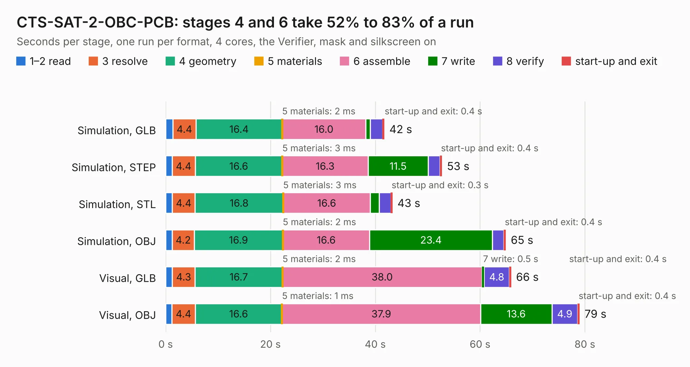

# 700. CTS-SAT-2-OBC-PCB

Board 700 of the 3,127 of [Corpus Testing](../Corpus-Testing.md), on [Corpus Page 7](../CorpusTestingPages/Corpus-Testing-07.md#700-cts-sat-2-obc-pcb).

| Mode and format | 1–2 read | 3 resolve | 4 geometry | 5 materials | 6 assemble | 7 write | 8 verify | start-up and exit | Total |
|---|---:|---:|---:|---:|---:|---:|---:|---:|---:|
| Simulation, GLB | 1.4 | 4.4 | 16.4 | 2&nbsp;ms | 16.0 | 0.8 | 2.4 | 0.4 | 41.7 |
| Simulation, STEP | 1.2 | 4.4 | 16.6 | 3&nbsp;ms | 16.3 | 11.5 | 2.3 | 0.4 | 52.7 |
| Simulation, STL | 1.3 | 4.4 | 16.8 | 3&nbsp;ms | 16.6 | 1.7 | 2.2 | 0.3 | 43.3 |
| Simulation, OBJ | 1.3 | 4.2 | 16.9 | 2&nbsp;ms | 16.6 | 23.4 | 2.2 | 0.4 | 64.9 |
| Visual, GLB | 1.3 | 4.3 | 16.7 | 2&nbsp;ms | 38.0 | 0.5 | 4.8 | 0.4 | 65.9 |
| Visual, OBJ | 1.2 | 4.4 | 16.6 | 1&nbsp;ms | 37.9 | 13.6 | 4.9 | 0.4 | 79.0 |

<table align="center"><tr><td valign="top">

| Board | Repo: [calgarytospace/cts-sat-2-obc-pcb](https://github.com/calgarytospace/cts-sat-2-obc-pcb) Board: `CTS-SAT-2-OBC-PCB.kicad_pcb` |
|---|---|
| Folder | Hardware |
| Complexity | 395&nbsp;/&nbsp;1000 (size&nbsp;280, features&nbsp;115) |
| KESE&nbsp;features | through vias, padstacks, slotted holes, rounded, trapezoid or chamfered pads, filled zones, stack-up, dielectric εr and tanδ |
| Tested | 9th November 2026 |
| Copper&nbsp;layers | 6 |
| File&nbsp;format | KiCad 9 (20241229) |
| Parts,&nbsp;tracks,&nbsp;vias | 219, 1,783, 433 |
| Triangles,&nbsp;simulation | 4,523,508 in 424 parts |
| Verifier | PASS in all six runs |

</td><td valign="top">

<table>
<tr><th>File type</th><th>File size</th><th>Peak memory used</th></tr>
<tr><th colspan="3" align="left">Simulation</th></tr>
<tr><td>GLB</td><td align="right">149&nbsp;MB</td><td align="right">1.3&nbsp;GB</td></tr>
<tr><td>STEP</td><td align="right">573&nbsp;MB</td><td align="right">1.6&nbsp;GB</td></tr>
<tr><td>STL</td><td align="right">226&nbsp;MB</td><td align="right">1.3&nbsp;GB</td></tr>
<tr><td>OBJ</td><td align="right">475&nbsp;MB</td><td align="right">2.9&nbsp;GB</td></tr>
<tr><th colspan="3" align="left">Visual</th></tr>
<tr><td>GLB</td><td align="right">93&nbsp;MB</td><td align="right">1.6&nbsp;GB</td></tr>
<tr><td>OBJ</td><td align="right">293&nbsp;MB</td><td align="right">2.1&nbsp;GB</td></tr>
</table>

</td></tr></table>

| Previous | Next |
|:---|---:|
| [699. OBC Development Board](b0699b_cts-sat-2-obc-pcb_OBC-Development-Board.md) | [701. MiniLatteLedArray](b0701b_minilatte_MiniLatteLedArray.md) |
