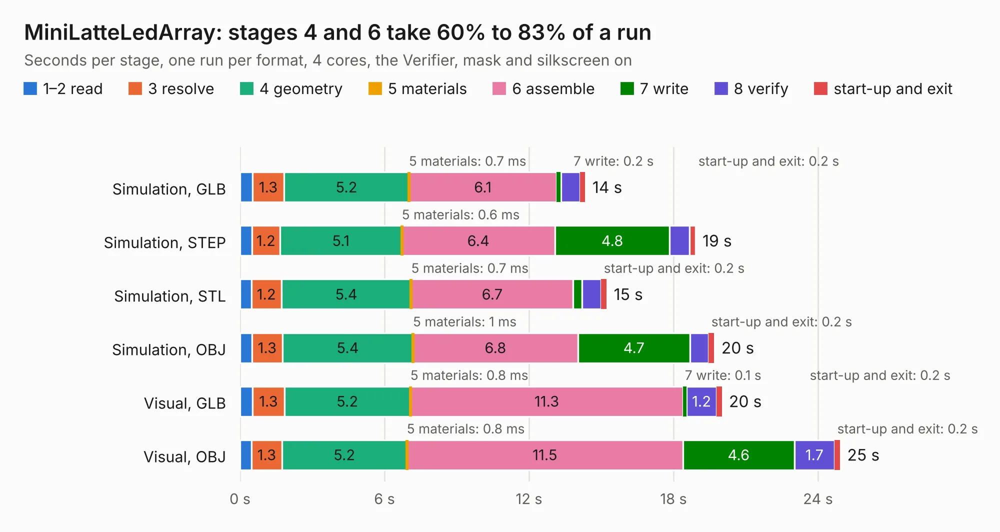

# 702. MiniLatteLedArray

Board 702 of the 3,138 of [Corpus Testing](../Corpus-Testing.md), on [Corpus Page 7](../CorpusTestingPages/Corpus-Testing-07.md#702-minilatteledarray).

| Mode and format | 1–2 read | 3 resolve | 4 geometry | 5 materials | 6 assemble | 7 write | 8 verify | start-up and exit | Total |
|---|---:|---:|---:|---:|---:|---:|---:|---:|---:|
| Simulation, GLB | 0.5 | 1.3 | 5.2 | 0.7&nbsp;ms | 6.1 | 0.2 | 0.8 | 0.2 | 14.3 |
| Simulation, STEP | 0.5 | 1.2 | 5.1 | 0.6&nbsp;ms | 6.4 | 4.8 | 0.8 | 0.2 | 18.9 |
| Simulation, STL | 0.5 | 1.2 | 5.4 | 0.7&nbsp;ms | 6.7 | 0.4 | 0.8 | 0.2 | 15.2 |
| Simulation, OBJ | 0.5 | 1.3 | 5.4 | 1&nbsp;ms | 6.8 | 4.7 | 0.8 | 0.2 | 19.7 |
| Visual, GLB | 0.5 | 1.3 | 5.2 | 0.8&nbsp;ms | 11.3 | 0.1 | 1.2 | 0.2 | 20.0 |
| Visual, OBJ | 0.5 | 1.3 | 5.2 | 0.8&nbsp;ms | 11.5 | 4.6 | 1.7 | 0.2 | 24.9 |

<table align="center"><tr><td valign="top">

| Board | Repo: [cath272/minilatte](https://github.com/cath272/minilatte) Board: `MiniLatteLedArray.kicad_pcb` |
|---|---|
| Folder | MiniLatteLedArray |
| Complexity | 294&nbsp;/&nbsp;1000 (size&nbsp;204, features&nbsp;90) |
| KESE&nbsp;features | through vias, arc tracks, filled zones, curved board outline, stack-up, dielectric εr and tanδ |
| Tested | 9th November 2026 |
| Copper&nbsp;layers | 2 |
| File&nbsp;format | KiCad 9 (20241229) |
| Parts,&nbsp;tracks,&nbsp;vias | 225, 1,844, 229 |
| Triangles,&nbsp;simulation | 1,114,792 in 235 parts |
| Note | panel |
| Verifier | PASS in all six runs |

</td><td valign="top">

<table>
<tr><th>File type</th><th>File size</th><th>Peak memory used</th></tr>
<tr><th colspan="3" align="left">Simulation</th></tr>
<tr><td>GLB</td><td align="right">39&nbsp;MB</td><td align="right">626&nbsp;MB</td></tr>
<tr><td>STEP</td><td align="right">201&nbsp;MB</td><td align="right">665&nbsp;MB</td></tr>
<tr><td>STL</td><td align="right">56&nbsp;MB</td><td align="right">631&nbsp;MB</td></tr>
<tr><td>OBJ</td><td align="right">117&nbsp;MB</td><td align="right">760&nbsp;MB</td></tr>
<tr><th colspan="3" align="left">Visual</th></tr>
<tr><td>GLB</td><td align="right">37&nbsp;MB</td><td align="right">933&nbsp;MB</td></tr>
<tr><td>OBJ</td><td align="right">110&nbsp;MB</td><td align="right">806&nbsp;MB</td></tr>
</table>

</td></tr></table>

| Previous | Next |
|:---|---:|
| [701. CTS-SAT-2-OBC-PCB](b0701b_cts-sat-2-obc-pcb_CTS-SAT-2-OBC-PCB.md) | [703. MiniLatte](b0703b_minilatte_MiniLatte.md) |
