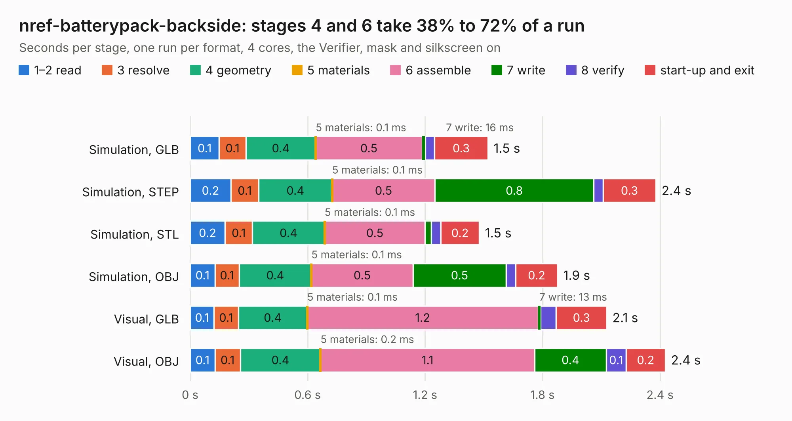

# 705. nref-batterypack-backside

Board 705 of the 3,138 of [Corpus Testing](../Corpus-Testing.md), on [Corpus Page 7](../CorpusTestingPages/Corpus-Testing-07.md#705-nref-batterypack-backside).

| Mode and format | 1–2 read | 3 resolve | 4 geometry | 5 materials | 6 assemble | 7 write | 8 verify | start-up and exit | Total |
|---|---:|---:|---:|---:|---:|---:|---:|---:|---:|
| Simulation, GLB | 0.1 | 0.1 | 0.4 | 0.1&nbsp;ms | 0.5 | 16&nbsp;ms | 48&nbsp;ms | 0.3 | 1.5 |
| Simulation, STEP | 0.2 | 0.1 | 0.4 | 0.1&nbsp;ms | 0.5 | 0.8 | 48&nbsp;ms | 0.3 | 2.4 |
| Simulation, STL | 0.2 | 0.1 | 0.4 | 0.1&nbsp;ms | 0.5 | 31&nbsp;ms | 49&nbsp;ms | 0.2 | 1.5 |
| Simulation, OBJ | 0.1 | 0.1 | 0.4 | 0.1&nbsp;ms | 0.5 | 0.5 | 48&nbsp;ms | 0.2 | 1.9 |
| Visual, GLB | 0.1 | 0.1 | 0.4 | 0.1&nbsp;ms | 1.2 | 13&nbsp;ms | 79&nbsp;ms | 0.3 | 2.1 |
| Visual, OBJ | 0.1 | 0.1 | 0.4 | 0.2&nbsp;ms | 1.1 | 0.4 | 0.1 | 0.2 | 2.4 |

<table align="center"><tr><td valign="top">

| Board | Repo: [cetola/reform-next-mirror](https://github.com/cetola/reform-next-mirror) Board: `nref-batterypack-backside.kicad_pcb` |
|---|---|
| Folder | nref-batterypack-v3 |
| Complexity | 229&nbsp;/&nbsp;1000 (size&nbsp;114, features&nbsp;115) |
| KESE&nbsp;features | through vias, rounded, trapezoid or chamfered pads, filled zones, curved board outline, knockout text, TrueType text, stack-up, dielectric εr and tanδ |
| Tested | 9th November 2026 |
| Copper&nbsp;layers | 4 |
| File&nbsp;format | KiCad 10 (20260206) |
| Parts,&nbsp;tracks,&nbsp;vias | 3, 16, 13 |
| Triangles,&nbsp;simulation | 82,176 in 16 parts |
| Verifier | PASS in all six runs |

</td><td valign="top">

<table>
<tr><th>File type</th><th>File size</th><th>Peak memory used</th></tr>
<tr><th colspan="3" align="left">Simulation</th></tr>
<tr><td>GLB</td><td align="right">2.9&nbsp;MB</td><td align="right">183&nbsp;MB</td></tr>
<tr><td>STEP</td><td align="right">13&nbsp;MB</td><td align="right">185&nbsp;MB</td></tr>
<tr><td>STL</td><td align="right">4.1&nbsp;MB</td><td align="right">178&nbsp;MB</td></tr>
<tr><td>OBJ</td><td align="right">8.0&nbsp;MB</td><td align="right">176&nbsp;MB</td></tr>
<tr><th colspan="3" align="left">Visual</th></tr>
<tr><td>GLB</td><td align="right">2.3&nbsp;MB</td><td align="right">151&nbsp;MB</td></tr>
<tr><td>OBJ</td><td align="right">6.3&nbsp;MB</td><td align="right">153&nbsp;MB</td></tr>
</table>

</td></tr></table>

| Previous | Next |
|:---|---:|
| [704. hdmi-edp2](b0704b_reform-next-mirror_hdmi-edp2.md) | [706. nref-batterypack](b0706b_reform-next-mirror_nref-batterypack-v3_nref-batterypack.md) |
