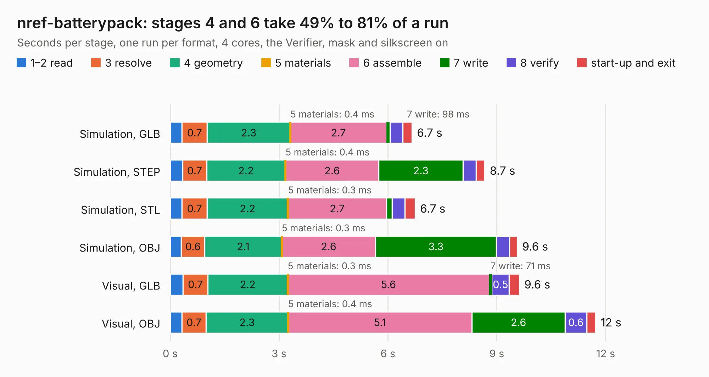

# 708. nref-batterypack

Board 708 of the 3,139 of [Corpus Testing](../Corpus-Testing.md), on [Corpus Page 7](../CorpusTestingPages/Corpus-Testing-07.md#708-nref-batterypack).

| Mode and format | 1–2 read | 3 resolve | 4 geometry | 5 materials | 6 assemble | 7 write | 8 verify | start-up and exit | Total |
|---|---:|---:|---:|---:|---:|---:|---:|---:|---:|
| Simulation, GLB | 0.3 | 0.7 | 2.3 | 0.4&nbsp;ms | 2.7 | 98&nbsp;ms | 0.3 | 0.3 | 6.7 |
| Simulation, STEP | 0.3 | 0.7 | 2.2 | 0.4&nbsp;ms | 2.6 | 2.3 | 0.4 | 0.2 | 8.7 |
| Simulation, STL | 0.3 | 0.7 | 2.2 | 0.3&nbsp;ms | 2.7 | 0.2 | 0.4 | 0.3 | 6.7 |
| Simulation, OBJ | 0.3 | 0.6 | 2.1 | 0.3&nbsp;ms | 2.6 | 3.3 | 0.4 | 0.2 | 9.6 |
| Visual, GLB | 0.4 | 0.7 | 2.2 | 0.3&nbsp;ms | 5.6 | 71&nbsp;ms | 0.5 | 0.3 | 9.6 |
| Visual, OBJ | 0.3 | 0.7 | 2.3 | 0.4&nbsp;ms | 5.1 | 2.6 | 0.6 | 0.2 | 11.7 |

<table align="center"><tr><td valign="top">

| Board | Repo: [cetola/reform-next-mirror](https://github.com/cetola/reform-next-mirror) Board: `nref-batterypack.kicad_pcb` |
|---|---|
| Folder | nref-batterypack |
| Complexity | 334&nbsp;/&nbsp;1000 (size&nbsp;224, features&nbsp;110) |
| KESE&nbsp;features | through vias, custom pads, rounded, trapezoid or chamfered pads, filled zones, copper drawings, curved board outline, stack-up, dielectric εr and tanδ |
| Tested | 9th November 2026 |
| Copper&nbsp;layers | 4 |
| File&nbsp;format | KiCad 9 (20241229) |
| Parts,&nbsp;tracks,&nbsp;vias | 59, 456, 67 |
| Triangles,&nbsp;simulation | 555,620 in 64 parts |
| Verifier | PASS in all six runs |

</td><td valign="top">

<table>
<tr><th>File type</th><th>File size</th><th>Peak memory used</th></tr>
<tr><th colspan="3" align="left">Simulation</th></tr>
<tr><td>GLB</td><td align="right">19&nbsp;MB</td><td align="right">321&nbsp;MB</td></tr>
<tr><td>STEP</td><td align="right">88&nbsp;MB</td><td align="right">389&nbsp;MB</td></tr>
<tr><td>STL</td><td align="right">28&nbsp;MB</td><td align="right">320&nbsp;MB</td></tr>
<tr><td>OBJ</td><td align="right">56&nbsp;MB</td><td align="right">422&nbsp;MB</td></tr>
<tr><th colspan="3" align="left">Visual</th></tr>
<tr><td>GLB</td><td align="right">14&nbsp;MB</td><td align="right">425&nbsp;MB</td></tr>
<tr><td>OBJ</td><td align="right">43&nbsp;MB</td><td align="right">368&nbsp;MB</td></tr>
</table>

</td></tr></table>

| Previous | Next |
|:---|---:|
| [707. nref-batterypack-backside](b0707b_reform-next-mirror_nref-batterypack_nref-batterypack-backside.md) | [709. nref-camera-adapter](b0709b_reform-next-mirror_nref-camera-adapter.md) |
