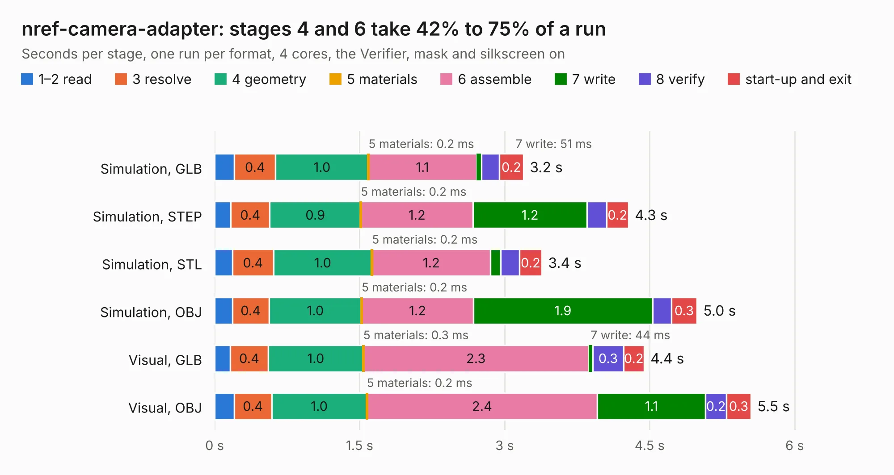

# 708. nref-camera-adapter

Board 708 of the 3,128 of [Corpus Testing](../Corpus-Testing.md), on [Corpus Page 7](../CorpusTestingPages/Corpus-Testing-07.md#708-nref-camera-adapter).

| Mode and format | 1–2 read | 3 resolve | 4 geometry | 5 materials | 6 assemble | 7 write | 8 verify | start-up and exit | Total |
|---|---:|---:|---:|---:|---:|---:|---:|---:|---:|
| Simulation, GLB | 0.2 | 0.4 | 1.0 | 0.2&nbsp;ms | 1.1 | 51&nbsp;ms | 0.2 | 0.2 | 3.2 |
| Simulation, STEP | 0.2 | 0.4 | 0.9 | 0.2&nbsp;ms | 1.2 | 1.2 | 0.2 | 0.2 | 4.3 |
| Simulation, STL | 0.2 | 0.4 | 1.0 | 0.2&nbsp;ms | 1.2 | 0.1 | 0.2 | 0.2 | 3.4 |
| Simulation, OBJ | 0.2 | 0.4 | 1.0 | 0.2&nbsp;ms | 1.2 | 1.9 | 0.2 | 0.3 | 5.0 |
| Visual, GLB | 0.2 | 0.4 | 1.0 | 0.3&nbsp;ms | 2.3 | 44&nbsp;ms | 0.3 | 0.2 | 4.4 |
| Visual, OBJ | 0.2 | 0.4 | 1.0 | 0.2&nbsp;ms | 2.4 | 1.1 | 0.2 | 0.3 | 5.5 |

<table align="center"><tr><td valign="top">

| Board | Repo: [cetola/reform-next-mirror](https://github.com/cetola/reform-next-mirror) Board: `nref-camera-adapter.kicad_pcb` |
|---|---|
| Folder | nref-camera-adapter |
| Complexity | 236&nbsp;/&nbsp;1000 (size&nbsp;146, features&nbsp;90) |
| KESE&nbsp;features | through vias, rounded, trapezoid or chamfered pads, filled zones, TrueType text, stack-up, dielectric εr and tanδ |
| Tested | 9th November 2026 |
| Copper&nbsp;layers | 4 |
| File&nbsp;format | KiCad 9 (20241229) |
| Parts,&nbsp;tracks,&nbsp;vias | 2, 157, 101 |
| Triangles,&nbsp;simulation | 308,202 in 36 parts |
| Verifier | PASS in all six runs |

</td><td valign="top">

<table>
<tr><th>File type</th><th>File size</th><th>Peak memory used</th></tr>
<tr><th colspan="3" align="left">Simulation</th></tr>
<tr><td>GLB</td><td align="right">11&nbsp;MB</td><td align="right">273&nbsp;MB</td></tr>
<tr><td>STEP</td><td align="right">31&nbsp;MB</td><td align="right">278&nbsp;MB</td></tr>
<tr><td>STL</td><td align="right">15&nbsp;MB</td><td align="right">269&nbsp;MB</td></tr>
<tr><td>OBJ</td><td align="right">30&nbsp;MB</td><td align="right">260&nbsp;MB</td></tr>
<tr><th colspan="3" align="left">Visual</th></tr>
<tr><td>GLB</td><td align="right">7.0&nbsp;MB</td><td align="right">233&nbsp;MB</td></tr>
<tr><td>OBJ</td><td align="right">21&nbsp;MB</td><td align="right">237&nbsp;MB</td></tr>
</table>

</td></tr></table>

| Previous | Next |
|:---|---:|
| [707. nref-batterypack](b0707b_reform-next-mirror_nref-batterypack_nref-batterypack.md) | [709. reform-camera](b0709b_reform-next-mirror_reform-camera.md) |
