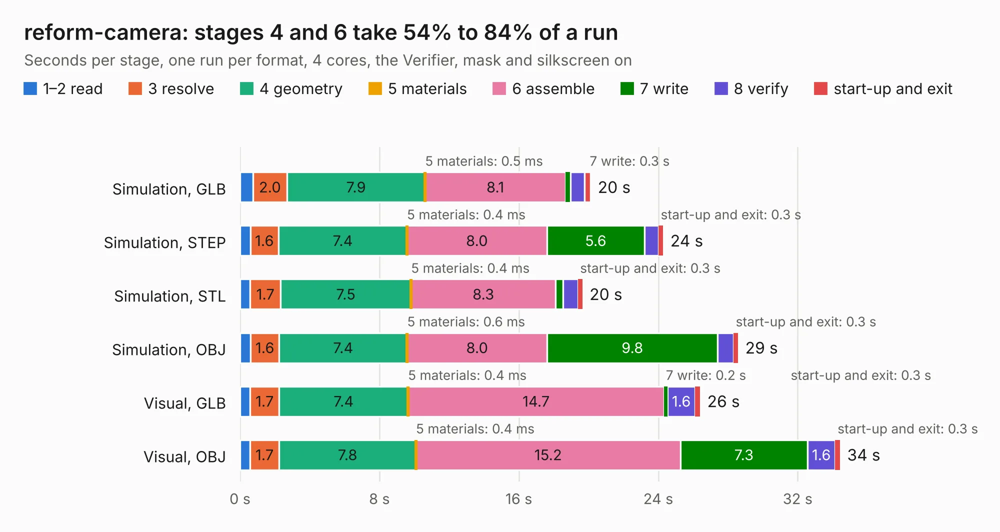

# 709. reform-camera

Board 709 of the 3,127 of [Corpus Testing](../Corpus-Testing.md), on [Corpus Page 7](../CorpusTestingPages/Corpus-Testing-07.md#709-reform-camera).

| Mode and format | 1–2 read | 3 resolve | 4 geometry | 5 materials | 6 assemble | 7 write | 8 verify | start-up and exit | Total |
|---|---:|---:|---:|---:|---:|---:|---:|---:|---:|
| Simulation, GLB | 0.7 | 2.0 | 7.9 | 0.5&nbsp;ms | 8.1 | 0.3 | 0.8 | 0.4 | 20.1 |
| Simulation, STEP | 0.6 | 1.6 | 7.4 | 0.4&nbsp;ms | 8.0 | 5.6 | 0.8 | 0.3 | 24.3 |
| Simulation, STL | 0.6 | 1.7 | 7.5 | 0.4&nbsp;ms | 8.3 | 0.4 | 0.8 | 0.3 | 19.6 |
| Simulation, OBJ | 0.6 | 1.6 | 7.4 | 0.6&nbsp;ms | 8.0 | 9.8 | 0.9 | 0.3 | 28.6 |
| Visual, GLB | 0.6 | 1.7 | 7.4 | 0.4&nbsp;ms | 14.7 | 0.2 | 1.6 | 0.3 | 26.4 |
| Visual, OBJ | 0.6 | 1.7 | 7.8 | 0.4&nbsp;ms | 15.2 | 7.3 | 1.6 | 0.3 | 34.4 |

<table align="center"><tr><td valign="top">

| Board | Repo: [cetola/reform-next-mirror](https://github.com/cetola/reform-next-mirror) Board: `reform-camera.kicad_pcb` |
|---|---|
| Folder | nref-camera |
| Complexity | 356&nbsp;/&nbsp;1000 (size&nbsp;261, features&nbsp;95) |
| KESE&nbsp;features | through vias, rounded, trapezoid or chamfered pads, arc tracks, filled zones, stack-up, dielectric εr and tanδ, mask and silkscreen colours |
| Tested | 9th November 2026 |
| Copper&nbsp;layers | 4 |
| File&nbsp;format | KiCad 8 (20240108) |
| Parts,&nbsp;tracks,&nbsp;vias | 114, 1,298, 235 |
| Triangles,&nbsp;simulation | 1,605,780 in 148 parts |
| Verifier | PASS in all six runs |

</td><td valign="top">

<table>
<tr><th>File type</th><th>File size</th><th>Peak memory used</th></tr>
<tr><th colspan="3" align="left">Simulation</th></tr>
<tr><td>GLB</td><td align="right">54&nbsp;MB</td><td align="right">613&nbsp;MB</td></tr>
<tr><td>STEP</td><td align="right">253&nbsp;MB</td><td align="right">747&nbsp;MB</td></tr>
<tr><td>STL</td><td align="right">80&nbsp;MB</td><td align="right">622&nbsp;MB</td></tr>
<tr><td>OBJ</td><td align="right">165&nbsp;MB</td><td align="right">1.1&nbsp;GB</td></tr>
<tr><th colspan="3" align="left">Visual</th></tr>
<tr><td>GLB</td><td align="right">39&nbsp;MB</td><td align="right">755&nbsp;MB</td></tr>
<tr><td>OBJ</td><td align="right">119&nbsp;MB</td><td align="right">902&nbsp;MB</td></tr>
</table>

</td></tr></table>

| Previous | Next |
|:---|---:|
| [708. nref-camera-adapter](b0708b_reform-next-mirror_nref-camera-adapter.md) | [710. nref-flex-eth](b0710b_reform-next-mirror_nref-flex-eth.md) |
