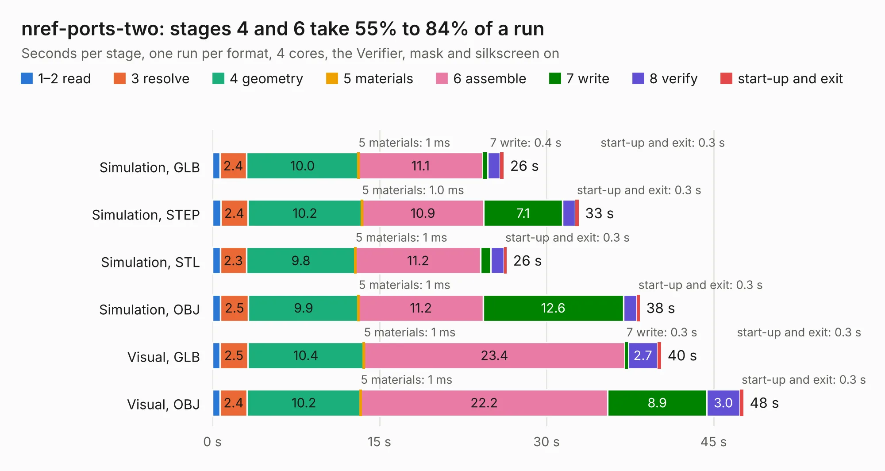

# 710. nref-ports-two

Board 710 of the 3,101 of [Corpus Testing](../Corpus-Testing.md), on [Corpus Page 7](../CorpusTestingPages/Corpus-Testing-07.md#710-nref-ports-two).

| Mode and format | 1–2 read | 3 resolve | 4 geometry | 5 materials | 6 assemble | 7 write | 8 verify | start-up and exit | Total |
|---|---:|---:|---:|---:|---:|---:|---:|---:|---:|
| Simulation, GLB | 0.7 | 2.4 | 10.0 | 1&nbsp;ms | 11.1 | 0.4 | 1.1 | 0.3 | 26.2 |
| Simulation, STEP | 0.7 | 2.4 | 10.2 | 1.0&nbsp;ms | 10.9 | 7.1 | 1.1 | 0.3 | 32.9 |
| Simulation, STL | 0.7 | 2.3 | 9.8 | 1&nbsp;ms | 11.2 | 0.9 | 1.2 | 0.3 | 26.4 |
| Simulation, OBJ | 0.7 | 2.5 | 9.9 | 1&nbsp;ms | 11.2 | 12.6 | 1.2 | 0.3 | 38.4 |
| Visual, GLB | 0.7 | 2.5 | 10.4 | 1&nbsp;ms | 23.4 | 0.3 | 2.7 | 0.3 | 40.3 |
| Visual, OBJ | 0.7 | 2.4 | 10.2 | 1&nbsp;ms | 22.2 | 8.9 | 3.0 | 0.3 | 47.7 |

<table align="center"><tr><td valign="top">

| Board | Repo: [cetola/reform-next-mirror](https://github.com/cetola/reform-next-mirror) Board: `nref-ports-two.kicad_pcb` |
|---|---|
| Folder | nref-ports-two |
| Complexity | 381&nbsp;/&nbsp;1000 (size&nbsp;266, features&nbsp;115) |
| KESE&nbsp;features | through vias, slotted holes, rounded, trapezoid or chamfered pads, arc tracks, filled zones, knockout text, stack-up, dielectric εr and tanδ |
| Tested | 9th November 2026 |
| Copper&nbsp;layers | 4 |
| File&nbsp;format | KiCad 10 (20260206) |
| Parts,&nbsp;tracks,&nbsp;vias | 137, 1,989, 422 |
| Triangles,&nbsp;simulation | 2,497,724 in 191 parts |
| Verifier | PASS in all six runs |

</td><td valign="top">

<table>
<tr><th>File type</th><th>File size</th><th>Peak memory used</th></tr>
<tr><th colspan="3" align="left">Simulation</th></tr>
<tr><td>GLB</td><td align="right">86&nbsp;MB</td><td align="right">825&nbsp;MB</td></tr>
<tr><td>STEP</td><td align="right">366&nbsp;MB</td><td align="right">1.1&nbsp;GB</td></tr>
<tr><td>STL</td><td align="right">125&nbsp;MB</td><td align="right">853&nbsp;MB</td></tr>
<tr><td>OBJ</td><td align="right">262&nbsp;MB</td><td align="right">1.6&nbsp;GB</td></tr>
<tr><th colspan="3" align="left">Visual</th></tr>
<tr><td>GLB</td><td align="right">57&nbsp;MB</td><td align="right">1.1&nbsp;GB</td></tr>
<tr><td>OBJ</td><td align="right">175&nbsp;MB</td><td align="right">1.3&nbsp;GB</td></tr>
</table>

</td></tr></table>

| Previous | Next |
|:---|---:|
| [709. nref-ports-one](b0709b_reform-next-mirror_nref-ports-one.md) | [711. Trackpad_IQS9150](b0711b_reform-next-mirror_Trackpad-IQS9150.md) |
