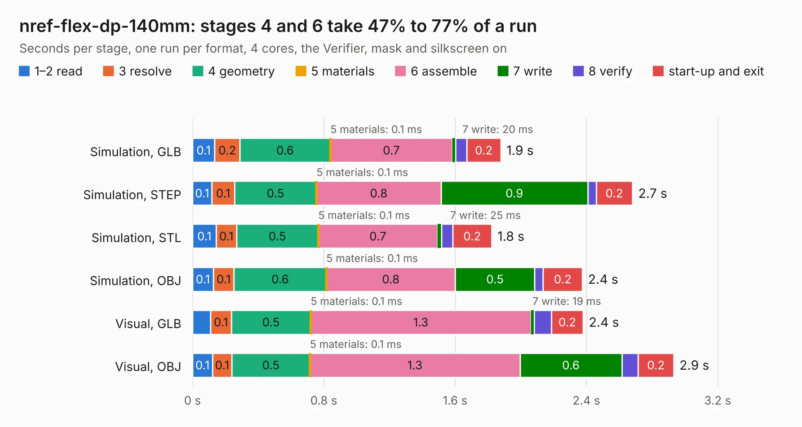

# 711. nref-flex-dp-140mm

Board 711 of the 3,128 of [Corpus Testing](../Corpus-Testing.md), on [Corpus Page 7](../CorpusTestingPages/Corpus-Testing-07.md#711-nref-flex-dp-140mm).

| Mode and format | 1–2 read | 3 resolve | 4 geometry | 5 materials | 6 assemble | 7 write | 8 verify | start-up and exit | Total |
|---|---:|---:|---:|---:|---:|---:|---:|---:|---:|
| Simulation, GLB | 0.1 | 0.2 | 0.6 | 0.1&nbsp;ms | 0.7 | 20&nbsp;ms | 69&nbsp;ms | 0.2 | 1.9 |
| Simulation, STEP | 0.1 | 0.1 | 0.5 | 0.1&nbsp;ms | 0.8 | 0.9 | 51&nbsp;ms | 0.2 | 2.7 |
| Simulation, STL | 0.1 | 0.1 | 0.5 | 0.1&nbsp;ms | 0.7 | 25&nbsp;ms | 67&nbsp;ms | 0.2 | 1.8 |
| Simulation, OBJ | 0.1 | 0.1 | 0.6 | 0.1&nbsp;ms | 0.8 | 0.5 | 51&nbsp;ms | 0.2 | 2.4 |
| Visual, GLB | 0.1 | 0.1 | 0.5 | 0.1&nbsp;ms | 1.3 | 19&nbsp;ms | 0.1 | 0.2 | 2.4 |
| Visual, OBJ | 0.1 | 0.1 | 0.5 | 0.1&nbsp;ms | 1.3 | 0.6 | 0.1 | 0.2 | 2.9 |

<table align="center"><tr><td valign="top">

| Board | Repo: [cetola/reform-next-mirror](https://github.com/cetola/reform-next-mirror) Board: `nref-flex-dp-140mm.kicad_pcb` |
|---|---|
| Folder | nref-flex / nref-flex-hdmi |
| Complexity | 165&nbsp;/&nbsp;1000 (size&nbsp;115, features&nbsp;50) |
| KESE&nbsp;features | through vias, filled zones, TrueType text |
| Tested | 9th November 2026 |
| Copper&nbsp;layers | 2 |
| File&nbsp;format | KiCad 9 (20241229) |
| Parts,&nbsp;tracks,&nbsp;vias | 2, 75, 40 |
| Triangles,&nbsp;simulation | 89,198 in 23 parts |
| Verifier | PASS in all six runs |

</td><td valign="top">

<table>
<tr><th>File type</th><th>File size</th><th>Peak memory used</th></tr>
<tr><th colspan="3" align="left">Simulation</th></tr>
<tr><td>GLB</td><td align="right">3.3&nbsp;MB</td><td align="right">185&nbsp;MB</td></tr>
<tr><td>STEP</td><td align="right">16&nbsp;MB</td><td align="right">203&nbsp;MB</td></tr>
<tr><td>STL</td><td align="right">4.5&nbsp;MB</td><td align="right">190&nbsp;MB</td></tr>
<tr><td>OBJ</td><td align="right">9.1&nbsp;MB</td><td align="right">187&nbsp;MB</td></tr>
<tr><th colspan="3" align="left">Visual</th></tr>
<tr><td>GLB</td><td align="right">4.0&nbsp;MB</td><td align="right">174&nbsp;MB</td></tr>
<tr><td>OBJ</td><td align="right">11&nbsp;MB</td><td align="right">171&nbsp;MB</td></tr>
</table>

</td></tr></table>

| Previous | Next |
|:---|---:|
| [710. nref-flex-eth](b0710b_reform-next-mirror_nref-flex-eth.md) | [712. nref-flex-hdmi](b0712b_reform-next-mirror_nref-flex-hdmi.md) |
