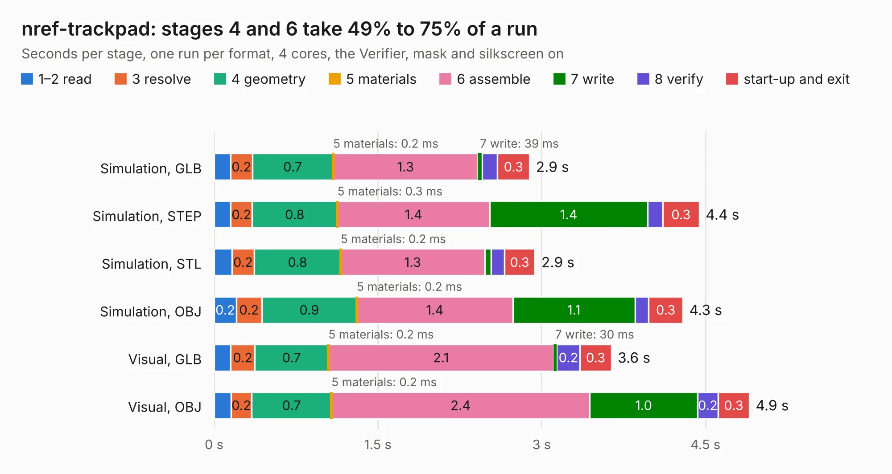

# 712. nref-trackpad

Board 712 of the 3,101 of [Corpus Testing](../Corpus-Testing.md), on [Corpus Page 7](../CorpusTestingPages/Corpus-Testing-07.md#712-nref-trackpad).

| Mode and format | 1–2 read | 3 resolve | 4 geometry | 5 materials | 6 assemble | 7 write | 8 verify | start-up and exit | Total |
|---|---:|---:|---:|---:|---:|---:|---:|---:|---:|
| Simulation, GLB | 0.2 | 0.2 | 0.7 | 0.2&nbsp;ms | 1.3 | 39&nbsp;ms | 0.1 | 0.3 | 2.9 |
| Simulation, STEP | 0.2 | 0.2 | 0.8 | 0.3&nbsp;ms | 1.4 | 1.4 | 0.1 | 0.3 | 4.4 |
| Simulation, STL | 0.2 | 0.2 | 0.8 | 0.2&nbsp;ms | 1.3 | 59&nbsp;ms | 0.1 | 0.3 | 2.9 |
| Simulation, OBJ | 0.2 | 0.2 | 0.9 | 0.2&nbsp;ms | 1.4 | 1.1 | 0.1 | 0.3 | 4.3 |
| Visual, GLB | 0.2 | 0.2 | 0.7 | 0.2&nbsp;ms | 2.1 | 30&nbsp;ms | 0.2 | 0.3 | 3.6 |
| Visual, OBJ | 0.2 | 0.2 | 0.7 | 0.2&nbsp;ms | 2.4 | 1.0 | 0.2 | 0.3 | 4.9 |

<table align="center"><tr><td valign="top">

| Board | Repo: [cetola/reform-next-mirror](https://github.com/cetola/reform-next-mirror) Board: `nref-trackpad.kicad_pcb` |
|---|---|
| Folder | nref-trackpad |
| Complexity | 243&nbsp;/&nbsp;1000 (size&nbsp;168, features&nbsp;75) |
| KESE&nbsp;features | through vias, rounded, trapezoid or chamfered pads, filled zones, stack-up, dielectric εr and tanδ |
| Tested | 9th November 2026 |
| Copper&nbsp;layers | 2 |
| File&nbsp;format | KiCad 9 (20241229) |
| Parts,&nbsp;tracks,&nbsp;vias | 12, 93, 22 |
| Triangles,&nbsp;simulation | 162,486 in 36 parts |
| Verifier | PASS in all six runs |

</td><td valign="top">

<table>
<tr><th>File type</th><th>File size</th><th>Peak memory used</th></tr>
<tr><th colspan="3" align="left">Simulation</th></tr>
<tr><td>GLB</td><td align="right">5.6&nbsp;MB</td><td align="right">209&nbsp;MB</td></tr>
<tr><td>STEP</td><td align="right">27&nbsp;MB</td><td align="right">230&nbsp;MB</td></tr>
<tr><td>STL</td><td align="right">8.1&nbsp;MB</td><td align="right">210&nbsp;MB</td></tr>
<tr><td>OBJ</td><td align="right">16&nbsp;MB</td><td align="right">212&nbsp;MB</td></tr>
<tr><th colspan="3" align="left">Visual</th></tr>
<tr><td>GLB</td><td align="right">4.8&nbsp;MB</td><td align="right">210&nbsp;MB</td></tr>
<tr><td>OBJ</td><td align="right">14&nbsp;MB</td><td align="right">209&nbsp;MB</td></tr>
</table>

</td></tr></table>

| Previous | Next |
|:---|---:|
| [711. Trackpad_IQS9150](b0711b_reform-next-mirror_Trackpad-IQS9150.md) | [713. nref-usb3-redriver](b0713b_reform-next-mirror_nref-usb3-redriver.md) |
