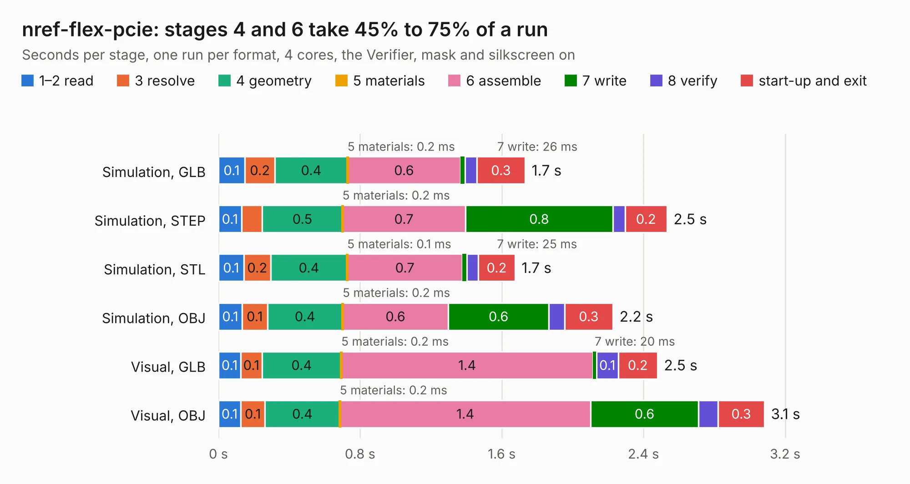

# 713. nref-flex-pcie

Board 713 of the 3,126 of [Corpus Testing](../Corpus-Testing.md), on [Corpus Page 7](../CorpusTestingPages/Corpus-Testing-07.md#713-nref-flex-pcie).

| Mode and format | 1–2 read | 3 resolve | 4 geometry | 5 materials | 6 assemble | 7 write | 8 verify | start-up and exit | Total |
|---|---:|---:|---:|---:|---:|---:|---:|---:|---:|
| Simulation, GLB | 0.1 | 0.2 | 0.4 | 0.2&nbsp;ms | 0.6 | 26&nbsp;ms | 66&nbsp;ms | 0.3 | 1.7 |
| Simulation, STEP | 0.1 | 0.1 | 0.5 | 0.2&nbsp;ms | 0.7 | 0.8 | 68&nbsp;ms | 0.2 | 2.5 |
| Simulation, STL | 0.1 | 0.2 | 0.4 | 0.1&nbsp;ms | 0.7 | 25&nbsp;ms | 64&nbsp;ms | 0.2 | 1.7 |
| Simulation, OBJ | 0.1 | 0.1 | 0.4 | 0.2&nbsp;ms | 0.6 | 0.6 | 88&nbsp;ms | 0.3 | 2.2 |
| Visual, GLB | 0.1 | 0.1 | 0.4 | 0.2&nbsp;ms | 1.4 | 20&nbsp;ms | 0.1 | 0.2 | 2.5 |
| Visual, OBJ | 0.1 | 0.1 | 0.4 | 0.2&nbsp;ms | 1.4 | 0.6 | 0.1 | 0.3 | 3.1 |

<table align="center"><tr><td valign="top">

| Board | Repo: [cetola/reform-next-mirror](https://github.com/cetola/reform-next-mirror) Board: `nref-flex-pcie.kicad_pcb` |
|---|---|
| Folder | nref-flex / nref-flex-pcie |
| Complexity | 195&nbsp;/&nbsp;1000 (size&nbsp;115, features&nbsp;80) |
| KESE&nbsp;features | through vias, filled zones, TrueType text, stack-up, dielectric εr and tanδ |
| Tested | 9th November 2026 |
| Copper&nbsp;layers | 2 |
| File&nbsp;format | KiCad 9 (20241229) |
| Parts,&nbsp;tracks,&nbsp;vias | 2, 95, 32 |
| Triangles,&nbsp;simulation | 97,104 in 24 parts |
| Verifier | PASS in all six runs |

</td><td valign="top">

<table>
<tr><th>File type</th><th>File size</th><th>Peak memory used</th></tr>
<tr><th colspan="3" align="left">Simulation</th></tr>
<tr><td>GLB</td><td align="right">3.4&nbsp;MB</td><td align="right">181&nbsp;MB</td></tr>
<tr><td>STEP</td><td align="right">16&nbsp;MB</td><td align="right">195&nbsp;MB</td></tr>
<tr><td>STL</td><td align="right">4.9&nbsp;MB</td><td align="right">185&nbsp;MB</td></tr>
<tr><td>OBJ</td><td align="right">9.6&nbsp;MB</td><td align="right">190&nbsp;MB</td></tr>
<tr><th colspan="3" align="left">Visual</th></tr>
<tr><td>GLB</td><td align="right">3.5&nbsp;MB</td><td align="right">158&nbsp;MB</td></tr>
<tr><td>OBJ</td><td align="right">9.9&nbsp;MB</td><td align="right">166&nbsp;MB</td></tr>
</table>

</td></tr></table>

| Previous | Next |
|:---|---:|
| [712. nref-flex-hdmi](b0712b_reform-next-mirror_nref-flex-hdmi.md) | [714. nref-flex-sdcard](b0714b_reform-next-mirror_nref-flex-sdcard.md) |
