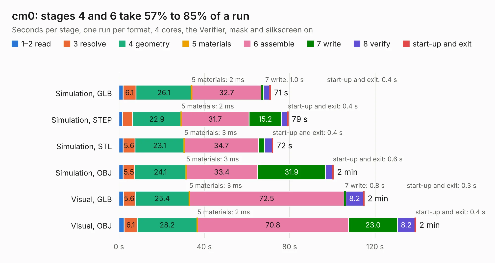

# 715. cm0

Board 715 of the 3,100 of [Corpus Testing](../Corpus-Testing.md), on [Corpus Page 7](../CorpusTestingPages/Corpus-Testing-07.md#715-cm0).

| Mode and format | 1–2 read | 3 resolve | 4 geometry | 5 materials | 6 assemble | 7 write | 8 verify | start-up and exit | Total |
|---|---:|---:|---:|---:|---:|---:|---:|---:|---:|
| Simulation, GLB | 2.0 | 6.1 | 26.1 | 2&nbsp;ms | 32.7 | 1.0 | 2.9 | 0.4 | 71.0 |
| Simulation, STEP | 1.6 | 4.8 | 22.9 | 2&nbsp;ms | 31.7 | 15.2 | 2.9 | 0.4 | 79.4 |
| Simulation, STL | 2.0 | 5.6 | 23.1 | 3&nbsp;ms | 34.7 | 2.9 | 3.6 | 0.4 | 72.2 |
| Simulation, OBJ | 1.9 | 5.5 | 24.1 | 3&nbsp;ms | 33.4 | 31.9 | 3.2 | 0.6 | 100.6 |
| Visual, GLB | 2.0 | 5.6 | 25.4 | 3&nbsp;ms | 72.5 | 0.8 | 8.2 | 0.3 | 114.9 |
| Visual, OBJ | 2.5 | 6.1 | 28.2 | 2&nbsp;ms | 70.8 | 23.0 | 8.2 | 0.4 | 139.1 |

<table align="center"><tr><td valign="top">

| Board | Repo: [cheyao/icepi-sbc](https://github.com/cheyao/icepi-sbc) Board: `cm0.kicad_pcb` |
|---|---|
| Folder | hardware |
| Complexity | 438&nbsp;/&nbsp;1000 (size&nbsp;303, features&nbsp;135) |
| KESE&nbsp;features | through vias, slotted holes, rounded, trapezoid or chamfered pads, arc tracks, filled zones, copper drawings, curved board outline, TrueType text, stack-up, dielectric εr and tanδ |
| Tested | 9th November 2026 |
| Copper&nbsp;layers | 4 |
| File&nbsp;format | KiCad 9 (20241229) |
| Parts,&nbsp;tracks,&nbsp;vias | 269, 5,249, 823 |
| Triangles,&nbsp;simulation | 4,795,238 in 480 parts |
| Verifier | PASS in all six runs |

</td><td valign="top">

<table>
<tr><th>File type</th><th>File size</th><th>Peak memory used</th></tr>
<tr><th colspan="3" align="left">Simulation</th></tr>
<tr><td>GLB</td><td align="right">161&nbsp;MB</td><td align="right">1.4&nbsp;GB</td></tr>
<tr><td>STEP</td><td align="right">691&nbsp;MB</td><td align="right">1.9&nbsp;GB</td></tr>
<tr><td>STL</td><td align="right">240&nbsp;MB</td><td align="right">1.4&nbsp;GB</td></tr>
<tr><td>OBJ</td><td align="right">511&nbsp;MB</td><td align="right">3.1&nbsp;GB</td></tr>
<tr><th colspan="3" align="left">Visual</th></tr>
<tr><td>GLB</td><td align="right">109&nbsp;MB</td><td align="right">2.1&nbsp;GB</td></tr>
<tr><td>OBJ</td><td align="right">356&nbsp;MB</td><td align="right">2.3&nbsp;GB</td></tr>
</table>

</td></tr></table>

| Previous | Next |
|:---|---:|
| [714. nref-wifi](b0714b_reform-next-mirror_nref-wifi.md) | [716. icepi-zero](b0716b_icepi-zero_hardware-v1-0_icepi-zero.md) |
