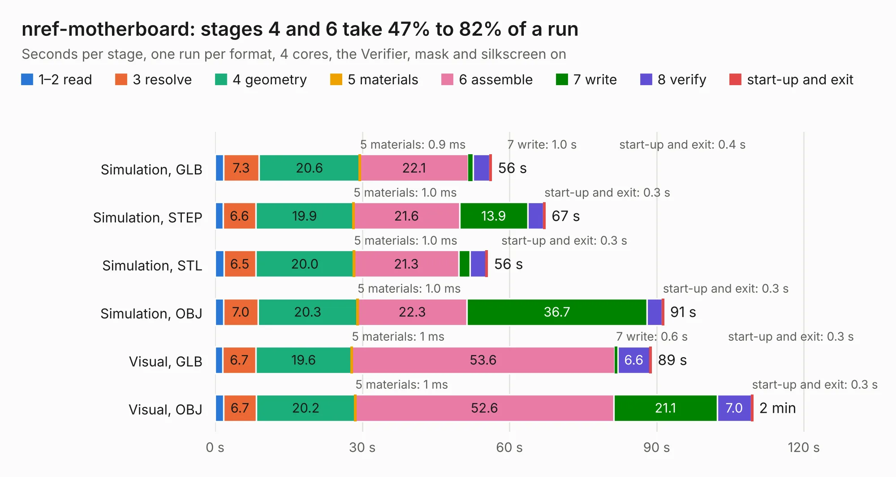

# 717. nref-motherboard

Board 717 of the 3,118 of [Corpus Testing](../Corpus-Testing.md), on [Corpus Page 7](../CorpusTestingPages/Corpus-Testing-07.md#717-nref-motherboard).

| Mode and format | 1–2 read | 3 resolve | 4 geometry | 5 materials | 6 assemble | 7 write | 8 verify | start-up and exit | Total |
|---|---:|---:|---:|---:|---:|---:|---:|---:|---:|
| Simulation, GLB | 1.7 | 7.3 | 20.6 | 0.9&nbsp;ms | 22.1 | 1.0 | 3.4 | 0.4 | 56.3 |
| Simulation, STEP | 1.7 | 6.6 | 19.9 | 1.0&nbsp;ms | 21.6 | 13.9 | 3.3 | 0.3 | 67.3 |
| Simulation, STL | 1.8 | 6.5 | 20.0 | 1.0&nbsp;ms | 21.3 | 2.3 | 3.3 | 0.3 | 55.5 |
| Simulation, OBJ | 1.7 | 7.0 | 20.3 | 1.0&nbsp;ms | 22.3 | 36.7 | 3.1 | 0.3 | 91.4 |
| Visual, GLB | 1.6 | 6.7 | 19.6 | 1&nbsp;ms | 53.6 | 0.6 | 6.6 | 0.3 | 88.9 |
| Visual, OBJ | 1.7 | 6.7 | 20.2 | 1&nbsp;ms | 52.6 | 21.1 | 7.0 | 0.3 | 109.6 |

<table align="center"><tr><td valign="top">

| Board | Repo: [cetola/reform-next-mirror](https://github.com/cetola/reform-next-mirror) Board: `nref-motherboard.kicad_pcb` |
|---|---|
| Folder | nref-motherboard |
| Complexity | 452&nbsp;/&nbsp;1000 (size&nbsp;302, features&nbsp;150) |
| KESE&nbsp;features | through vias, custom pads, rounded, trapezoid or chamfered pads, arc tracks, filled zones, copper drawings, knockout text, stack-up, dielectric εr and tanδ, copper finish, mask and silkscreen colours |
| Tested | 9th November 2026 |
| Copper&nbsp;layers | 6 |
| File&nbsp;format | KiCad 10 (20260206) |
| Parts,&nbsp;tracks,&nbsp;vias | 267, 4,810, 1,094 |
| Triangles,&nbsp;simulation | 6,534,402 in 430 parts |
| Verifier | PASS in all six runs |

</td><td valign="top">

<table>
<tr><th>File type</th><th>File size</th><th>Peak memory used</th></tr>
<tr><th colspan="3" align="left">Simulation</th></tr>
<tr><td>GLB</td><td align="right">219&nbsp;MB</td><td align="right">1.9&nbsp;GB</td></tr>
<tr><td>STEP</td><td align="right">770&nbsp;MB</td><td align="right">2.4&nbsp;GB</td></tr>
<tr><td>STL</td><td align="right">327&nbsp;MB</td><td align="right">1.8&nbsp;GB</td></tr>
<tr><td>OBJ</td><td align="right">691&nbsp;MB</td><td align="right">4.1&nbsp;GB</td></tr>
<tr><th colspan="3" align="left">Visual</th></tr>
<tr><td>GLB</td><td align="right">129&nbsp;MB</td><td align="right">2.2&nbsp;GB</td></tr>
<tr><td>OBJ</td><td align="right">418&nbsp;MB</td><td align="right">2.7&nbsp;GB</td></tr>
</table>

</td></tr></table>

| Previous | Next |
|:---|---:|
| [716. nref-flex-usb3-one](b0716b_reform-next-mirror_nref-flex-usb3-one.md) | [718. nref-ports-one](b0718b_reform-next-mirror_nref-ports-one.md) |
