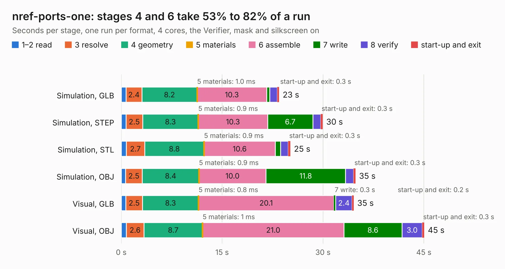

# 718. nref-ports-one

Board 718 of the 3,118 of [Corpus Testing](../Corpus-Testing.md), on [Corpus Page 7](../CorpusTestingPages/Corpus-Testing-07.md#718-nref-ports-one).

| Mode and format | 1–2 read | 3 resolve | 4 geometry | 5 materials | 6 assemble | 7 write | 8 verify | start-up and exit | Total |
|---|---:|---:|---:|---:|---:|---:|---:|---:|---:|
| Simulation, GLB | 0.7 | 2.4 | 8.2 | 1.0&nbsp;ms | 10.3 | 0.5 | 1.1 | 0.3 | 23.5 |
| Simulation, STEP | 0.7 | 2.5 | 8.3 | 0.9&nbsp;ms | 10.3 | 6.7 | 1.2 | 0.3 | 30.0 |
| Simulation, STL | 0.7 | 2.7 | 8.8 | 0.9&nbsp;ms | 10.6 | 0.8 | 1.1 | 0.3 | 25.2 |
| Simulation, OBJ | 0.6 | 2.5 | 8.4 | 0.9&nbsp;ms | 10.0 | 11.8 | 1.2 | 0.3 | 34.8 |
| Visual, GLB | 0.7 | 2.5 | 8.3 | 0.8&nbsp;ms | 20.1 | 0.3 | 2.4 | 0.2 | 34.6 |
| Visual, OBJ | 0.8 | 2.6 | 8.7 | 1&nbsp;ms | 21.0 | 8.6 | 3.0 | 0.3 | 45.1 |

<table align="center"><tr><td valign="top">

| Board | Repo: [cetola/reform-next-mirror](https://github.com/cetola/reform-next-mirror) Board: `nref-ports-one.kicad_pcb` |
|---|---|
| Folder | nref-ports-one |
| Complexity | 376&nbsp;/&nbsp;1000 (size&nbsp;261, features&nbsp;115) |
| KESE&nbsp;features | through vias, slotted holes, rounded, trapezoid or chamfered pads, arc tracks, filled zones, knockout text, stack-up, dielectric εr and tanδ |
| Tested | 9th November 2026 |
| Copper&nbsp;layers | 4 |
| File&nbsp;format | KiCad 9 (20241229) |
| Parts,&nbsp;tracks,&nbsp;vias | 146, 2,113, 461 |
| Triangles,&nbsp;simulation | 2,380,888 in 187 parts |
| Verifier | PASS in all six runs |

</td><td valign="top">

<table>
<tr><th>File type</th><th>File size</th><th>Peak memory used</th></tr>
<tr><th colspan="3" align="left">Simulation</th></tr>
<tr><td>GLB</td><td align="right">81&nbsp;MB</td><td align="right">821&nbsp;MB</td></tr>
<tr><td>STEP</td><td align="right">339&nbsp;MB</td><td align="right">1.0&nbsp;GB</td></tr>
<tr><td>STL</td><td align="right">119&nbsp;MB</td><td align="right">815&nbsp;MB</td></tr>
<tr><td>OBJ</td><td align="right">248&nbsp;MB</td><td align="right">1.6&nbsp;GB</td></tr>
<tr><th colspan="3" align="left">Visual</th></tr>
<tr><td>GLB</td><td align="right">56&nbsp;MB</td><td align="right">1.0&nbsp;GB</td></tr>
<tr><td>OBJ</td><td align="right">174&nbsp;MB</td><td align="right">1.2&nbsp;GB</td></tr>
</table>

</td></tr></table>

| Previous | Next |
|:---|---:|
| [717. nref-motherboard](b0717b_reform-next-mirror_nref-motherboard.md) | [719. nref-ports-two](b0719b_reform-next-mirror_nref-ports-two.md) |
