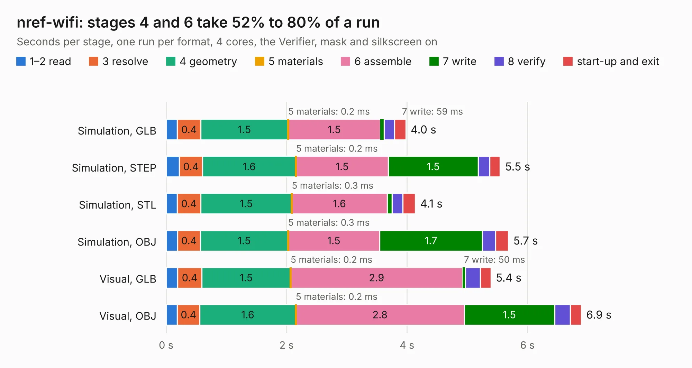

# 718. nref-wifi

Board 718 of the 3,106 of [Corpus Testing](../Corpus-Testing.md), on [Corpus Page 7](../CorpusTestingPages/Corpus-Testing-07.md#718-nref-wifi).

| Mode and format | 1–2 read | 3 resolve | 4 geometry | 5 materials | 6 assemble | 7 write | 8 verify | start-up and exit | Total |
|---|---:|---:|---:|---:|---:|---:|---:|---:|---:|
| Simulation, GLB | 0.2 | 0.4 | 1.5 | 0.2&nbsp;ms | 1.5 | 59&nbsp;ms | 0.2 | 0.2 | 4.0 |
| Simulation, STEP | 0.2 | 0.4 | 1.6 | 0.2&nbsp;ms | 1.5 | 1.5 | 0.2 | 0.2 | 5.5 |
| Simulation, STL | 0.2 | 0.4 | 1.5 | 0.3&nbsp;ms | 1.6 | 79&nbsp;ms | 0.2 | 0.2 | 4.1 |
| Simulation, OBJ | 0.2 | 0.4 | 1.5 | 0.3&nbsp;ms | 1.5 | 1.7 | 0.2 | 0.2 | 5.7 |
| Visual, GLB | 0.2 | 0.4 | 1.5 | 0.2&nbsp;ms | 2.9 | 50&nbsp;ms | 0.2 | 0.2 | 5.4 |
| Visual, OBJ | 0.2 | 0.4 | 1.6 | 0.2&nbsp;ms | 2.8 | 1.5 | 0.3 | 0.2 | 6.9 |

<table align="center"><tr><td valign="top">

| Board | Repo: [cetola/reform-next-mirror](https://github.com/cetola/reform-next-mirror) Board: `nref-wifi.kicad_pcb` |
|---|---|
| Folder | nref-wifi |
| Complexity | 232&nbsp;/&nbsp;1000 (size&nbsp;157, features&nbsp;75) |
| KESE&nbsp;features | through vias, rounded, trapezoid or chamfered pads, filled zones, stack-up, dielectric εr and tanδ |
| Tested | 9th November 2026 |
| Copper&nbsp;layers | 2 |
| File&nbsp;format | KiCad 8 (20240108) |
| Parts,&nbsp;tracks,&nbsp;vias | 23, 351, 98 |
| Triangles,&nbsp;simulation | 336,550 in 54 parts |
| Verifier | PASS in all six runs |

</td><td valign="top">

<table>
<tr><th>File type</th><th>File size</th><th>Peak memory used</th></tr>
<tr><th colspan="3" align="left">Simulation</th></tr>
<tr><td>GLB</td><td align="right">12&nbsp;MB</td><td align="right">272&nbsp;MB</td></tr>
<tr><td>STEP</td><td align="right">56&nbsp;MB</td><td align="right">312&nbsp;MB</td></tr>
<tr><td>STL</td><td align="right">17&nbsp;MB</td><td align="right">275&nbsp;MB</td></tr>
<tr><td>OBJ</td><td align="right">34&nbsp;MB</td><td align="right">274&nbsp;MB</td></tr>
<tr><th colspan="3" align="left">Visual</th></tr>
<tr><td>GLB</td><td align="right">10&nbsp;MB</td><td align="right">297&nbsp;MB</td></tr>
<tr><td>OBJ</td><td align="right">30&nbsp;MB</td><td align="right">300&nbsp;MB</td></tr>
</table>

</td></tr></table>

| Previous | Next |
|:---|---:|
| [717. nref-wifi-m2](b0717b_reform-next-mirror_nref-wifi-m2.md) | [719. cm0](b0719b_icepi-sbc_cm0.md) |
