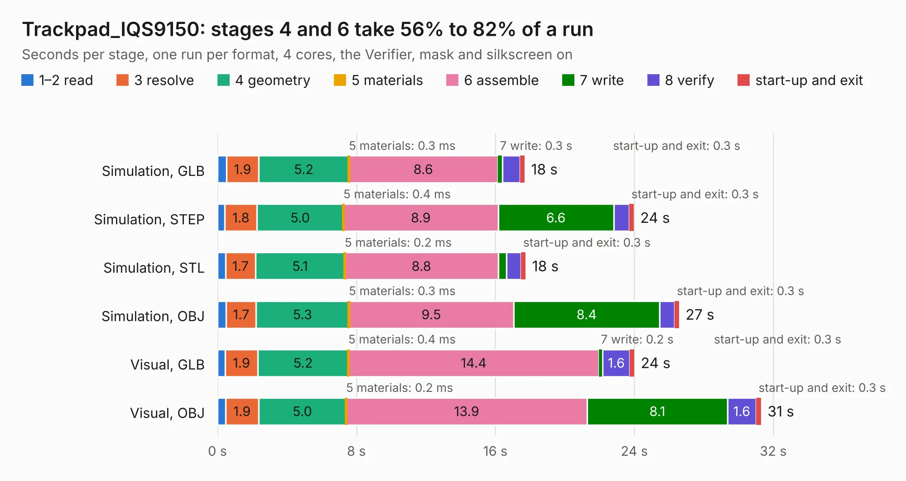

# 721. Trackpad_IQS9150

Board 721 of the 3,119 of [Corpus Testing](../Corpus-Testing.md), on [Corpus Page 7](../CorpusTestingPages/Corpus-Testing-07.md#721-trackpad_iqs9150).

| Mode and format | 1–2 read | 3 resolve | 4 geometry | 5 materials | 6 assemble | 7 write | 8 verify | start-up and exit | Total |
|---|---:|---:|---:|---:|---:|---:|---:|---:|---:|
| Simulation, GLB | 0.5 | 1.9 | 5.2 | 0.3&nbsp;ms | 8.6 | 0.3 | 1.0 | 0.3 | 17.7 |
| Simulation, STEP | 0.4 | 1.8 | 5.0 | 0.4&nbsp;ms | 8.9 | 6.6 | 0.9 | 0.3 | 24.0 |
| Simulation, STL | 0.5 | 1.7 | 5.1 | 0.2&nbsp;ms | 8.8 | 0.5 | 0.8 | 0.3 | 17.7 |
| Simulation, OBJ | 0.5 | 1.7 | 5.3 | 0.3&nbsp;ms | 9.5 | 8.4 | 0.9 | 0.3 | 26.6 |
| Visual, GLB | 0.4 | 1.9 | 5.2 | 0.4&nbsp;ms | 14.4 | 0.2 | 1.6 | 0.3 | 24.0 |
| Visual, OBJ | 0.5 | 1.9 | 5.0 | 0.2&nbsp;ms | 13.9 | 8.1 | 1.6 | 0.3 | 31.3 |

<table align="center"><tr><td valign="top">

| Board | Repo: [cetola/reform-next-mirror](https://github.com/cetola/reform-next-mirror) Board: `Trackpad_IQS9150.kicad_pcb` |
|---|---|
| Folder | nref-trackpad-sensor |
| Complexity | 259&nbsp;/&nbsp;1000 (size&nbsp;174, features&nbsp;85) |
| KESE&nbsp;features | through vias, rounded, trapezoid or chamfered pads, filled zones, curved board outline, stack-up, dielectric εr and tanδ |
| Tested | 9th November 2026 |
| Copper&nbsp;layers | 2 |
| File&nbsp;format | KiCad 10 (20260206) |
| Parts,&nbsp;tracks,&nbsp;vias | 10, 1,065, 633 |
| Triangles,&nbsp;simulation | 1,517,980 in 63 parts |
| Verifier | PASS in all six runs |

</td><td valign="top">

<table>
<tr><th>File type</th><th>File size</th><th>Peak memory used</th></tr>
<tr><th colspan="3" align="left">Simulation</th></tr>
<tr><td>GLB</td><td align="right">52&nbsp;MB</td><td align="right">712&nbsp;MB</td></tr>
<tr><td>STEP</td><td align="right">213&nbsp;MB</td><td align="right">789&nbsp;MB</td></tr>
<tr><td>STL</td><td align="right">76&nbsp;MB</td><td align="right">702&nbsp;MB</td></tr>
<tr><td>OBJ</td><td align="right">156&nbsp;MB</td><td align="right">1.0&nbsp;GB</td></tr>
<tr><th colspan="3" align="left">Visual</th></tr>
<tr><td>GLB</td><td align="right">46&nbsp;MB</td><td align="right">1.0&nbsp;GB</td></tr>
<tr><td>OBJ</td><td align="right">141&nbsp;MB</td><td align="right">1.0&nbsp;GB</td></tr>
</table>

</td></tr></table>

| Previous | Next |
|:---|---:|
| [720. nref-ports-two](b0720b_reform-next-mirror_nref-ports-two.md) | [722. nref-trackpad](b0722b_reform-next-mirror_nref-trackpad.md) |
