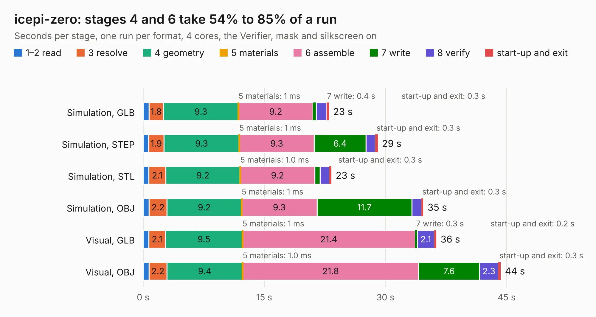

# 722. icepi-zero

Board 722 of the 3,103 of [Corpus Testing](../Corpus-Testing.md), on [Corpus Page 7](../CorpusTestingPages/Corpus-Testing-07.md#722-icepi-zero).

| Mode and format | 1–2 read | 3 resolve | 4 geometry | 5 materials | 6 assemble | 7 write | 8 verify | start-up and exit | Total |
|---|---:|---:|---:|---:|---:|---:|---:|---:|---:|
| Simulation, GLB | 0.7 | 1.8 | 9.3 | 1&nbsp;ms | 9.2 | 0.4 | 1.3 | 0.3 | 23.0 |
| Simulation, STEP | 0.7 | 1.9 | 9.3 | 1&nbsp;ms | 9.3 | 6.4 | 1.2 | 0.3 | 29.1 |
| Simulation, STL | 0.7 | 2.1 | 9.2 | 1.0&nbsp;ms | 9.2 | 0.7 | 1.1 | 0.3 | 23.3 |
| Simulation, OBJ | 0.7 | 2.2 | 9.2 | 1&nbsp;ms | 9.3 | 11.7 | 1.2 | 0.3 | 34.7 |
| Visual, GLB | 0.7 | 2.1 | 9.5 | 1&nbsp;ms | 21.4 | 0.3 | 2.1 | 0.2 | 36.3 |
| Visual, OBJ | 0.7 | 2.2 | 9.4 | 1.0&nbsp;ms | 21.8 | 7.6 | 2.3 | 0.3 | 44.3 |

<table align="center"><tr><td valign="top">

| Board | Repo: [cheyao/icepi-zero](https://github.com/cheyao/icepi-zero) Board: `icepi-zero.kicad_pcb` |
|---|---|
| Folder | hardware / v1.4 |
| Complexity | 416&nbsp;/&nbsp;1000 (size&nbsp;271, features&nbsp;145) |
| KESE&nbsp;features | through vias, slotted holes, rounded, trapezoid or chamfered pads, arc tracks, filled zones, curved board outline, TrueType text, stack-up, dielectric εr and tanδ, copper finish, mask and silkscreen colours |
| Tested | 9th November 2026 |
| Copper&nbsp;layers | 4 |
| File&nbsp;format | KiCad 10 (20260206) |
| Parts,&nbsp;tracks,&nbsp;vias | 144, 2,286, 277 |
| Triangles,&nbsp;simulation | 2,359,720 in 277 parts |
| Verifier | PASS in all six runs |

</td><td valign="top">

<table>
<tr><th>File type</th><th>File size</th><th>Peak memory used</th></tr>
<tr><th colspan="3" align="left">Simulation</th></tr>
<tr><td>GLB</td><td align="right">81&nbsp;MB</td><td align="right">818&nbsp;MB</td></tr>
<tr><td>STEP</td><td align="right">373&nbsp;MB</td><td align="right">1.0&nbsp;GB</td></tr>
<tr><td>STL</td><td align="right">118&nbsp;MB</td><td align="right">925&nbsp;MB</td></tr>
<tr><td>OBJ</td><td align="right">252&nbsp;MB</td><td align="right">1.6&nbsp;GB</td></tr>
<tr><th colspan="3" align="left">Visual</th></tr>
<tr><td>GLB</td><td align="right">51&nbsp;MB</td><td align="right">1.0&nbsp;GB</td></tr>
<tr><td>OBJ</td><td align="right">161&nbsp;MB</td><td align="right">1.1&nbsp;GB</td></tr>
</table>

</td></tr></table>

| Previous | Next |
|:---|---:|
| [721. icepi-zero](b0721b_icepi-zero_hardware-v1-3_icepi-zero.md) | [723. breakout-tt04-qfn-openframe](b0723b_breakout-pcb-standalone_breakout-tt04-qfn-openframe.md) |
