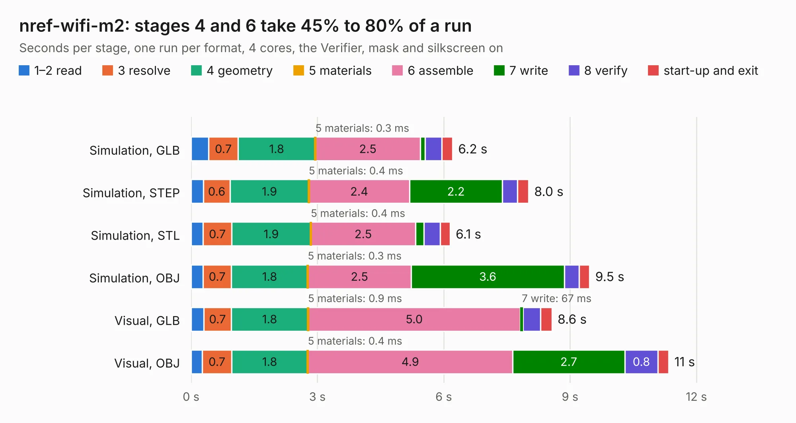

# 722. nref-wifi-m2

Board 722 of the 3,117 of [Corpus Testing](../Corpus-Testing.md), on [Corpus Page 7](../CorpusTestingPages/Corpus-Testing-07.md#722-nref-wifi-m2).

| Mode and format | 1–2 read | 3 resolve | 4 geometry | 5 materials | 6 assemble | 7 write | 8 verify | start-up and exit | Total |
|---|---:|---:|---:|---:|---:|---:|---:|---:|---:|
| Simulation, GLB | 0.4 | 0.7 | 1.8 | 0.3&nbsp;ms | 2.5 | 0.1 | 0.4 | 0.3 | 6.2 |
| Simulation, STEP | 0.3 | 0.6 | 1.9 | 0.4&nbsp;ms | 2.4 | 2.2 | 0.4 | 0.3 | 8.0 |
| Simulation, STL | 0.3 | 0.7 | 1.9 | 0.4&nbsp;ms | 2.5 | 0.2 | 0.4 | 0.2 | 6.1 |
| Simulation, OBJ | 0.3 | 0.7 | 1.8 | 0.3&nbsp;ms | 2.5 | 3.6 | 0.3 | 0.3 | 9.5 |
| Visual, GLB | 0.3 | 0.7 | 1.8 | 0.9&nbsp;ms | 5.0 | 67&nbsp;ms | 0.4 | 0.3 | 8.6 |
| Visual, OBJ | 0.3 | 0.7 | 1.8 | 0.4&nbsp;ms | 4.9 | 2.7 | 0.8 | 0.3 | 11.3 |

<table align="center"><tr><td valign="top">

| Board | Repo: [cetola/reform-next-mirror](https://github.com/cetola/reform-next-mirror) Board: `nref-wifi-m2.kicad_pcb` |
|---|---|
| Folder | nref-wifi-m2 |
| Complexity | 280&nbsp;/&nbsp;1000 (size&nbsp;180, features&nbsp;100) |
| KESE&nbsp;features | through vias, custom pads, rounded, trapezoid or chamfered pads, filled zones, copper drawings, stack-up, dielectric εr and tanδ |
| Tested | 9th November 2026 |
| Copper&nbsp;layers | 4 |
| File&nbsp;format | KiCad 9 (20241229) |
| Parts,&nbsp;tracks,&nbsp;vias | 28, 402, 141 |
| Triangles,&nbsp;simulation | 588,790 in 76 parts |
| Verifier | PASS in all six runs |

</td><td valign="top">

<table>
<tr><th>File type</th><th>File size</th><th>Peak memory used</th></tr>
<tr><th colspan="3" align="left">Simulation</th></tr>
<tr><td>GLB</td><td align="right">20&nbsp;MB</td><td align="right">332&nbsp;MB</td></tr>
<tr><td>STEP</td><td align="right">80&nbsp;MB</td><td align="right">393&nbsp;MB</td></tr>
<tr><td>STL</td><td align="right">29&nbsp;MB</td><td align="right">320&nbsp;MB</td></tr>
<tr><td>OBJ</td><td align="right">59&nbsp;MB</td><td align="right">448&nbsp;MB</td></tr>
<tr><th colspan="3" align="left">Visual</th></tr>
<tr><td>GLB</td><td align="right">14&nbsp;MB</td><td align="right">382&nbsp;MB</td></tr>
<tr><td>OBJ</td><td align="right">43&nbsp;MB</td><td align="right">410&nbsp;MB</td></tr>
</table>

</td></tr></table>

| Previous | Next |
|:---|---:|
| [721. nref-usb3-redriver](b0721b_reform-next-mirror_nref-usb3-redriver.md) | [723. nref-wifi](b0723b_reform-next-mirror_nref-wifi.md) |
