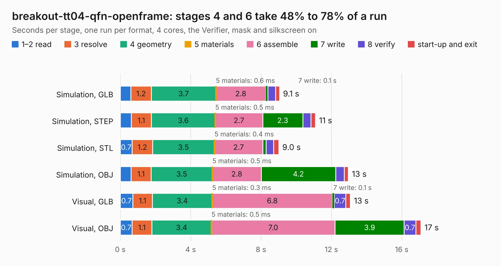

# 723. breakout-tt04-qfn-openframe

Board 723 of the 3,103 of [Corpus Testing](../Corpus-Testing.md), on [Corpus Page 7](../CorpusTestingPages/Corpus-Testing-07.md#723-breakout-tt04-qfn-openframe).

| Mode and format | 1–2 read | 3 resolve | 4 geometry | 5 materials | 6 assemble | 7 write | 8 verify | start-up and exit | Total |
|---|---:|---:|---:|---:|---:|---:|---:|---:|---:|
| Simulation, GLB | 0.6 | 1.2 | 3.7 | 0.6&nbsp;ms | 2.8 | 0.1 | 0.5 | 0.2 | 9.1 |
| Simulation, STEP | 0.6 | 1.1 | 3.6 | 0.5&nbsp;ms | 2.7 | 2.3 | 0.5 | 0.3 | 11.1 |
| Simulation, STL | 0.7 | 1.2 | 3.5 | 0.4&nbsp;ms | 2.7 | 0.2 | 0.4 | 0.3 | 9.0 |
| Simulation, OBJ | 0.6 | 1.1 | 3.5 | 0.5&nbsp;ms | 2.8 | 4.2 | 0.5 | 0.2 | 13.0 |
| Visual, GLB | 0.7 | 1.1 | 3.4 | 0.3&nbsp;ms | 6.8 | 0.1 | 0.7 | 0.3 | 13.1 |
| Visual, OBJ | 0.7 | 1.1 | 3.4 | 0.5&nbsp;ms | 7.0 | 3.9 | 0.7 | 0.3 | 17.1 |

<table align="center"><tr><td valign="top">

| Board | Repo: [chipfoundry/breakout-pcb-standalone](https://github.com/chipfoundry/breakout-pcb-standalone) Board: `breakout-tt04-qfn-openframe.kicad_pcb` |
|---|---|
| Folder | breakout-tt04-qfn-openframe |
| Complexity | 280&nbsp;/&nbsp;1000 (size&nbsp;195, features&nbsp;85) |
| KESE&nbsp;features | through vias, rounded, trapezoid or chamfered pads, filled zones, curved board outline, knockout text, TrueType text |
| Tested | 9th November 2026 |
| Copper&nbsp;layers | 2 |
| File&nbsp;format | KiCad 9 (20241229) |
| Parts,&nbsp;tracks,&nbsp;vias | 13, 529, 93 |
| Triangles,&nbsp;simulation | 688,812 in 81 parts |
| Verifier | PASS in all six runs |

</td><td valign="top">

<table>
<tr><th>File type</th><th>File size</th><th>Peak memory used</th></tr>
<tr><th colspan="3" align="left">Simulation</th></tr>
<tr><td>GLB</td><td align="right">24&nbsp;MB</td><td align="right">388&nbsp;MB</td></tr>
<tr><td>STEP</td><td align="right">127&nbsp;MB</td><td align="right">468&nbsp;MB</td></tr>
<tr><td>STL</td><td align="right">34&nbsp;MB</td><td align="right">388&nbsp;MB</td></tr>
<tr><td>OBJ</td><td align="right">71&nbsp;MB</td><td align="right">500&nbsp;MB</td></tr>
<tr><th colspan="3" align="left">Visual</th></tr>
<tr><td>GLB</td><td align="right">23&nbsp;MB</td><td align="right">553&nbsp;MB</td></tr>
<tr><td>OBJ</td><td align="right">69&nbsp;MB</td><td align="right">550&nbsp;MB</td></tr>
</table>

</td></tr></table>

| Previous | Next |
|:---|---:|
| [722. icepi-zero](b0722b_icepi-zero_hardware-v1-4_icepi-zero.md) | [724. caravel-M.2-card-QFN](b0724b_caravel-board_caravel-M-2-card-QFN.md) |
