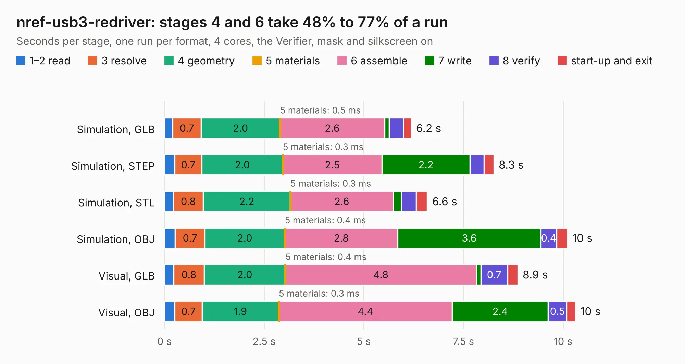

# 724. nref-usb3-redriver

Board 724 of the 3,129 of [Corpus Testing](../Corpus-Testing.md), on [Corpus Page 7](../CorpusTestingPages/Corpus-Testing-07.md#724-nref-usb3-redriver).

| Mode and format | 1–2 read | 3 resolve | 4 geometry | 5 materials | 6 assemble | 7 write | 8 verify | start-up and exit | Total |
|---|---:|---:|---:|---:|---:|---:|---:|---:|---:|
| Simulation, GLB | 0.2 | 0.7 | 2.0 | 0.5&nbsp;ms | 2.6 | 0.1 | 0.4 | 0.2 | 6.2 |
| Simulation, STEP | 0.3 | 0.7 | 2.0 | 0.3&nbsp;ms | 2.5 | 2.2 | 0.4 | 0.2 | 8.3 |
| Simulation, STL | 0.2 | 0.8 | 2.2 | 0.3&nbsp;ms | 2.6 | 0.2 | 0.4 | 0.3 | 6.6 |
| Simulation, OBJ | 0.3 | 0.7 | 2.0 | 0.4&nbsp;ms | 2.8 | 3.6 | 0.4 | 0.3 | 10.1 |
| Visual, GLB | 0.2 | 0.8 | 2.0 | 0.4&nbsp;ms | 4.8 | 0.1 | 0.7 | 0.3 | 8.9 |
| Visual, OBJ | 0.3 | 0.7 | 1.9 | 0.3&nbsp;ms | 4.4 | 2.4 | 0.5 | 0.2 | 10.3 |

<table align="center"><tr><td valign="top">

| Board | Repo: [cetola/reform-next-mirror](https://github.com/cetola/reform-next-mirror) Board: `nref-usb3-redriver.kicad_pcb` |
|---|---|
| Folder | nref-usb3-redriver |
| Complexity | 287&nbsp;/&nbsp;1000 (size&nbsp;187, features&nbsp;100) |
| KESE&nbsp;features | through vias, slotted holes, rounded, trapezoid or chamfered pads, filled zones, knockout text, stack-up, dielectric εr and tanδ |
| Tested | 9th November 2026 |
| Copper&nbsp;layers | 4 |
| File&nbsp;format | KiCad 9 (20241229) |
| Parts,&nbsp;tracks,&nbsp;vias | 40, 496, 171 |
| Triangles,&nbsp;simulation | 669,168 in 65 parts |
| Verifier | PASS in all six runs |

</td><td valign="top">

<table>
<tr><th>File type</th><th>File size</th><th>Peak memory used</th></tr>
<tr><th colspan="3" align="left">Simulation</th></tr>
<tr><td>GLB</td><td align="right">23&nbsp;MB</td><td align="right">378&nbsp;MB</td></tr>
<tr><td>STEP</td><td align="right">84&nbsp;MB</td><td align="right">442&nbsp;MB</td></tr>
<tr><td>STL</td><td align="right">33&nbsp;MB</td><td align="right">380&nbsp;MB</td></tr>
<tr><td>OBJ</td><td align="right">67&nbsp;MB</td><td align="right">489&nbsp;MB</td></tr>
<tr><th colspan="3" align="left">Visual</th></tr>
<tr><td>GLB</td><td align="right">16&nbsp;MB</td><td align="right">381&nbsp;MB</td></tr>
<tr><td>OBJ</td><td align="right">47&nbsp;MB</td><td align="right">431&nbsp;MB</td></tr>
</table>

</td></tr></table>

| Previous | Next |
|:---|---:|
| [723. nref-trackpad](b0723b_reform-next-mirror_nref-trackpad.md) | [725. nref-wifi-m2](b0725b_reform-next-mirror_nref-wifi-m2.md) |
