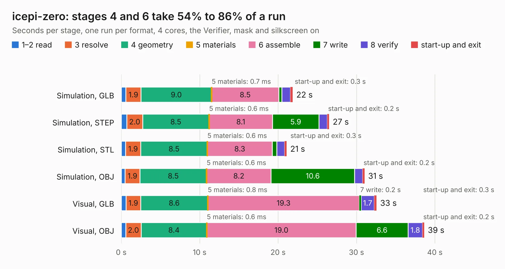

# 725. icepi-zero

Board 725 of the 3,116 of [Corpus Testing](../Corpus-Testing.md), on [Corpus Page 7](../CorpusTestingPages/Corpus-Testing-07.md#725-icepi-zero).

| Mode and format | 1–2 read | 3 resolve | 4 geometry | 5 materials | 6 assemble | 7 write | 8 verify | start-up and exit | Total |
|---|---:|---:|---:|---:|---:|---:|---:|---:|---:|
| Simulation, GLB | 0.6 | 1.9 | 9.0 | 0.7&nbsp;ms | 8.5 | 0.4 | 1.1 | 0.3 | 21.9 |
| Simulation, STEP | 0.7 | 2.0 | 8.5 | 0.6&nbsp;ms | 8.1 | 5.9 | 1.0 | 0.2 | 26.5 |
| Simulation, STL | 0.5 | 1.9 | 8.5 | 0.6&nbsp;ms | 8.3 | 0.6 | 1.0 | 0.3 | 21.1 |
| Simulation, OBJ | 0.5 | 1.9 | 8.5 | 0.6&nbsp;ms | 8.2 | 10.6 | 1.0 | 0.2 | 31.0 |
| Visual, GLB | 0.6 | 1.9 | 8.6 | 0.8&nbsp;ms | 19.3 | 0.2 | 1.7 | 0.3 | 32.6 |
| Visual, OBJ | 0.6 | 2.0 | 8.4 | 0.6&nbsp;ms | 19.0 | 6.6 | 1.8 | 0.2 | 38.6 |

<table align="center"><tr><td valign="top">

| Board | Repo: [cheyao/icepi-zero](https://github.com/cheyao/icepi-zero) Board: `icepi-zero.kicad_pcb` |
|---|---|
| Folder | hardware / v1.1 |
| Complexity | 397&nbsp;/&nbsp;1000 (size&nbsp;267, features&nbsp;130) |
| KESE&nbsp;features | through vias, slotted holes, rounded, trapezoid or chamfered pads, arc tracks, filled zones, curved board outline, TrueType text, stack-up, dielectric εr and tanδ, mask and silkscreen colours |
| Tested | 9th November 2026 |
| Copper&nbsp;layers | 4 |
| File&nbsp;format | KiCad 9 (20241229) |
| Parts,&nbsp;tracks,&nbsp;vias | 124, 1,947, 269 |
| Triangles,&nbsp;simulation | 2,216,300 in 265 parts |
| Verifier | PASS in all six runs |

</td><td valign="top">

<table>
<tr><th>File type</th><th>File size</th><th>Peak memory used</th></tr>
<tr><th colspan="3" align="left">Simulation</th></tr>
<tr><td>GLB</td><td align="right">76&nbsp;MB</td><td align="right">777&nbsp;MB</td></tr>
<tr><td>STEP</td><td align="right">334&nbsp;MB</td><td align="right">955&nbsp;MB</td></tr>
<tr><td>STL</td><td align="right">111&nbsp;MB</td><td align="right">787&nbsp;MB</td></tr>
<tr><td>OBJ</td><td align="right">236&nbsp;MB</td><td align="right">1.5&nbsp;GB</td></tr>
<tr><th colspan="3" align="left">Visual</th></tr>
<tr><td>GLB</td><td align="right">48&nbsp;MB</td><td align="right">902&nbsp;MB</td></tr>
<tr><td>OBJ</td><td align="right">149&nbsp;MB</td><td align="right">1.1&nbsp;GB</td></tr>
</table>

</td></tr></table>

| Previous | Next |
|:---|---:|
| [724. icepi-zero](b0724b_icepi-zero_hardware-v1-0_icepi-zero.md) | [726. icepi-zero](b0726b_icepi-zero_hardware-v1-2_icepi-zero.md) |
