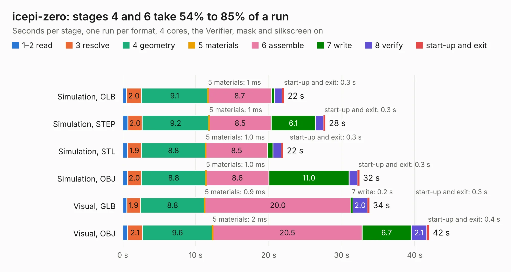

# 729. icepi-zero

Board 729 of the 3,132 of [Corpus Testing](../Corpus-Testing.md), on [Corpus Page 7](../CorpusTestingPages/Corpus-Testing-07.md#729-icepi-zero).

| Mode and format | 1–2 read | 3 resolve | 4 geometry | 5 materials | 6 assemble | 7 write | 8 verify | start-up and exit | Total |
|---|---:|---:|---:|---:|---:|---:|---:|---:|---:|
| Simulation, GLB | 0.5 | 2.0 | 9.1 | 1&nbsp;ms | 8.7 | 0.4 | 1.0 | 0.3 | 22.1 |
| Simulation, STEP | 0.7 | 2.0 | 9.2 | 1&nbsp;ms | 8.5 | 6.1 | 1.1 | 0.3 | 27.7 |
| Simulation, STL | 0.6 | 1.9 | 8.8 | 1.0&nbsp;ms | 8.5 | 0.7 | 1.1 | 0.3 | 22.0 |
| Simulation, OBJ | 0.6 | 2.0 | 8.8 | 1.0&nbsp;ms | 8.6 | 11.0 | 1.1 | 0.3 | 32.4 |
| Visual, GLB | 0.6 | 1.9 | 8.8 | 0.9&nbsp;ms | 20.0 | 0.2 | 2.0 | 0.3 | 33.8 |
| Visual, OBJ | 0.6 | 2.1 | 9.6 | 2&nbsp;ms | 20.5 | 6.7 | 2.1 | 0.4 | 42.0 |

<table align="center"><tr><td valign="top">

| Board | Repo: [cheyao/icepi-zero](https://github.com/cheyao/icepi-zero) Board: `icepi-zero.kicad_pcb` |
|---|---|
| Folder | hardware / v1.0 |
| Complexity | 397&nbsp;/&nbsp;1000 (size&nbsp;267, features&nbsp;130) |
| KESE&nbsp;features | through vias, slotted holes, rounded, trapezoid or chamfered pads, arc tracks, filled zones, curved board outline, TrueType text, stack-up, dielectric εr and tanδ, mask and silkscreen colours |
| Tested | 9th November 2026 |
| Copper&nbsp;layers | 4 |
| File&nbsp;format | KiCad 9 (20241229) |
| Parts,&nbsp;tracks,&nbsp;vias | 119, 2,041, 256 |
| Triangles,&nbsp;simulation | 2,163,986 in 265 parts |
| Verifier | PASS in all six runs |

</td><td valign="top">

<table>
<tr><th>File type</th><th>File size</th><th>Peak memory used</th></tr>
<tr><th colspan="3" align="left">Simulation</th></tr>
<tr><td>GLB</td><td align="right">75&nbsp;MB</td><td align="right">754&nbsp;MB</td></tr>
<tr><td>STEP</td><td align="right">328&nbsp;MB</td><td align="right">932&nbsp;MB</td></tr>
<tr><td>STL</td><td align="right">108&nbsp;MB</td><td align="right">745&nbsp;MB</td></tr>
<tr><td>OBJ</td><td align="right">227&nbsp;MB</td><td align="right">1.4&nbsp;GB</td></tr>
<tr><th colspan="3" align="left">Visual</th></tr>
<tr><td>GLB</td><td align="right">47&nbsp;MB</td><td align="right">1.1&nbsp;GB</td></tr>
<tr><td>OBJ</td><td align="right">144&nbsp;MB</td><td align="right">1.1&nbsp;GB</td></tr>
</table>

</td></tr></table>

| Previous | Next |
|:---|---:|
| [728. cm0](b0728b_icepi-sbc_cm0.md) | [730. icepi-zero](b0730b_icepi-zero_hardware-v1-1_icepi-zero.md) |
