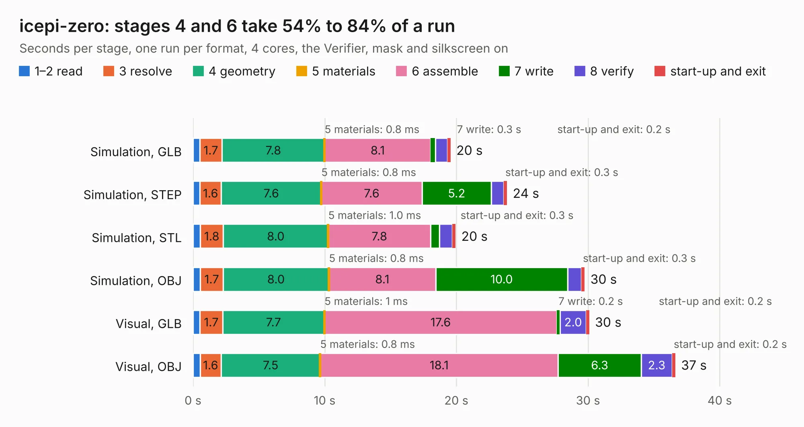

# 730. icepi-zero

Board 730 of the 3,129 of [Corpus Testing](../Corpus-Testing.md), on [Corpus Page 7](../CorpusTestingPages/Corpus-Testing-07.md#730-icepi-zero).

| Mode and format | 1–2 read | 3 resolve | 4 geometry | 5 materials | 6 assemble | 7 write | 8 verify | start-up and exit | Total |
|---|---:|---:|---:|---:|---:|---:|---:|---:|---:|
| Simulation, GLB | 0.5 | 1.7 | 7.8 | 0.8&nbsp;ms | 8.1 | 0.3 | 0.9 | 0.2 | 19.6 |
| Simulation, STEP | 0.5 | 1.6 | 7.6 | 0.8&nbsp;ms | 7.6 | 5.2 | 0.9 | 0.3 | 23.9 |
| Simulation, STL | 0.6 | 1.8 | 8.0 | 1.0&nbsp;ms | 7.8 | 0.7 | 1.0 | 0.3 | 19.9 |
| Simulation, OBJ | 0.6 | 1.7 | 8.0 | 0.8&nbsp;ms | 8.1 | 10.0 | 1.0 | 0.3 | 29.7 |
| Visual, GLB | 0.5 | 1.7 | 7.7 | 1&nbsp;ms | 17.6 | 0.2 | 2.0 | 0.2 | 30.1 |
| Visual, OBJ | 0.5 | 1.6 | 7.5 | 0.8&nbsp;ms | 18.1 | 6.3 | 2.3 | 0.2 | 36.6 |

<table align="center"><tr><td valign="top">

| Board | Repo: [cheyao/icepi-zero](https://github.com/cheyao/icepi-zero) Board: `icepi-zero.kicad_pcb` |
|---|---|
| Folder | hardware / v1.2 |
| Complexity | 399&nbsp;/&nbsp;1000 (size&nbsp;269, features&nbsp;130) |
| KESE&nbsp;features | through vias, slotted holes, rounded, trapezoid or chamfered pads, arc tracks, filled zones, curved board outline, TrueType text, stack-up, dielectric εr and tanδ, mask and silkscreen colours |
| Tested | 9th November 2026 |
| Copper&nbsp;layers | 4 |
| File&nbsp;format | KiCad 9 (20241229) |
| Parts,&nbsp;tracks,&nbsp;vias | 140, 2,064, 271 |
| Triangles,&nbsp;simulation | 2,281,968 in 274 parts |
| Verifier | PASS in all six runs |

</td><td valign="top">

<table>
<tr><th>File type</th><th>File size</th><th>Peak memory used</th></tr>
<tr><th colspan="3" align="left">Simulation</th></tr>
<tr><td>GLB</td><td align="right">79&nbsp;MB</td><td align="right">797&nbsp;MB</td></tr>
<tr><td>STEP</td><td align="right">349&nbsp;MB</td><td align="right">991&nbsp;MB</td></tr>
<tr><td>STL</td><td align="right">114&nbsp;MB</td><td align="right">794&nbsp;MB</td></tr>
<tr><td>OBJ</td><td align="right">244&nbsp;MB</td><td align="right">1.6&nbsp;GB</td></tr>
<tr><th colspan="3" align="left">Visual</th></tr>
<tr><td>GLB</td><td align="right">49&nbsp;MB</td><td align="right">905&nbsp;MB</td></tr>
<tr><td>OBJ</td><td align="right">154&nbsp;MB</td><td align="right">1.1&nbsp;GB</td></tr>
</table>

</td></tr></table>

| Previous | Next |
|:---|---:|
| [729. icepi-zero](b0729b_icepi-zero_hardware-v1-1_icepi-zero.md) | [731. icepi-zero](b0731b_icepi-zero_hardware-v1-3_icepi-zero.md) |
