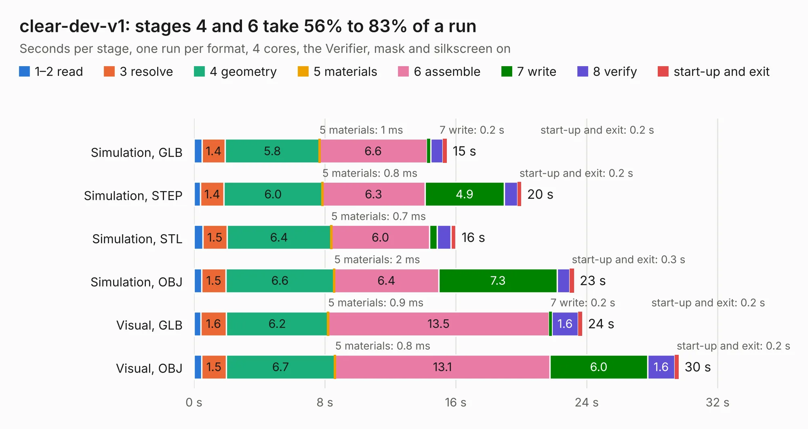

# 732. clear-dev-v1

Board 732 of the 3,109 of [Corpus Testing](../Corpus-Testing.md), on [Corpus Page 7](../CorpusTestingPages/Corpus-Testing-07.md#732-clear-dev-v1).

| Mode and format | 1–2 read | 3 resolve | 4 geometry | 5 materials | 6 assemble | 7 write | 8 verify | start-up and exit | Total |
|---|---:|---:|---:|---:|---:|---:|---:|---:|---:|
| Simulation, GLB | 0.5 | 1.4 | 5.8 | 1&nbsp;ms | 6.6 | 0.2 | 0.8 | 0.2 | 15.5 |
| Simulation, STEP | 0.4 | 1.4 | 6.0 | 0.8&nbsp;ms | 6.3 | 4.9 | 0.8 | 0.2 | 20.0 |
| Simulation, STL | 0.5 | 1.5 | 6.4 | 0.7&nbsp;ms | 6.0 | 0.5 | 0.8 | 0.3 | 16.0 |
| Simulation, OBJ | 0.5 | 1.5 | 6.6 | 2&nbsp;ms | 6.4 | 7.3 | 0.8 | 0.3 | 23.2 |
| Visual, GLB | 0.4 | 1.6 | 6.2 | 0.9&nbsp;ms | 13.5 | 0.2 | 1.6 | 0.2 | 23.7 |
| Visual, OBJ | 0.5 | 1.5 | 6.7 | 0.8&nbsp;ms | 13.1 | 6.0 | 1.6 | 0.2 | 29.6 |

<table align="center"><tr><td valign="top">

| Board | Repo: [chipfoundry/caravel_board](https://github.com/chipfoundry/caravel_board) Board: `clear-dev-v1.kicad_pcb` |
|---|---|
| Folder | hardware / development / _archive / clear-dev-v1 |
| Complexity | 328&nbsp;/&nbsp;1000 (size&nbsp;228, features&nbsp;100) |
| KESE&nbsp;features | through vias, slotted holes, rounded, trapezoid or chamfered pads, filled zones, knockout text, stack-up, dielectric εr and tanδ |
| Tested | 9th November 2026 |
| Copper&nbsp;layers | 2 |
| File&nbsp;format | KiCad 7 (20221018) |
| Parts,&nbsp;tracks,&nbsp;vias | 82, 1,321, 186 |
| Triangles,&nbsp;simulation | 1,469,894 in 111 parts |
| Verifier | PASS in all six runs |

</td><td valign="top">

<table>
<tr><th>File type</th><th>File size</th><th>Peak memory used</th></tr>
<tr><th colspan="3" align="left">Simulation</th></tr>
<tr><td>GLB</td><td align="right">51&nbsp;MB</td><td align="right">614&nbsp;MB</td></tr>
<tr><td>STEP</td><td align="right">256&nbsp;MB</td><td align="right">780&nbsp;MB</td></tr>
<tr><td>STL</td><td align="right">74&nbsp;MB</td><td align="right">646&nbsp;MB</td></tr>
<tr><td>OBJ</td><td align="right">152&nbsp;MB</td><td align="right">1.0&nbsp;GB</td></tr>
<tr><th colspan="3" align="left">Visual</th></tr>
<tr><td>GLB</td><td align="right">42&nbsp;MB</td><td align="right">890&nbsp;MB</td></tr>
<tr><td>OBJ</td><td align="right">126&nbsp;MB</td><td align="right">928&nbsp;MB</td></tr>
</table>

</td></tr></table>

| Previous | Next |
|:---|---:|
| [731. caravel_pcb_v3_FTDI_flexy_fixed](b0731b_caravel-board_caravel-pcb-v3-FTDI-flexy-fixed.md) | [733. Fab-Drawing-clear-dev-v1](b0733b_caravel-board_Fab-Drawing-clear-dev-v1.md) |
