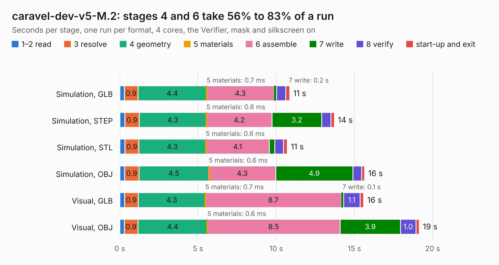

# 733. caravel-dev-v5-M.2

Board 733 of the 3,105 of [Corpus Testing](../Corpus-Testing.md), on [Corpus Page 7](../CorpusTestingPages/Corpus-Testing-07.md#733-caravel-dev-v5-m2).

| Mode and format | 1–2 read | 3 resolve | 4 geometry | 5 materials | 6 assemble | 7 write | 8 verify | start-up and exit | Total |
|---|---:|---:|---:|---:|---:|---:|---:|---:|---:|
| Simulation, GLB | 0.3 | 0.9 | 4.4 | 0.7&nbsp;ms | 4.3 | 0.2 | 0.6 | 0.2 | 10.9 |
| Simulation, STEP | 0.3 | 0.9 | 4.3 | 0.6&nbsp;ms | 4.2 | 3.2 | 0.6 | 0.2 | 13.7 |
| Simulation, STL | 0.3 | 0.9 | 4.3 | 0.6&nbsp;ms | 4.1 | 0.3 | 0.6 | 0.2 | 10.7 |
| Simulation, OBJ | 0.3 | 0.9 | 4.5 | 0.6&nbsp;ms | 4.3 | 4.9 | 0.6 | 0.2 | 15.7 |
| Visual, GLB | 0.3 | 0.9 | 4.3 | 0.7&nbsp;ms | 8.7 | 0.1 | 1.1 | 0.2 | 15.6 |
| Visual, OBJ | 0.3 | 0.9 | 4.4 | 0.6&nbsp;ms | 8.5 | 3.9 | 1.0 | 0.2 | 19.1 |

<table align="center"><tr><td valign="top">

| Board | Repo: [chipfoundry/caravel_board](https://github.com/chipfoundry/caravel_board) Board: `caravel-dev-v5-M.2.kicad_pcb` |
|---|---|
| Folder | hardware / development / caravel-dev-v5-M.2-revA |
| Complexity | 304&nbsp;/&nbsp;1000 (size&nbsp;219, features&nbsp;85) |
| KESE&nbsp;features | through vias, slotted holes, rounded, trapezoid or chamfered pads, filled zones, stack-up, dielectric εr and tanδ |
| Tested | 9th November 2026 |
| Copper&nbsp;layers | 2 |
| File&nbsp;format | KiCad 7 (20221018) |
| Parts,&nbsp;tracks,&nbsp;vias | 61, 946, 125 |
| Triangles,&nbsp;simulation | 1,185,610 in 112 parts |
| Verifier | PASS in all six runs |

</td><td valign="top">

<table>
<tr><th>File type</th><th>File size</th><th>Peak memory used</th></tr>
<tr><th colspan="3" align="left">Simulation</th></tr>
<tr><td>GLB</td><td align="right">41&nbsp;MB</td><td align="right">508&nbsp;MB</td></tr>
<tr><td>STEP</td><td align="right">199&nbsp;MB</td><td align="right">642&nbsp;MB</td></tr>
<tr><td>STL</td><td align="right">59&nbsp;MB</td><td align="right">494&nbsp;MB</td></tr>
<tr><td>OBJ</td><td align="right">121&nbsp;MB</td><td align="right">806&nbsp;MB</td></tr>
<tr><th colspan="3" align="left">Visual</th></tr>
<tr><td>GLB</td><td align="right">32&nbsp;MB</td><td align="right">631&nbsp;MB</td></tr>
<tr><td>OBJ</td><td align="right">97&nbsp;MB</td><td align="right">736&nbsp;MB</td></tr>
</table>

</td></tr></table>

| Previous | Next |
|:---|---:|
| [732. Fab-Drawing-clear-dev-v1](b0732b_caravel-board_Fab-Drawing-clear-dev-v1.md) | [734. caravel-dev-v5-M.2](b0734b_caravel-board_hardware-development-caravel-dev-v5-M-2-revB_caravel-dev-v5-M-2.md) |
