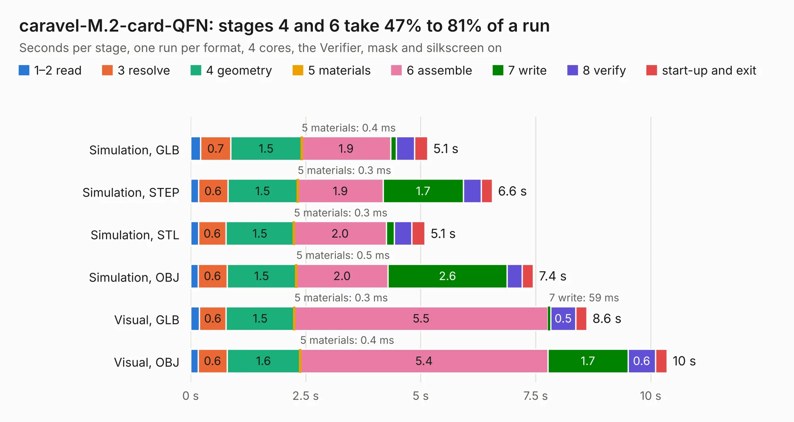

# 734. caravel-M.2-card-QFN

Board 734 of the 3,130 of [Corpus Testing](../Corpus-Testing.md), on [Corpus Page 7](../CorpusTestingPages/Corpus-Testing-07.md#734-caravel-m2-card-qfn).

| Mode and format | 1–2 read | 3 resolve | 4 geometry | 5 materials | 6 assemble | 7 write | 8 verify | start-up and exit | Total |
|---|---:|---:|---:|---:|---:|---:|---:|---:|---:|
| Simulation, GLB | 0.2 | 0.7 | 1.5 | 0.4&nbsp;ms | 1.9 | 0.1 | 0.4 | 0.3 | 5.1 |
| Simulation, STEP | 0.2 | 0.6 | 1.5 | 0.3&nbsp;ms | 1.9 | 1.7 | 0.4 | 0.2 | 6.6 |
| Simulation, STL | 0.2 | 0.6 | 1.5 | 0.3&nbsp;ms | 2.0 | 0.2 | 0.4 | 0.3 | 5.1 |
| Simulation, OBJ | 0.2 | 0.6 | 1.5 | 0.5&nbsp;ms | 2.0 | 2.6 | 0.3 | 0.2 | 7.4 |
| Visual, GLB | 0.2 | 0.6 | 1.5 | 0.3&nbsp;ms | 5.5 | 59&nbsp;ms | 0.5 | 0.2 | 8.6 |
| Visual, OBJ | 0.2 | 0.6 | 1.6 | 0.4&nbsp;ms | 5.4 | 1.7 | 0.6 | 0.3 | 10.4 |

<table align="center"><tr><td valign="top">

| Board | Repo: [chipfoundry/caravel_board](https://github.com/chipfoundry/caravel_board) Board: `caravel-M.2-card-QFN.kicad_pcb` |
|---|---|
| Folder | hardware / breakout / caravel-M.2-card-QFN |
| Complexity | 301&nbsp;/&nbsp;1000 (size&nbsp;211, features&nbsp;90) |
| KESE&nbsp;features | through vias, rounded, trapezoid or chamfered pads, filled zones, stack-up, dielectric εr and tanδ, copper finish |
| Tested | 9th November 2026 |
| Copper&nbsp;layers | 4 |
| File&nbsp;format | KiCad 7 (20221018) |
| Parts,&nbsp;tracks,&nbsp;vias | 11, 592, 95 |
| Triangles,&nbsp;simulation | 547,288 in 77 parts |
| Verifier | PASS in all six runs |

</td><td valign="top">

<table>
<tr><th>File type</th><th>File size</th><th>Peak memory used</th></tr>
<tr><th colspan="3" align="left">Simulation</th></tr>
<tr><td>GLB</td><td align="right">19&nbsp;MB</td><td align="right">299&nbsp;MB</td></tr>
<tr><td>STEP</td><td align="right">85&nbsp;MB</td><td align="right">352&nbsp;MB</td></tr>
<tr><td>STL</td><td align="right">27&nbsp;MB</td><td align="right">300&nbsp;MB</td></tr>
<tr><td>OBJ</td><td align="right">56&nbsp;MB</td><td align="right">417&nbsp;MB</td></tr>
<tr><th colspan="3" align="left">Visual</th></tr>
<tr><td>GLB</td><td align="right">13&nbsp;MB</td><td align="right">371&nbsp;MB</td></tr>
<tr><td>OBJ</td><td align="right">40&nbsp;MB</td><td align="right">369&nbsp;MB</td></tr>
</table>

</td></tr></table>

| Previous | Next |
|:---|---:|
| [733. breakout-tt04-qfn-openframe](b0733b_breakout-pcb-standalone_breakout-tt04-qfn-openframe.md) | [735. Fab-Drawing-caravel-M.2-card-QFN](b0735b_caravel-board_Fab-Drawing-caravel-M-2-card-QFN.md) |
