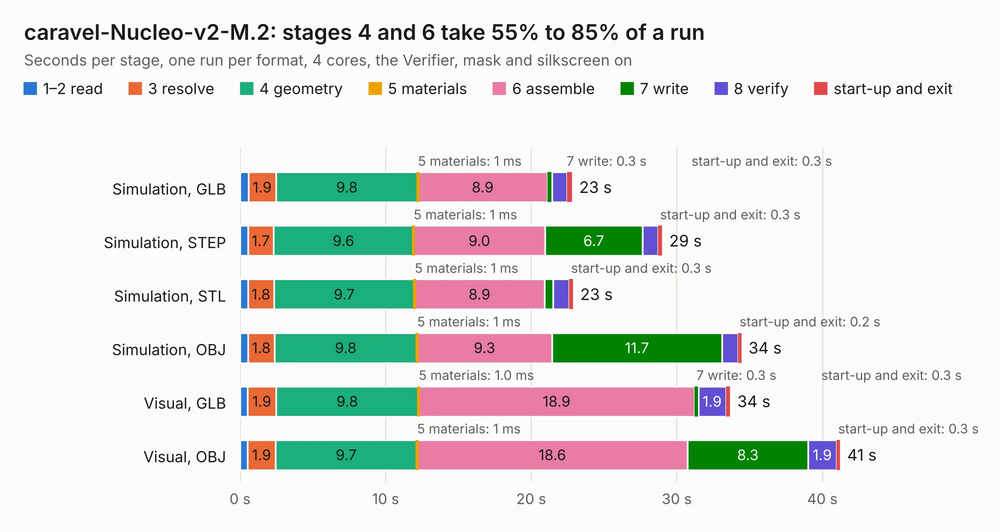

# 734. caravel-Nucleo-v2-M.2

Board 734 of the 3,101 of [Corpus Testing](../Corpus-Testing.md), on [Corpus Page 7](../CorpusTestingPages/Corpus-Testing-07.md#734-caravel-nucleo-v2-m2).

| Mode and format | 1–2 read | 3 resolve | 4 geometry | 5 materials | 6 assemble | 7 write | 8 verify | start-up and exit | Total |
|---|---:|---:|---:|---:|---:|---:|---:|---:|---:|
| Simulation, GLB | 0.6 | 1.9 | 9.8 | 1&nbsp;ms | 8.9 | 0.3 | 1.0 | 0.3 | 22.8 |
| Simulation, STEP | 0.6 | 1.7 | 9.6 | 1&nbsp;ms | 9.0 | 6.7 | 1.1 | 0.3 | 29.0 |
| Simulation, STL | 0.6 | 1.8 | 9.7 | 1&nbsp;ms | 8.9 | 0.6 | 1.1 | 0.3 | 22.9 |
| Simulation, OBJ | 0.6 | 1.8 | 9.8 | 1&nbsp;ms | 9.3 | 11.7 | 1.1 | 0.2 | 34.4 |
| Visual, GLB | 0.5 | 1.9 | 9.8 | 1.0&nbsp;ms | 18.9 | 0.3 | 1.9 | 0.3 | 33.7 |
| Visual, OBJ | 0.5 | 1.9 | 9.7 | 1&nbsp;ms | 18.6 | 8.3 | 1.9 | 0.3 | 41.2 |

<table align="center"><tr><td valign="top">

| Board | Repo: [chipfoundry/caravel_board](https://github.com/chipfoundry/caravel_board) Board: `caravel-Nucleo-v2-M.2.kicad_pcb` |
|---|---|
| Folder | hardware / nucleo / caravel-Nucleo-v2-M.2 |
| Complexity | 322&nbsp;/&nbsp;1000 (size&nbsp;227, features&nbsp;95) |
| KESE&nbsp;features | through vias, slotted holes, rounded, trapezoid or chamfered pads, filled zones, curved board outline, stack-up, dielectric εr and tanδ |
| Tested | 9th November 2026 |
| Copper&nbsp;layers | 2 |
| File&nbsp;format | KiCad 7 (20221018) |
| Parts,&nbsp;tracks,&nbsp;vias | 89, 1,180, 157 |
| Triangles,&nbsp;simulation | 1,978,734 in 216 parts |
| Verifier | PASS in all six runs |

</td><td valign="top">

<table>
<tr><th>File type</th><th>File size</th><th>Peak memory used</th></tr>
<tr><th colspan="3" align="left">Simulation</th></tr>
<tr><td>GLB</td><td align="right">68&nbsp;MB</td><td align="right">702&nbsp;MB</td></tr>
<tr><td>STEP</td><td align="right">347&nbsp;MB</td><td align="right">912&nbsp;MB</td></tr>
<tr><td>STL</td><td align="right">99&nbsp;MB</td><td align="right">692&nbsp;MB</td></tr>
<tr><td>OBJ</td><td align="right">208&nbsp;MB</td><td align="right">1.3&nbsp;GB</td></tr>
<tr><th colspan="3" align="left">Visual</th></tr>
<tr><td>GLB</td><td align="right">49&nbsp;MB</td><td align="right">985&nbsp;MB</td></tr>
<tr><td>OBJ</td><td align="right">149&nbsp;MB</td><td align="right">1.0&nbsp;GB</td></tr>
</table>

</td></tr></table>

| Previous | Next |
|:---|---:|
| [733. Fab-Drawing-caravel-dev-v5-M.2](b0733b_caravel-board_Fab-Drawing-caravel-dev-v5-M-2.md) | [735. led-bar-pcb](b0735b_caravel-board_led-bar-pcb.md) |
