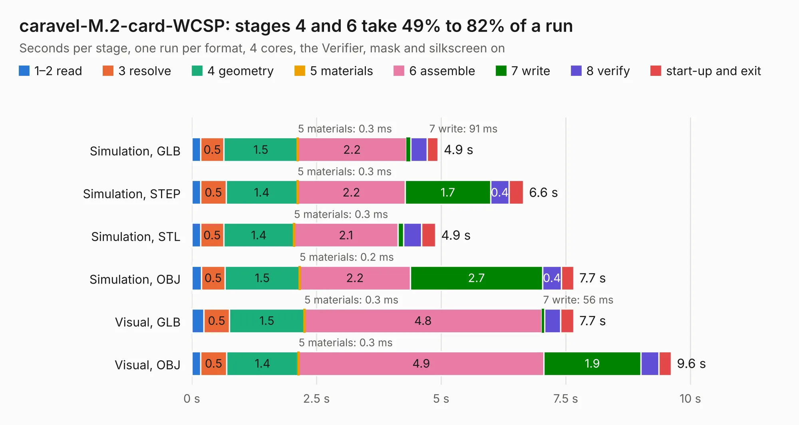

# 735. caravel-M.2-card-WCSP

Board 735 of the 3,122 of [Corpus Testing](../Corpus-Testing.md), on [Corpus Page 7](../CorpusTestingPages/Corpus-Testing-07.md#735-caravel-m2-card-wcsp).

| Mode and format | 1–2 read | 3 resolve | 4 geometry | 5 materials | 6 assemble | 7 write | 8 verify | start-up and exit | Total |
|---|---:|---:|---:|---:|---:|---:|---:|---:|---:|
| Simulation, GLB | 0.2 | 0.5 | 1.5 | 0.3&nbsp;ms | 2.2 | 91&nbsp;ms | 0.3 | 0.2 | 4.9 |
| Simulation, STEP | 0.2 | 0.5 | 1.4 | 0.3&nbsp;ms | 2.2 | 1.7 | 0.4 | 0.3 | 6.6 |
| Simulation, STL | 0.2 | 0.5 | 1.4 | 0.3&nbsp;ms | 2.1 | 0.1 | 0.4 | 0.3 | 4.9 |
| Simulation, OBJ | 0.2 | 0.5 | 1.5 | 0.2&nbsp;ms | 2.2 | 2.7 | 0.4 | 0.2 | 7.7 |
| Visual, GLB | 0.2 | 0.5 | 1.5 | 0.3&nbsp;ms | 4.8 | 56&nbsp;ms | 0.3 | 0.3 | 7.7 |
| Visual, OBJ | 0.2 | 0.5 | 1.4 | 0.3&nbsp;ms | 4.9 | 1.9 | 0.4 | 0.2 | 9.6 |

<table align="center"><tr><td valign="top">

| Board | Repo: [chipfoundry/caravel_board](https://github.com/chipfoundry/caravel_board) Board: `caravel-M.2-card-WCSP.kicad_pcb` |
|---|---|
| Folder | hardware / breakout / caravel-M.2-card-WCSP |
| Complexity | 309&nbsp;/&nbsp;1000 (size&nbsp;219, features&nbsp;90) |
| KESE&nbsp;features | through vias, rounded, trapezoid or chamfered pads, filled zones, stack-up, dielectric εr and tanδ, copper finish |
| Tested | 9th November 2026 |
| Copper&nbsp;layers | 4 |
| File&nbsp;format | KiCad 7 (20221018) |
| Parts,&nbsp;tracks,&nbsp;vias | 9, 555, 62 |
| Triangles,&nbsp;simulation | 439,070 in 76 parts |
| Verifier | PASS in all six runs |

</td><td valign="top">

<table>
<tr><th>File type</th><th>File size</th><th>Peak memory used</th></tr>
<tr><th colspan="3" align="left">Simulation</th></tr>
<tr><td>GLB</td><td align="right">16&nbsp;MB</td><td align="right">278&nbsp;MB</td></tr>
<tr><td>STEP</td><td align="right">72&nbsp;MB</td><td align="right">320&nbsp;MB</td></tr>
<tr><td>STL</td><td align="right">22&nbsp;MB</td><td align="right">274&nbsp;MB</td></tr>
<tr><td>OBJ</td><td align="right">45&nbsp;MB</td><td align="right">356&nbsp;MB</td></tr>
<tr><th colspan="3" align="left">Visual</th></tr>
<tr><td>GLB</td><td align="right">11&nbsp;MB</td><td align="right">329&nbsp;MB</td></tr>
<tr><td>OBJ</td><td align="right">33&nbsp;MB</td><td align="right">327&nbsp;MB</td></tr>
</table>

</td></tr></table>

| Previous | Next |
|:---|---:|
| [734. Fab-Drawing-caravel-M.2-card-QFN](b0734b_caravel-board_Fab-Drawing-caravel-M-2-card-QFN.md) | [736. caravel-5V-dev-v6-M.2](b0736b_caravel-board_caravel-5V-dev-v6-M-2.md) |
