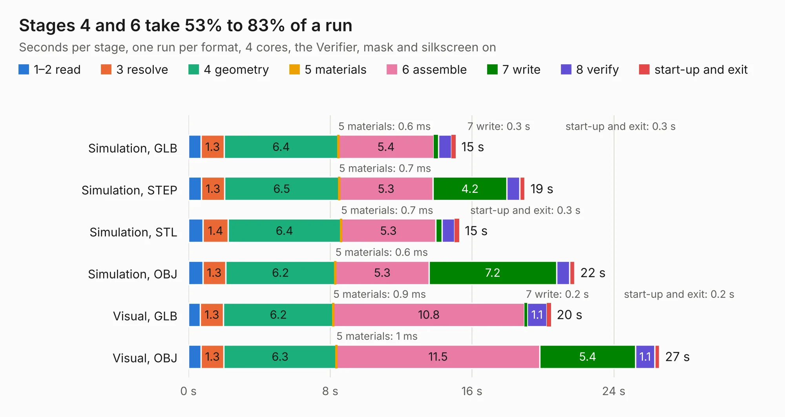

# 736. Fab-Drawing-caravel-dev-v5-M.2

Board 736 of the 3,108 of [Corpus Testing](../Corpus-Testing.md), on [Corpus Page 7](../CorpusTestingPages/Corpus-Testing-07.md#736-fab-drawing-caravel-dev-v5-m2).

| Mode and format | 1–2 read | 3 resolve | 4 geometry | 5 materials | 6 assemble | 7 write | 8 verify | start-up and exit | Total |
|---|---:|---:|---:|---:|---:|---:|---:|---:|---:|
| Simulation, GLB | 0.7 | 1.3 | 6.4 | 0.6&nbsp;ms | 5.4 | 0.3 | 0.7 | 0.3 | 15.1 |
| Simulation, STEP | 0.7 | 1.3 | 6.5 | 0.7&nbsp;ms | 5.3 | 4.2 | 0.7 | 0.3 | 19.0 |
| Simulation, STL | 0.8 | 1.4 | 6.4 | 0.7&nbsp;ms | 5.3 | 0.4 | 0.7 | 0.3 | 15.3 |
| Simulation, OBJ | 0.8 | 1.3 | 6.2 | 0.6&nbsp;ms | 5.3 | 7.2 | 0.7 | 0.3 | 21.8 |
| Visual, GLB | 0.7 | 1.3 | 6.2 | 0.9&nbsp;ms | 10.8 | 0.2 | 1.1 | 0.2 | 20.5 |
| Visual, OBJ | 0.7 | 1.3 | 6.3 | 1&nbsp;ms | 11.5 | 5.4 | 1.1 | 0.3 | 26.6 |

<table align="center"><tr><td valign="top">

| Board | Repo: [chipfoundry/caravel_board](https://github.com/chipfoundry/caravel_board) Board: `Fab-Drawing-caravel-dev-v5-M.2.kicad_pcb` |
|---|---|
| Folder | hardware / development / caravel-dev-v5-M.2-revB |
| Complexity | 325&nbsp;/&nbsp;1000 (size&nbsp;220, features&nbsp;105) |
| KESE&nbsp;features | through vias, slotted holes, rounded, trapezoid or chamfered pads, filled zones, knockout text, stack-up, dielectric εr and tanδ, mask and silkscreen colours |
| Tested | 9th November 2026 |
| Copper&nbsp;layers | 2 |
| File&nbsp;format | KiCad 7 (20221018) |
| Parts,&nbsp;tracks,&nbsp;vias | 67, 982, 118 |
| Triangles,&nbsp;simulation | 1,222,914 in 111 parts |
| Verifier | PASS in all six runs |

</td><td valign="top">

<table>
<tr><th>File type</th><th>File size</th><th>Peak memory used</th></tr>
<tr><th colspan="3" align="left">Simulation</th></tr>
<tr><td>GLB</td><td align="right">42&nbsp;MB</td><td align="right">584&nbsp;MB</td></tr>
<tr><td>STEP</td><td align="right">212&nbsp;MB</td><td align="right">679&nbsp;MB</td></tr>
<tr><td>STL</td><td align="right">61&nbsp;MB</td><td align="right">534&nbsp;MB</td></tr>
<tr><td>OBJ</td><td align="right">125&nbsp;MB</td><td align="right">843&nbsp;MB</td></tr>
<tr><th colspan="3" align="left">Visual</th></tr>
<tr><td>GLB</td><td align="right">34&nbsp;MB</td><td align="right">649&nbsp;MB</td></tr>
<tr><td>OBJ</td><td align="right">102&nbsp;MB</td><td align="right">776&nbsp;MB</td></tr>
</table>

</td></tr></table>

| Previous | Next |
|:---|---:|
| [735. caravel-dev-v5-M.2](b0735b_caravel-board_hardware-development-caravel-dev-v5-M-2-revB_caravel-dev-v5-M-2.md) | [737. caravel-Nucleo-v2-M.2](b0737b_caravel-board_caravel-Nucleo-v2-M-2.md) |
