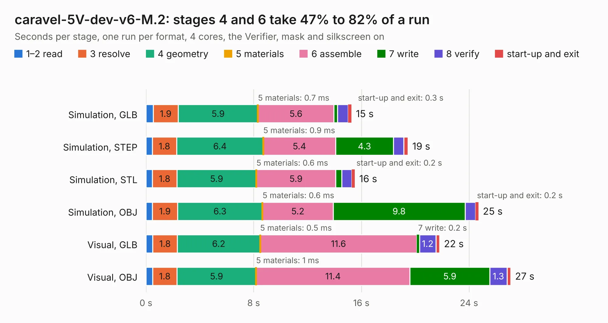

# 737. caravel-5V-dev-v6-M.2

Board 737 of the 3,123 of [Corpus Testing](../Corpus-Testing.md), on [Corpus Page 7](../CorpusTestingPages/Corpus-Testing-07.md#737-caravel-5v-dev-v6-m2).

| Mode and format | 1–2 read | 3 resolve | 4 geometry | 5 materials | 6 assemble | 7 write | 8 verify | start-up and exit | Total |
|---|---:|---:|---:|---:|---:|---:|---:|---:|---:|
| Simulation, GLB | 0.5 | 1.9 | 5.9 | 0.7&nbsp;ms | 5.6 | 0.3 | 0.8 | 0.3 | 15.3 |
| Simulation, STEP | 0.5 | 1.8 | 6.4 | 0.9&nbsp;ms | 5.4 | 4.3 | 0.8 | 0.3 | 19.5 |
| Simulation, STL | 0.5 | 1.8 | 5.9 | 0.6&nbsp;ms | 5.9 | 0.5 | 0.7 | 0.2 | 15.5 |
| Simulation, OBJ | 0.5 | 1.9 | 6.3 | 0.6&nbsp;ms | 5.2 | 9.8 | 0.8 | 0.2 | 24.7 |
| Visual, GLB | 0.5 | 1.8 | 6.2 | 0.5&nbsp;ms | 11.6 | 0.2 | 1.2 | 0.3 | 21.8 |
| Visual, OBJ | 0.5 | 1.8 | 5.9 | 1&nbsp;ms | 11.4 | 5.9 | 1.3 | 0.3 | 27.1 |

<table align="center"><tr><td valign="top">

| Board | Repo: [chipfoundry/caravel_board](https://github.com/chipfoundry/caravel_board) Board: `caravel-5V-dev-v6-M.2.kicad_pcb` |
|---|---|
| Folder | hardware / development / _archive / caravel-dev-gf180-v6-M.2 |
| Complexity | 327&nbsp;/&nbsp;1000 (size&nbsp;242, features&nbsp;85) |
| KESE&nbsp;features | through vias, slotted holes, rounded, trapezoid or chamfered pads, filled zones, stack-up, dielectric εr and tanδ |
| Tested | 9th November 2026 |
| Copper&nbsp;layers | 4 |
| File&nbsp;format | KiCad 7 (20221018) |
| Parts,&nbsp;tracks,&nbsp;vias | 82, 1,102, 175 |
| Triangles,&nbsp;simulation | 1,609,950 in 124 parts |
| Verifier | PASS in all six runs |

</td><td valign="top">

<table>
<tr><th>File type</th><th>File size</th><th>Peak memory used</th></tr>
<tr><th colspan="3" align="left">Simulation</th></tr>
<tr><td>GLB</td><td align="right">55&nbsp;MB</td><td align="right">545&nbsp;MB</td></tr>
<tr><td>STEP</td><td align="right">201&nbsp;MB</td><td align="right">697&nbsp;MB</td></tr>
<tr><td>STL</td><td align="right">81&nbsp;MB</td><td align="right">556&nbsp;MB</td></tr>
<tr><td>OBJ</td><td align="right">167&nbsp;MB</td><td align="right">1.1&nbsp;GB</td></tr>
<tr><th colspan="3" align="left">Visual</th></tr>
<tr><td>GLB</td><td align="right">34&nbsp;MB</td><td align="right">661&nbsp;MB</td></tr>
<tr><td>OBJ</td><td align="right">102&nbsp;MB</td><td align="right">828&nbsp;MB</td></tr>
</table>

</td></tr></table>

| Previous | Next |
|:---|---:|
| [736. caravel-M.2-card-WCSP](b0736b_caravel-board_caravel-M-2-card-WCSP.md) | [738. caravel_pcb_v3_FTDI_flexy](b0738b_caravel-board_hardware-development-archive-caravel-pcb-v3-FTDI-prev_caravel-pcb-v3-FTDI-flexy.md) |
