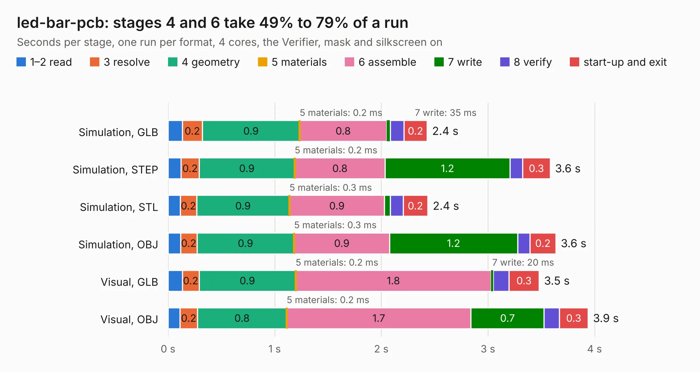

# 737. led-bar-pcb

Board 737 of the 3,104 of [Corpus Testing](../Corpus-Testing.md), on [Corpus Page 7](../CorpusTestingPages/Corpus-Testing-07.md#737-led-bar-pcb).

| Mode and format | 1–2 read | 3 resolve | 4 geometry | 5 materials | 6 assemble | 7 write | 8 verify | start-up and exit | Total |
|---|---:|---:|---:|---:|---:|---:|---:|---:|---:|
| Simulation, GLB | 0.1 | 0.2 | 0.9 | 0.2&nbsp;ms | 0.8 | 35&nbsp;ms | 0.1 | 0.2 | 2.4 |
| Simulation, STEP | 0.1 | 0.2 | 0.9 | 0.2&nbsp;ms | 0.8 | 1.2 | 0.1 | 0.3 | 3.6 |
| Simulation, STL | 0.1 | 0.2 | 0.9 | 0.3&nbsp;ms | 0.9 | 54&nbsp;ms | 0.1 | 0.2 | 2.4 |
| Simulation, OBJ | 0.1 | 0.2 | 0.9 | 0.3&nbsp;ms | 0.9 | 1.2 | 0.1 | 0.2 | 3.6 |
| Visual, GLB | 0.1 | 0.2 | 0.9 | 0.2&nbsp;ms | 1.8 | 20&nbsp;ms | 0.1 | 0.3 | 3.5 |
| Visual, OBJ | 0.1 | 0.2 | 0.8 | 0.2&nbsp;ms | 1.7 | 0.7 | 0.1 | 0.3 | 3.9 |

<table align="center"><tr><td valign="top">

| Board | Repo: [chipfoundry/caravel_board](https://github.com/chipfoundry/caravel_board) Board: `led-bar-pcb.kicad_pcb` |
|---|---|
| Folder | hardware / other / led-bar-pcb |
| Complexity | 175&nbsp;/&nbsp;1000 (size&nbsp;105, features&nbsp;70) |
| KESE&nbsp;features | rounded, trapezoid or chamfered pads, filled zones, curved board outline, stack-up, dielectric εr and tanδ |
| Tested | 9th November 2026 |
| Copper&nbsp;layers | 2 |
| File&nbsp;format | KiCad 7 (20221018) |
| Parts,&nbsp;tracks,&nbsp;vias | 12, 39, 0 |
| Triangles,&nbsp;simulation | 199,000 in 31 parts |
| Verifier | PASS in all six runs |

</td><td valign="top">

<table>
<tr><th>File type</th><th>File size</th><th>Peak memory used</th></tr>
<tr><th colspan="3" align="left">Simulation</th></tr>
<tr><td>GLB</td><td align="right">6.8&nbsp;MB</td><td align="right">207&nbsp;MB</td></tr>
<tr><td>STEP</td><td align="right">30&nbsp;MB</td><td align="right">228&nbsp;MB</td></tr>
<tr><td>STL</td><td align="right">10.0&nbsp;MB</td><td align="right">209&nbsp;MB</td></tr>
<tr><td>OBJ</td><td align="right">20&nbsp;MB</td><td align="right">207&nbsp;MB</td></tr>
<tr><th colspan="3" align="left">Visual</th></tr>
<tr><td>GLB</td><td align="right">4.1&nbsp;MB</td><td align="right">194&nbsp;MB</td></tr>
<tr><td>OBJ</td><td align="right">12&nbsp;MB</td><td align="right">195&nbsp;MB</td></tr>
</table>

</td></tr></table>

| Previous | Next |
|:---|---:|
| [736. caravel-Nucleo-v2-M.2](b0736b_caravel-board_caravel-Nucleo-v2-M-2.md) | [738. ciaa_acc](b0738b_Hardware_ciaa-acc.md) |
