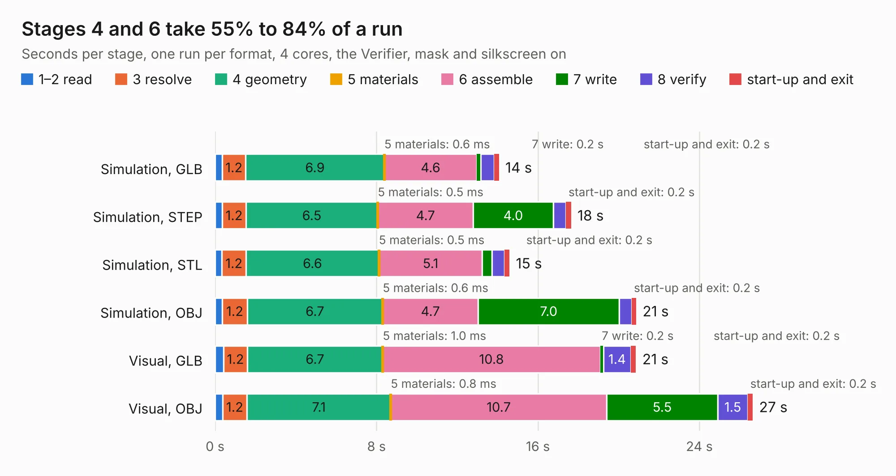

# 739. caravel_pcb_v3_FTDI_flexy_fixed

Board 739 of the 3,129 of [Corpus Testing](../Corpus-Testing.md), on [Corpus Page 7](../CorpusTestingPages/Corpus-Testing-07.md#739-caravel_pcb_v3_ftdi_flexy_fixed).

| Mode and format | 1–2 read | 3 resolve | 4 geometry | 5 materials | 6 assemble | 7 write | 8 verify | start-up and exit | Total |
|---|---:|---:|---:|---:|---:|---:|---:|---:|---:|
| Simulation, GLB | 0.4 | 1.2 | 6.9 | 0.6&nbsp;ms | 4.6 | 0.2 | 0.6 | 0.2 | 14.1 |
| Simulation, STEP | 0.4 | 1.2 | 6.5 | 0.5&nbsp;ms | 4.7 | 4.0 | 0.6 | 0.2 | 17.6 |
| Simulation, STL | 0.3 | 1.2 | 6.6 | 0.5&nbsp;ms | 5.1 | 0.5 | 0.6 | 0.2 | 14.6 |
| Simulation, OBJ | 0.4 | 1.2 | 6.7 | 0.6&nbsp;ms | 4.7 | 7.0 | 0.6 | 0.2 | 20.9 |
| Visual, GLB | 0.4 | 1.2 | 6.7 | 1.0&nbsp;ms | 10.8 | 0.2 | 1.4 | 0.2 | 20.9 |
| Visual, OBJ | 0.4 | 1.2 | 7.1 | 0.8&nbsp;ms | 10.7 | 5.5 | 1.5 | 0.2 | 26.6 |

<table align="center"><tr><td valign="top">

| Board | Repo: [chipfoundry/caravel_board](https://github.com/chipfoundry/caravel_board) Board: `caravel_pcb_v3_FTDI_flexy_fixed.kicad_pcb` |
|---|---|
| Folder | hardware / development / _archive / caravel_pcb_v3_FTDI_prev |
| Complexity | 311&nbsp;/&nbsp;1000 (size&nbsp;216, features&nbsp;95) |
| KESE&nbsp;features | through vias, slotted holes, rounded, trapezoid or chamfered pads, drill offsets, filled zones, stack-up, dielectric εr and tanδ |
| Tested | 9th November 2026 |
| Copper&nbsp;layers | 2 |
| File&nbsp;format | KiCad 6 (20211014) |
| Parts,&nbsp;tracks,&nbsp;vias | 58, 836, 104 |
| Triangles,&nbsp;simulation | 1,330,918 in 97 parts |
| Verifier | PASS in all six runs |

</td><td valign="top">

<table>
<tr><th>File type</th><th>File size</th><th>Peak memory used</th></tr>
<tr><th colspan="3" align="left">Simulation</th></tr>
<tr><td>GLB</td><td align="right">45&nbsp;MB</td><td align="right">534&nbsp;MB</td></tr>
<tr><td>STEP</td><td align="right">229&nbsp;MB</td><td align="right">680&nbsp;MB</td></tr>
<tr><td>STL</td><td align="right">67&nbsp;MB</td><td align="right">514&nbsp;MB</td></tr>
<tr><td>OBJ</td><td align="right">137&nbsp;MB</td><td align="right">932&nbsp;MB</td></tr>
<tr><th colspan="3" align="left">Visual</th></tr>
<tr><td>GLB</td><td align="right">32&nbsp;MB</td><td align="right">649&nbsp;MB</td></tr>
<tr><td>OBJ</td><td align="right">96&nbsp;MB</td><td align="right">746&nbsp;MB</td></tr>
</table>

</td></tr></table>

| Previous | Next |
|:---|---:|
| [738. caravel_pcb_v3_FTDI_flexy](b0738b_caravel-board_hardware-development-archive-caravel-pcb-v3-FTDI-prev_caravel-pcb-v3-FTDI-flexy.md) | [740. clear-dev-v1](b0740b_caravel-board_clear-dev-v1.md) |
