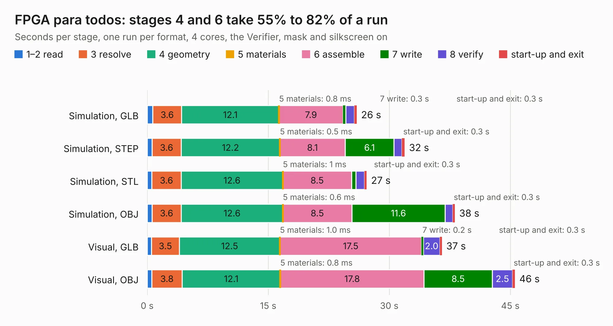

# 740. FPGA para todos

Board 740 of the 3,107 of [Corpus Testing](../Corpus-Testing.md), on [Corpus Page 7](../CorpusTestingPages/Corpus-Testing-07.md#740-fpga-para-todos).

| Mode and format | 1–2 read | 3 resolve | 4 geometry | 5 materials | 6 assemble | 7 write | 8 verify | start-up and exit | Total |
|---|---:|---:|---:|---:|---:|---:|---:|---:|---:|
| Simulation, GLB | 0.7 | 3.6 | 12.1 | 0.8&nbsp;ms | 7.9 | 0.3 | 1.1 | 0.3 | 26.0 |
| Simulation, STEP | 0.6 | 3.6 | 12.2 | 0.5&nbsp;ms | 8.1 | 6.1 | 1.0 | 0.3 | 31.9 |
| Simulation, STL | 0.6 | 3.6 | 12.6 | 1&nbsp;ms | 8.5 | 0.6 | 1.0 | 0.3 | 27.2 |
| Simulation, OBJ | 0.6 | 3.6 | 12.6 | 0.6&nbsp;ms | 8.5 | 11.6 | 0.9 | 0.3 | 38.1 |
| Visual, GLB | 0.5 | 3.5 | 12.5 | 1.0&nbsp;ms | 17.5 | 0.2 | 2.0 | 0.3 | 36.5 |
| Visual, OBJ | 0.6 | 3.8 | 12.1 | 0.8&nbsp;ms | 17.8 | 8.5 | 2.5 | 0.3 | 45.6 |

<table align="center"><tr><td valign="top">

| Board | Repo: [ciaa/Hardware](https://github.com/ciaa/Hardware) Board: `FPGA para todos.kicad_pcb` |
|---|---|
| Folder | PCB / EDU-FPGA / Schematic |
| Complexity | 297&nbsp;/&nbsp;1000 (size&nbsp;242, features&nbsp;55) |
| KESE&nbsp;features | through vias, slotted holes, rounded, trapezoid or chamfered pads, filled zones |
| Tested | 9th November 2026 |
| Copper&nbsp;layers | 2 |
| File&nbsp;format | KiCad 5 (20171130) |
| Parts,&nbsp;tracks,&nbsp;vias | 125, 1,674, 196 |
| Triangles,&nbsp;simulation | 1,757,582 in 196 parts |
| Verifier | PASS in all six runs |

</td><td valign="top">

<table>
<tr><th>File type</th><th>File size</th><th>Peak memory used</th></tr>
<tr><th colspan="3" align="left">Simulation</th></tr>
<tr><td>GLB</td><td align="right">62&nbsp;MB</td><td align="right">760&nbsp;MB</td></tr>
<tr><td>STEP</td><td align="right">327&nbsp;MB</td><td align="right">841&nbsp;MB</td></tr>
<tr><td>STL</td><td align="right">88&nbsp;MB</td><td align="right">762&nbsp;MB</td></tr>
<tr><td>OBJ</td><td align="right">187&nbsp;MB</td><td align="right">1.2&nbsp;GB</td></tr>
<tr><th colspan="3" align="left">Visual</th></tr>
<tr><td>GLB</td><td align="right">46&nbsp;MB</td><td align="right">825&nbsp;MB</td></tr>
<tr><td>OBJ</td><td align="right">141&nbsp;MB</td><td align="right">971&nbsp;MB</td></tr>
</table>

</td></tr></table>

| Previous | Next |
|:---|---:|
| [739. ciaa_acc](b0739b_Hardware_ciaa-acc.md) | [741. EDU_CIAA_K60](b0741b_Hardware_EDU-CIAA-K60.md) |
