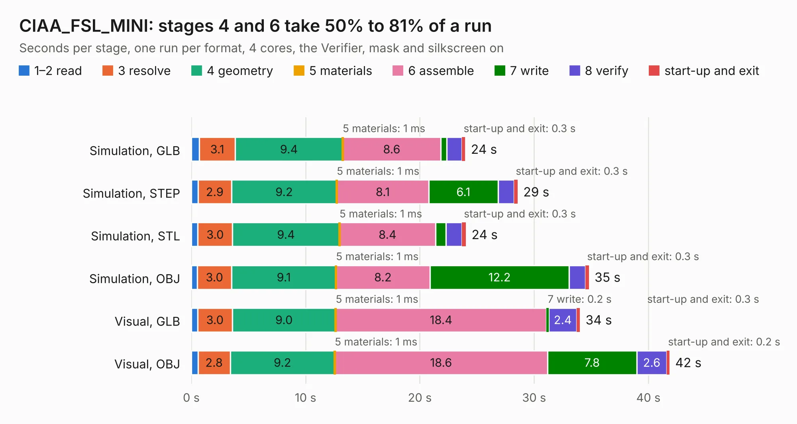

# 741. CIAA_FSL_MINI

Board 741 of the 3,102 of [Corpus Testing](../Corpus-Testing.md), on [Corpus Page 7](../CorpusTestingPages/Corpus-Testing-07.md#741-ciaa_fsl_mini).

| Mode and format | 1–2 read | 3 resolve | 4 geometry | 5 materials | 6 assemble | 7 write | 8 verify | start-up and exit | Total |
|---|---:|---:|---:|---:|---:|---:|---:|---:|---:|
| Simulation, GLB | 0.7 | 3.1 | 9.4 | 1&nbsp;ms | 8.6 | 0.5 | 1.3 | 0.3 | 24.0 |
| Simulation, STEP | 0.6 | 2.9 | 9.2 | 1&nbsp;ms | 8.1 | 6.1 | 1.4 | 0.3 | 28.6 |
| Simulation, STL | 0.6 | 3.0 | 9.4 | 1&nbsp;ms | 8.4 | 0.9 | 1.4 | 0.3 | 24.0 |
| Simulation, OBJ | 0.5 | 3.0 | 9.1 | 1&nbsp;ms | 8.2 | 12.2 | 1.4 | 0.3 | 34.8 |
| Visual, GLB | 0.5 | 3.0 | 9.0 | 1&nbsp;ms | 18.4 | 0.2 | 2.4 | 0.3 | 34.0 |
| Visual, OBJ | 0.6 | 2.8 | 9.2 | 1&nbsp;ms | 18.6 | 7.8 | 2.6 | 0.2 | 41.8 |

<table align="center"><tr><td valign="top">

| Board | Repo: [ciaa/Hardware](https://github.com/ciaa/Hardware) Board: `CIAA_FSL_MINI.kicad_pcb` |
|---|---|
| Folder | PCB / FSL-MINI |
| Complexity | 294&nbsp;/&nbsp;1000 (size&nbsp;259, features&nbsp;35) |
| KESE&nbsp;features | through vias, filled zones |
| Tested | 9th November 2026 |
| Copper&nbsp;layers | 4 |
| File&nbsp;format | KiCad 4 (4) |
| Parts,&nbsp;tracks,&nbsp;vias | 132, 2,318, 294 |
| Triangles,&nbsp;simulation | 2,465,310 in 200 parts |
| Verifier | PASS in all six runs |

</td><td valign="top">

<table>
<tr><th>File type</th><th>File size</th><th>Peak memory used</th></tr>
<tr><th colspan="3" align="left">Simulation</th></tr>
<tr><td>GLB</td><td align="right">85&nbsp;MB</td><td align="right">915&nbsp;MB</td></tr>
<tr><td>STEP</td><td align="right">316&nbsp;MB</td><td align="right">950&nbsp;MB</td></tr>
<tr><td>STL</td><td align="right">123&nbsp;MB</td><td align="right">856&nbsp;MB</td></tr>
<tr><td>OBJ</td><td align="right">260&nbsp;MB</td><td align="right">1.6&nbsp;GB</td></tr>
<tr><th colspan="3" align="left">Visual</th></tr>
<tr><td>GLB</td><td align="right">52&nbsp;MB</td><td align="right">983&nbsp;MB</td></tr>
<tr><td>OBJ</td><td align="right">161&nbsp;MB</td><td align="right">1.1&nbsp;GB</td></tr>
</table>

</td></tr></table>

| Previous | Next |
|:---|---:|
| [740. edu-ciaa-nxp](b0740b_Hardware_edu-ciaa-nxp.md) | [742. CIAA_K60](b0742b_Hardware_CIAA-K60.md) |
