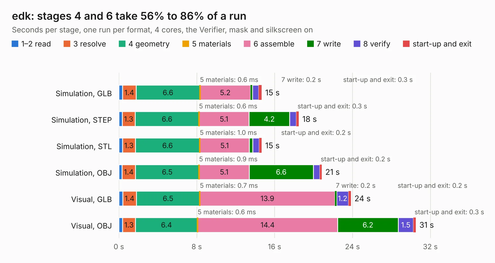

# 742. edk

Board 742 of the 3,108 of [Corpus Testing](../Corpus-Testing.md), on [Corpus Page 7](../CorpusTestingPages/Corpus-Testing-07.md#742-edk).

| Mode and format | 1–2 read | 3 resolve | 4 geometry | 5 materials | 6 assemble | 7 write | 8 verify | start-up and exit | Total |
|---|---:|---:|---:|---:|---:|---:|---:|---:|---:|
| Simulation, GLB | 0.4 | 1.4 | 6.6 | 0.6&nbsp;ms | 5.2 | 0.2 | 0.7 | 0.3 | 14.7 |
| Simulation, STEP | 0.3 | 1.3 | 6.6 | 0.6&nbsp;ms | 5.1 | 4.2 | 0.7 | 0.3 | 18.5 |
| Simulation, STL | 0.4 | 1.3 | 6.6 | 1.0&nbsp;ms | 5.1 | 0.3 | 0.7 | 0.2 | 14.7 |
| Simulation, OBJ | 0.3 | 1.4 | 6.5 | 0.9&nbsp;ms | 5.1 | 6.6 | 0.7 | 0.2 | 20.8 |
| Visual, GLB | 0.4 | 1.4 | 6.5 | 0.7&nbsp;ms | 13.9 | 0.2 | 1.2 | 0.2 | 23.8 |
| Visual, OBJ | 0.4 | 1.3 | 6.4 | 0.6&nbsp;ms | 14.4 | 6.2 | 1.5 | 0.3 | 30.5 |

<table align="center"><tr><td valign="top">

| Board | Repo: [ciaa/Hardware](https://github.com/ciaa/Hardware) Board: `edk.kicad_pcb` |
|---|---|
| Folder | PCB / EDU-INTEL |
| Complexity | 271&nbsp;/&nbsp;1000 (size&nbsp;226, features&nbsp;45) |
| KESE&nbsp;features | through vias, slotted holes, filled zones |
| Tested | 9th November 2026 |
| Copper&nbsp;layers | 2 |
| File&nbsp;format | KiCad 4 (4) |
| Parts,&nbsp;tracks,&nbsp;vias | 83, 1,298, 110 |
| Triangles,&nbsp;simulation | 1,143,178 in 162 parts |
| Verifier | PASS in all six runs |

</td><td valign="top">

<table>
<tr><th>File type</th><th>File size</th><th>Peak memory used</th></tr>
<tr><th colspan="3" align="left">Simulation</th></tr>
<tr><td>GLB</td><td align="right">40&nbsp;MB</td><td align="right">588&nbsp;MB</td></tr>
<tr><td>STEP</td><td align="right">221&nbsp;MB</td><td align="right">647&nbsp;MB</td></tr>
<tr><td>STL</td><td align="right">57&nbsp;MB</td><td align="right">576&nbsp;MB</td></tr>
<tr><td>OBJ</td><td align="right">119&nbsp;MB</td><td align="right">783&nbsp;MB</td></tr>
<tr><th colspan="3" align="left">Visual</th></tr>
<tr><td>GLB</td><td align="right">37&nbsp;MB</td><td align="right">759&nbsp;MB</td></tr>
<tr><td>OBJ</td><td align="right">111&nbsp;MB</td><td align="right">789&nbsp;MB</td></tr>
</table>

</td></tr></table>

| Previous | Next |
|:---|---:|
| [741. EDU_CIAA_K60](b0741b_Hardware_EDU-CIAA-K60.md) | [743. edu-ciaa-nxp](b0743b_Hardware_edu-ciaa-nxp.md) |
