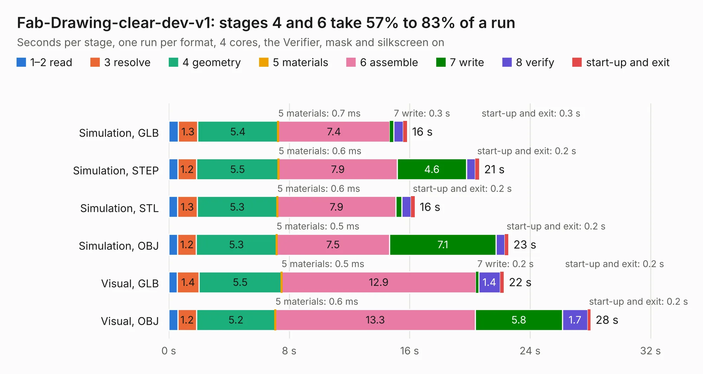

# 742 Fab-Drawing-clear-dev-v1

Board 742 of the 3,138 of [Corpus Testing](../Corpus-Testing.md), on [Corpus Page 7](../CorpusTestingPages/Corpus-Testing-07.md#742-fab-drawing-clear-dev-v1).

| Mode and format | 1–2 read | 3 resolve | 4 geometry | 5 materials | 6 assemble | 7 write | 8 verify | start-up and exit | Total |
|---|---:|---:|---:|---:|---:|---:|---:|---:|---:|
| Simulation, GLB | 0.6 | 1.3 | 5.4 | 0.7&nbsp;ms | 7.4 | 0.3 | 0.6 | 0.3 | 15.8 |
| Simulation, STEP | 0.6 | 1.2 | 5.5 | 0.6&nbsp;ms | 7.9 | 4.6 | 0.6 | 0.2 | 20.6 |
| Simulation, STL | 0.6 | 1.3 | 5.3 | 0.6&nbsp;ms | 7.9 | 0.4 | 0.6 | 0.2 | 16.3 |
| Simulation, OBJ | 0.6 | 1.2 | 5.3 | 0.5&nbsp;ms | 7.5 | 7.1 | 0.6 | 0.2 | 22.6 |
| Visual, GLB | 0.6 | 1.4 | 5.5 | 0.5&nbsp;ms | 12.9 | 0.2 | 1.4 | 0.2 | 22.3 |
| Visual, OBJ | 0.6 | 1.2 | 5.2 | 0.6&nbsp;ms | 13.3 | 5.8 | 1.7 | 0.2 | 28.0 |

<table align="center"><tr><td valign="top">

| Board | Repo: [chipfoundry/caravel_board](https://github.com/chipfoundry/caravel_board) Board: `Fab-Drawing-clear-dev-v1.kicad_pcb` |
|---|---|
| Folder | hardware / development / _archive / clear-dev-v1 |
| Complexity | 333&nbsp;/&nbsp;1000 (size&nbsp;228, features&nbsp;105) |
| KESE&nbsp;features | through vias, slotted holes, rounded, trapezoid or chamfered pads, filled zones, knockout text, stack-up, dielectric εr and tanδ, mask and silkscreen colours |
| Tested | 9th November 2026 |
| Copper&nbsp;layers | 2 |
| File&nbsp;format | KiCad 7 (20221018) |
| Parts,&nbsp;tracks,&nbsp;vias | 82, 1,321, 186 |
| Triangles,&nbsp;simulation | 1,657,796 in 11 parts |
| Verifier | PASS in all six runs |

</td><td valign="top">

<table>
<tr><th>File type</th><th>File size</th><th>Peak memory used</th></tr>
<tr><th colspan="3" align="left">Simulation</th></tr>
<tr><td>GLB</td><td align="right">57&nbsp;MB</td><td align="right">732&nbsp;MB</td></tr>
<tr><td>STEP</td><td align="right">309&nbsp;MB</td><td align="right">949&nbsp;MB</td></tr>
<tr><td>STL</td><td align="right">83&nbsp;MB</td><td align="right">705&nbsp;MB</td></tr>
<tr><td>OBJ</td><td align="right">172&nbsp;MB</td><td align="right">1.1&nbsp;GB</td></tr>
<tr><th colspan="3" align="left">Visual</th></tr>
<tr><td>GLB</td><td align="right">48&nbsp;MB</td><td align="right">1.1&nbsp;GB</td></tr>
<tr><td>OBJ</td><td align="right">146&nbsp;MB</td><td align="right">999&nbsp;MB</td></tr>
</table>

</td></tr></table>

| Previous | Next |
|:---|---:|
| [741 clear-dev-v1](b0741b_caravel-board_clear-dev-v1.md) | [743 caravel-dev-v5-M.2](b0743b_caravel-board_hardware-development-caravel-dev-v5-M-2-revA_caravel-dev-v5-M-2.md) |
