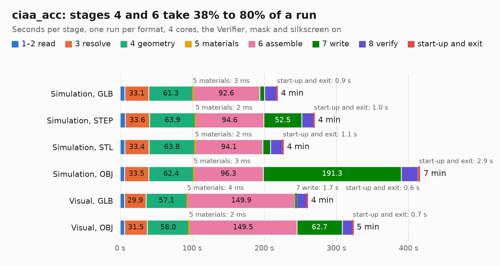

# 743. ciaa_acc

Board 743 of the 3,116 of [Corpus Testing](../Corpus-Testing.md), on [Corpus Page 7](../CorpusTestingPages/Corpus-Testing-07.md#743-ciaa_acc).

| Mode and format | 1–2 read | 3 resolve | 4 geometry | 5 materials | 6 assemble | 7 write | 8 verify | start-up and exit | Total |
|---|---:|---:|---:|---:|---:|---:|---:|---:|---:|
| Simulation, GLB | 6.7 | 33.1 | 61.3 | 3&nbsp;ms | 92.6 | 6.8 | 16.7 | 0.9 | 218.0 |
| Simulation, STEP | 7.2 | 33.6 | 63.9 | 2&nbsp;ms | 94.6 | 52.5 | 16.7 | 1.0 | 269.5 |
| Simulation, STL | 6.7 | 33.4 | 63.8 | 2&nbsp;ms | 94.1 | 10.7 | 16.6 | 1.1 | 226.4 |
| Simulation, OBJ | 6.2 | 33.5 | 62.4 | 3&nbsp;ms | 96.3 | 191.3 | 23.3 | 2.9 | 415.8 |
| Visual, GLB | 6.2 | 29.9 | 57.1 | 4&nbsp;ms | 149.9 | 1.7 | 14.5 | 0.6 | 259.9 |
| Visual, OBJ | 6.2 | 31.5 | 58.0 | 2&nbsp;ms | 149.5 | 62.7 | 14.5 | 0.7 | 323.1 |

<table align="center"><tr><td valign="top">

| Board | Repo: [ciaa/Hardware](https://github.com/ciaa/Hardware) Board: `ciaa_acc.kicad_pcb` |
|---|---|
| Folder | PCB / ACC / CIAA_ACC |
| Complexity | 422&nbsp;/&nbsp;1000 (size&nbsp;377, features&nbsp;45) |
| KESE&nbsp;features | through vias, slotted holes, filled zones |
| Tested | 9th November 2026 to 11th November 2026 |
| Copper&nbsp;layers | 12 |
| File&nbsp;format | KiCad 5 (20171130) |
| Parts,&nbsp;tracks,&nbsp;vias | 550, 59,024, 1,875 |
| Triangles,&nbsp;simulation | 25,101,984 in 809 parts |
| Verifier | PASS in all six runs |
| Run&nbsp;again | Simulation, OBJ: failed in the corpus run, run again with no memory cap and no time limit (swap added to a 16 GB machine), and passed |

</td><td valign="top">

<table>
<tr><th>File type</th><th>File size</th><th>Peak memory used</th></tr>
<tr><th colspan="3" align="left">Simulation</th></tr>
<tr><td>GLB</td><td align="right">858&nbsp;MB</td><td align="right">4.7&nbsp;GB</td></tr>
<tr><td>STEP</td><td align="right">2.3&nbsp;GB</td><td align="right">6.1&nbsp;GB</td></tr>
<tr><td>STL</td><td align="right">1.3&nbsp;GB</td><td align="right">4.9&nbsp;GB</td></tr>
<tr><td>OBJ</td><td align="right">2.9&nbsp;GB</td><td align="right">16&nbsp;GB</td></tr>
<tr><th colspan="3" align="left">Visual</th></tr>
<tr><td>GLB</td><td align="right">300&nbsp;MB</td><td align="right">5.3&nbsp;GB</td></tr>
<tr><td>OBJ</td><td align="right">1.0&nbsp;GB</td><td align="right">6.7&nbsp;GB</td></tr>
</table>

</td></tr></table>

| Previous | Next |
|:---|---:|
| [742. led-bar-pcb](b0742b_caravel-board_led-bar-pcb.md) | [744. FPGA para todos](b0744b_Hardware_FPGA-para-todos.md) |
