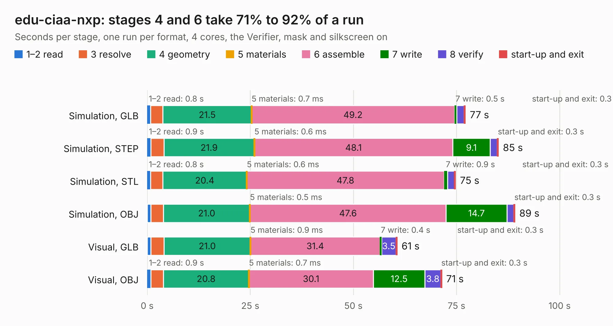

# 743. edu-ciaa-nxp

Board 743 of the 3,106 of [Corpus Testing](../Corpus-Testing.md), on [Corpus Page 7](../CorpusTestingPages/Corpus-Testing-07.md#743-edu-ciaa-nxp).

| Mode and format | 1–2 read | 3 resolve | 4 geometry | 5 materials | 6 assemble | 7 write | 8 verify | start-up and exit | Total |
|---|---:|---:|---:|---:|---:|---:|---:|---:|---:|
| Simulation, GLB | 0.8 | 3.0 | 21.5 | 0.7&nbsp;ms | 49.2 | 0.5 | 1.8 | 0.3 | 77.2 |
| Simulation, STEP | 0.9 | 3.2 | 21.9 | 0.6&nbsp;ms | 48.1 | 9.1 | 1.7 | 0.3 | 85.2 |
| Simulation, STL | 0.8 | 2.9 | 20.4 | 0.6&nbsp;ms | 47.8 | 0.9 | 1.7 | 0.3 | 74.8 |
| Simulation, OBJ | 0.9 | 3.0 | 21.0 | 0.5&nbsp;ms | 47.6 | 14.7 | 1.7 | 0.3 | 89.2 |
| Visual, GLB | 0.9 | 3.2 | 21.0 | 0.9&nbsp;ms | 31.4 | 0.4 | 3.5 | 0.3 | 60.6 |
| Visual, OBJ | 0.9 | 3.1 | 20.8 | 0.7&nbsp;ms | 30.1 | 12.5 | 3.8 | 0.3 | 71.4 |

<table align="center"><tr><td valign="top">

| Board | Repo: [ciaa/Hardware](https://github.com/ciaa/Hardware) Board: `edu-ciaa-nxp.kicad_pcb` |
|---|---|
| Folder | PCB / EDU-NXP |
| Complexity | 310&nbsp;/&nbsp;1000 (size&nbsp;255, features&nbsp;55) |
| KESE&nbsp;features | through vias, slotted holes, filled zones, curved board outline |
| Tested | 9th November 2026 |
| Copper&nbsp;layers | 2 |
| File&nbsp;format | KiCad 4 (4) |
| Parts,&nbsp;tracks,&nbsp;vias | 183, 3,006, 261 |
| Triangles,&nbsp;simulation | 2,584,942 in 178 parts |
| Verifier | PASS in all six runs |

</td><td valign="top">

<table>
<tr><th>File type</th><th>File size</th><th>Peak memory used</th></tr>
<tr><th colspan="3" align="left">Simulation</th></tr>
<tr><td>GLB</td><td align="right">92&nbsp;MB</td><td align="right">957&nbsp;MB</td></tr>
<tr><td>STEP</td><td align="right">500&nbsp;MB</td><td align="right">1.2&nbsp;GB</td></tr>
<tr><td>STL</td><td align="right">129&nbsp;MB</td><td align="right">951&nbsp;MB</td></tr>
<tr><td>OBJ</td><td align="right">280&nbsp;MB</td><td align="right">1.8&nbsp;GB</td></tr>
<tr><th colspan="3" align="left">Visual</th></tr>
<tr><td>GLB</td><td align="right">74&nbsp;MB</td><td align="right">1.3&nbsp;GB</td></tr>
<tr><td>OBJ</td><td align="right">228&nbsp;MB</td><td align="right">1.5&nbsp;GB</td></tr>
</table>

</td></tr></table>

| Previous | Next |
|:---|---:|
| [742. edk](b0742b_Hardware_edk.md) | [744. CIAA_FSL_MINI](b0744b_Hardware_CIAA-FSL-MINI.md) |
