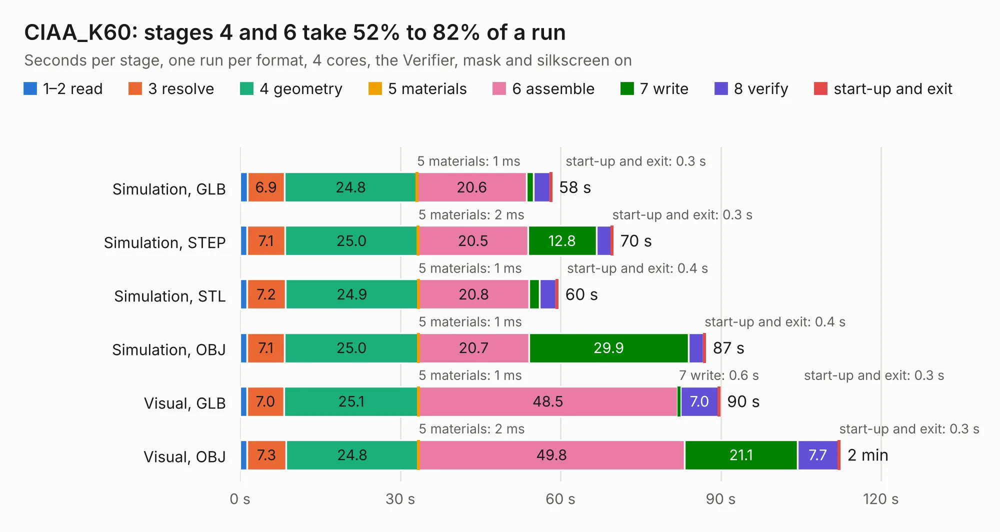

# 745. CIAA_K60

Board 745 of the 3,111 of [Corpus Testing](../Corpus-Testing.md), on [Corpus Page 7](../CorpusTestingPages/Corpus-Testing-07.md#745-ciaa_k60).

| Mode and format | 1–2 read | 3 resolve | 4 geometry | 5 materials | 6 assemble | 7 write | 8 verify | start-up and exit | Total |
|---|---:|---:|---:|---:|---:|---:|---:|---:|---:|
| Simulation, GLB | 1.4 | 6.9 | 24.8 | 1&nbsp;ms | 20.6 | 1.2 | 3.1 | 0.3 | 58.3 |
| Simulation, STEP | 1.3 | 7.1 | 25.0 | 2&nbsp;ms | 20.5 | 12.8 | 2.8 | 0.3 | 69.9 |
| Simulation, STL | 1.3 | 7.2 | 24.9 | 1&nbsp;ms | 20.8 | 1.9 | 3.1 | 0.4 | 59.5 |
| Simulation, OBJ | 1.3 | 7.1 | 25.0 | 1&nbsp;ms | 20.7 | 29.9 | 2.8 | 0.4 | 87.2 |
| Visual, GLB | 1.3 | 7.0 | 25.1 | 1&nbsp;ms | 48.5 | 0.6 | 7.0 | 0.3 | 89.8 |
| Visual, OBJ | 1.3 | 7.3 | 24.8 | 2&nbsp;ms | 49.8 | 21.1 | 7.7 | 0.3 | 112.3 |

<table align="center"><tr><td valign="top">

| Board | Repo: [ciaa/Hardware](https://github.com/ciaa/Hardware) Board: `CIAA_K60.kicad_pcb` |
|---|---|
| Folder | PCB / FSL / CIAA_K60 |
| Complexity | 337&nbsp;/&nbsp;1000 (size&nbsp;292, features&nbsp;45) |
| KESE&nbsp;features | through vias, filled zones, curved board outline |
| Tested | 9th November 2026 |
| Copper&nbsp;layers | 4 |
| File&nbsp;format | KiCad 3 (3) |
| Parts,&nbsp;tracks,&nbsp;vias | 455, 4,461, 456 |
| Triangles,&nbsp;simulation | 4,924,524 in 340 parts |
| Verifier | PASS in all six runs |

</td><td valign="top">

<table>
<tr><th>File type</th><th>File size</th><th>Peak memory used</th></tr>
<tr><th colspan="3" align="left">Simulation</th></tr>
<tr><td>GLB</td><td align="right">176&nbsp;MB</td><td align="right">1.4&nbsp;GB</td></tr>
<tr><td>STEP</td><td align="right">795&nbsp;MB</td><td align="right">1.8&nbsp;GB</td></tr>
<tr><td>STL</td><td align="right">246&nbsp;MB</td><td align="right">1.4&nbsp;GB</td></tr>
<tr><td>OBJ</td><td align="right">544&nbsp;MB</td><td align="right">3.3&nbsp;GB</td></tr>
<tr><th colspan="3" align="left">Visual</th></tr>
<tr><td>GLB</td><td align="right">125&nbsp;MB</td><td align="right">2.0&nbsp;GB</td></tr>
<tr><td>OBJ</td><td align="right">394&nbsp;MB</td><td align="right">2.6&nbsp;GB</td></tr>
</table>

</td></tr></table>

| Previous | Next |
|:---|---:|
| [744. CIAA_FSL_MINI](b0744b_Hardware_CIAA-FSL-MINI.md) | [746. ciaa-nxp](b0746b_Hardware_ciaa-nxp.md) |
