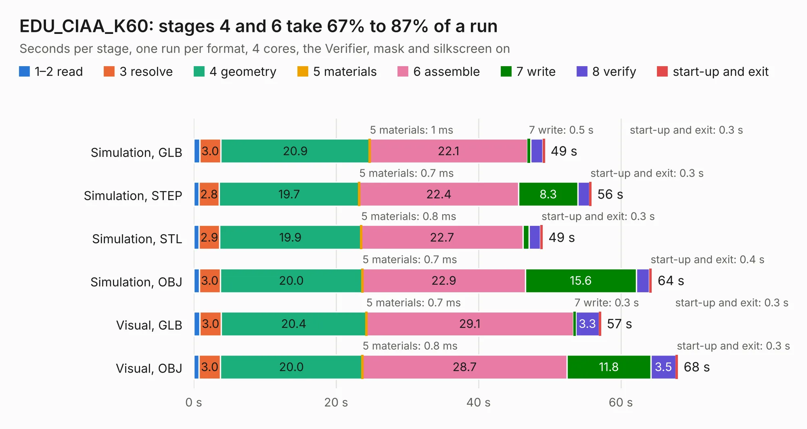

# 745. EDU_CIAA_K60

Board 745 of the 3,116 of [Corpus Testing](../Corpus-Testing.md), on [Corpus Page 7](../CorpusTestingPages/Corpus-Testing-07.md#745-edu_ciaa_k60).

| Mode and format | 1–2 read | 3 resolve | 4 geometry | 5 materials | 6 assemble | 7 write | 8 verify | start-up and exit | Total |
|---|---:|---:|---:|---:|---:|---:|---:|---:|---:|
| Simulation, GLB | 0.8 | 3.0 | 20.9 | 1&nbsp;ms | 22.1 | 0.5 | 1.7 | 0.3 | 49.3 |
| Simulation, STEP | 0.8 | 2.8 | 19.7 | 0.7&nbsp;ms | 22.4 | 8.3 | 1.6 | 0.3 | 55.9 |
| Simulation, STL | 0.7 | 2.9 | 19.9 | 0.8&nbsp;ms | 22.7 | 0.8 | 1.6 | 0.3 | 49.0 |
| Simulation, OBJ | 0.8 | 3.0 | 20.0 | 0.7&nbsp;ms | 22.9 | 15.6 | 1.8 | 0.4 | 64.4 |
| Visual, GLB | 0.9 | 3.0 | 20.4 | 0.7&nbsp;ms | 29.1 | 0.3 | 3.3 | 0.3 | 57.2 |
| Visual, OBJ | 0.7 | 3.0 | 20.0 | 0.8&nbsp;ms | 28.7 | 11.8 | 3.5 | 0.3 | 68.0 |

<table align="center"><tr><td valign="top">

| Board | Repo: [ciaa/Hardware](https://github.com/ciaa/Hardware) Board: `EDU_CIAA_K60.kicad_pcb` |
|---|---|
| Folder | PCB / EDU-FSL / EDU_CIAA_K60 |
| Complexity | 307&nbsp;/&nbsp;1000 (size&nbsp;252, features&nbsp;55) |
| KESE&nbsp;features | through vias, slotted holes, filled zones, curved board outline |
| Tested | 9th November 2026 |
| Copper&nbsp;layers | 2 |
| File&nbsp;format | KiCad 4 (4) |
| Parts,&nbsp;tracks,&nbsp;vias | 177, 2,647, 173 |
| Triangles,&nbsp;simulation | 2,377,654 in 250 parts |
| Verifier | PASS in all six runs |

</td><td valign="top">

<table>
<tr><th>File type</th><th>File size</th><th>Peak memory used</th></tr>
<tr><th colspan="3" align="left">Simulation</th></tr>
<tr><td>GLB</td><td align="right">85&nbsp;MB</td><td align="right">878&nbsp;MB</td></tr>
<tr><td>STEP</td><td align="right">460&nbsp;MB</td><td align="right">1.2&nbsp;GB</td></tr>
<tr><td>STL</td><td align="right">119&nbsp;MB</td><td align="right">880&nbsp;MB</td></tr>
<tr><td>OBJ</td><td align="right">259&nbsp;MB</td><td align="right">1.6&nbsp;GB</td></tr>
<tr><th colspan="3" align="left">Visual</th></tr>
<tr><td>GLB</td><td align="right">68&nbsp;MB</td><td align="right">1.3&nbsp;GB</td></tr>
<tr><td>OBJ</td><td align="right">208&nbsp;MB</td><td align="right">1.4&nbsp;GB</td></tr>
</table>

</td></tr></table>

| Previous | Next |
|:---|---:|
| [744. FPGA para todos](b0744b_Hardware_FPGA-para-todos.md) | [746. edk](b0746b_Hardware_edk.md) |
