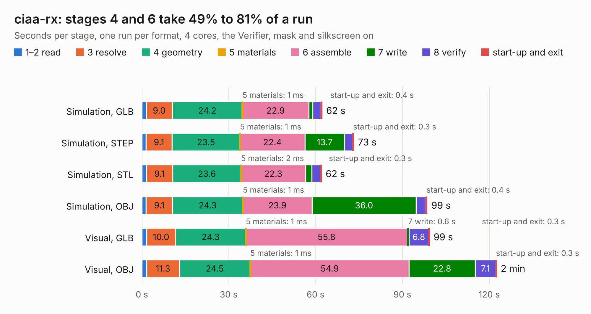

# 745. ciaa-rx

Board 745 of the 3,100 of [Corpus Testing](../Corpus-Testing.md), on [Corpus Page 7](../CorpusTestingPages/Corpus-Testing-07.md#745-ciaa-rx).

| Mode and format | 1–2 read | 3 resolve | 4 geometry | 5 materials | 6 assemble | 7 write | 8 verify | start-up and exit | Total |
|---|---:|---:|---:|---:|---:|---:|---:|---:|---:|
| Simulation, GLB | 1.5 | 9.0 | 24.2 | 1&nbsp;ms | 22.9 | 1.3 | 2.9 | 0.4 | 62.2 |
| Simulation, STEP | 1.4 | 9.1 | 23.5 | 1&nbsp;ms | 22.4 | 13.7 | 2.8 | 0.3 | 73.2 |
| Simulation, STL | 1.5 | 9.1 | 23.6 | 2&nbsp;ms | 22.3 | 2.2 | 3.0 | 0.3 | 62.0 |
| Simulation, OBJ | 1.5 | 9.1 | 24.3 | 1&nbsp;ms | 23.9 | 36.0 | 3.4 | 0.4 | 98.5 |
| Visual, GLB | 1.6 | 10.0 | 24.3 | 1&nbsp;ms | 55.8 | 0.6 | 6.8 | 0.3 | 99.3 |
| Visual, OBJ | 1.7 | 11.3 | 24.5 | 1&nbsp;ms | 54.9 | 22.8 | 7.1 | 0.3 | 122.5 |

<table align="center"><tr><td valign="top">

| Board | Repo: [ciaa/Hardware](https://github.com/ciaa/Hardware) Board: `ciaa-rx.kicad_pcb` |
|---|---|
| Folder | PCB / RX / hw |
| Complexity | 331&nbsp;/&nbsp;1000 (size&nbsp;296, features&nbsp;35) |
| KESE&nbsp;features | through vias, filled zones |
| Tested | 9th November 2026 |
| Copper&nbsp;layers | 4 |
| File&nbsp;format | KiCad 3 (3) |
| Parts,&nbsp;tracks,&nbsp;vias | 437, 7,689, 615 |
| Triangles,&nbsp;simulation | 5,637,478 in 419 parts |
| Verifier | PASS in all six runs |

</td><td valign="top">

<table>
<tr><th>File type</th><th>File size</th><th>Peak memory used</th></tr>
<tr><th colspan="3" align="left">Simulation</th></tr>
<tr><td>GLB</td><td align="right">199&nbsp;MB</td><td align="right">1.7&nbsp;GB</td></tr>
<tr><td>STEP</td><td align="right">887&nbsp;MB</td><td align="right">2.0&nbsp;GB</td></tr>
<tr><td>STL</td><td align="right">282&nbsp;MB</td><td align="right">1.7&nbsp;GB</td></tr>
<tr><td>OBJ</td><td align="right">618&nbsp;MB</td><td align="right">3.7&nbsp;GB</td></tr>
<tr><th colspan="3" align="left">Visual</th></tr>
<tr><td>GLB</td><td align="right">135&nbsp;MB</td><td align="right">2.0&nbsp;GB</td></tr>
<tr><td>OBJ</td><td align="right">431&nbsp;MB</td><td align="right">2.9&nbsp;GB</td></tr>
</table>

</td></tr></table>

| Previous | Next |
|:---|---:|
| [744. .kicad_pcb](b0744b_Hardware_kicad-pcb.md) | [746. CIAA_Safety_VTI_1.0](b0746b_Hardware_CIAA-Safety-VTI-1-0.md) |
