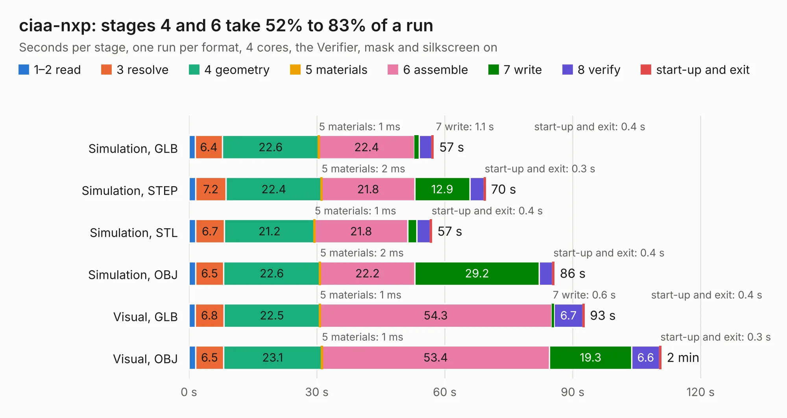

# 746. ciaa-nxp

Board 746 of the 3,108 of [Corpus Testing](../Corpus-Testing.md), on [Corpus Page 7](../CorpusTestingPages/Corpus-Testing-07.md#746-ciaa-nxp).

| Mode and format | 1–2 read | 3 resolve | 4 geometry | 5 materials | 6 assemble | 7 write | 8 verify | start-up and exit | Total |
|---|---:|---:|---:|---:|---:|---:|---:|---:|---:|
| Simulation, GLB | 1.5 | 6.4 | 22.6 | 1&nbsp;ms | 22.4 | 1.1 | 3.0 | 0.4 | 57.4 |
| Simulation, STEP | 1.6 | 7.2 | 22.4 | 2&nbsp;ms | 21.8 | 12.9 | 3.3 | 0.3 | 69.5 |
| Simulation, STL | 1.6 | 6.7 | 21.2 | 1&nbsp;ms | 21.8 | 2.1 | 3.2 | 0.4 | 56.9 |
| Simulation, OBJ | 1.6 | 6.5 | 22.6 | 2&nbsp;ms | 22.2 | 29.2 | 3.1 | 0.4 | 85.7 |
| Visual, GLB | 1.5 | 6.8 | 22.5 | 1&nbsp;ms | 54.3 | 0.6 | 6.7 | 0.4 | 92.7 |
| Visual, OBJ | 1.6 | 6.5 | 23.1 | 1&nbsp;ms | 53.4 | 19.3 | 6.6 | 0.3 | 110.7 |

<table align="center"><tr><td valign="top">

| Board | Repo: [ciaa/Hardware](https://github.com/ciaa/Hardware) Board: `ciaa-nxp.kicad_pcb` |
|---|---|
| Folder | PCB / NXP |
| Complexity | 332&nbsp;/&nbsp;1000 (size&nbsp;297, features&nbsp;35) |
| KESE&nbsp;features | through vias, filled zones |
| Tested | 9th November 2026 |
| Copper&nbsp;layers | 4 |
| File&nbsp;format | KiCad 5 (20171130) |
| Parts,&nbsp;tracks,&nbsp;vias | 430, 8,086, 618 |
| Triangles,&nbsp;simulation | 5,554,394 in 389 parts |
| Verifier | PASS in all six runs |

</td><td valign="top">

<table>
<tr><th>File type</th><th>File size</th><th>Peak memory used</th></tr>
<tr><th colspan="3" align="left">Simulation</th></tr>
<tr><td>GLB</td><td align="right">197&nbsp;MB</td><td align="right">1.6&nbsp;GB</td></tr>
<tr><td>STEP</td><td align="right">840&nbsp;MB</td><td align="right">1.9&nbsp;GB</td></tr>
<tr><td>STL</td><td align="right">278&nbsp;MB</td><td align="right">1.6&nbsp;GB</td></tr>
<tr><td>OBJ</td><td align="right">610&nbsp;MB</td><td align="right">3.6&nbsp;GB</td></tr>
<tr><th colspan="3" align="left">Visual</th></tr>
<tr><td>GLB</td><td align="right">130&nbsp;MB</td><td align="right">2.1&nbsp;GB</td></tr>
<tr><td>OBJ</td><td align="right">414&nbsp;MB</td><td align="right">2.8&nbsp;GB</td></tr>
</table>

</td></tr></table>

| Previous | Next |
|:---|---:|
| [745. CIAA_K60](b0745b_Hardware_CIAA-K60.md) | [747. ciaa-pic](b0747b_Hardware_ciaa-pic.md) |
