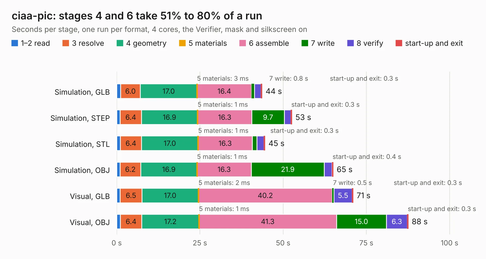

# 747. ciaa-pic

Board 747 of the 3,106 of [Corpus Testing](../Corpus-Testing.md), on [Corpus Page 7](../CorpusTestingPages/Corpus-Testing-07.md#747-ciaa-pic).

| Mode and format | 1–2 read | 3 resolve | 4 geometry | 5 materials | 6 assemble | 7 write | 8 verify | start-up and exit | Total |
|---|---:|---:|---:|---:|---:|---:|---:|---:|---:|
| Simulation, GLB | 1.2 | 6.0 | 17.0 | 3&nbsp;ms | 16.4 | 0.8 | 2.0 | 0.3 | 43.7 |
| Simulation, STEP | 1.1 | 6.4 | 16.9 | 1&nbsp;ms | 16.3 | 9.7 | 2.0 | 0.3 | 52.6 |
| Simulation, STL | 1.1 | 6.4 | 17.0 | 1&nbsp;ms | 16.3 | 1.4 | 2.1 | 0.3 | 44.6 |
| Simulation, OBJ | 1.0 | 6.2 | 16.9 | 1&nbsp;ms | 16.3 | 21.9 | 2.3 | 0.4 | 65.0 |
| Visual, GLB | 1.0 | 6.5 | 17.0 | 2&nbsp;ms | 40.2 | 0.5 | 5.5 | 0.3 | 71.0 |
| Visual, OBJ | 1.1 | 6.4 | 17.2 | 1&nbsp;ms | 41.3 | 15.0 | 6.3 | 0.3 | 87.6 |

<table align="center"><tr><td valign="top">

| Board | Repo: [ciaa/Hardware](https://github.com/ciaa/Hardware) Board: `ciaa-pic.kicad_pcb` |
|---|---|
| Folder | PCB / PIC |
| Complexity | 340&nbsp;/&nbsp;1000 (size&nbsp;295, features&nbsp;45) |
| KESE&nbsp;features | through vias, filled zones, curved board outline |
| Tested | 9th November 2026 |
| Copper&nbsp;layers | 4 |
| File&nbsp;format | KiCad 4 (4) |
| Parts,&nbsp;tracks,&nbsp;vias | 423, 5,588, 506 |
| Triangles,&nbsp;simulation | 4,767,406 in 329 parts |
| Verifier | PASS in all six runs |

</td><td valign="top">

<table>
<tr><th>File type</th><th>File size</th><th>Peak memory used</th></tr>
<tr><th colspan="3" align="left">Simulation</th></tr>
<tr><td>GLB</td><td align="right">170&nbsp;MB</td><td align="right">1.3&nbsp;GB</td></tr>
<tr><td>STEP</td><td align="right">762&nbsp;MB</td><td align="right">1.8&nbsp;GB</td></tr>
<tr><td>STL</td><td align="right">238&nbsp;MB</td><td align="right">1.4&nbsp;GB</td></tr>
<tr><td>OBJ</td><td align="right">524&nbsp;MB</td><td align="right">3.2&nbsp;GB</td></tr>
<tr><th colspan="3" align="left">Visual</th></tr>
<tr><td>GLB</td><td align="right">119&nbsp;MB</td><td align="right">1.9&nbsp;GB</td></tr>
<tr><td>OBJ</td><td align="right">376&nbsp;MB</td><td align="right">2.5&nbsp;GB</td></tr>
</table>

</td></tr></table>

| Previous | Next |
|:---|---:|
| [746. ciaa-nxp](b0746b_Hardware_ciaa-nxp.md) | [748. picociaa](b0748b_Hardware_picociaa.md) |
