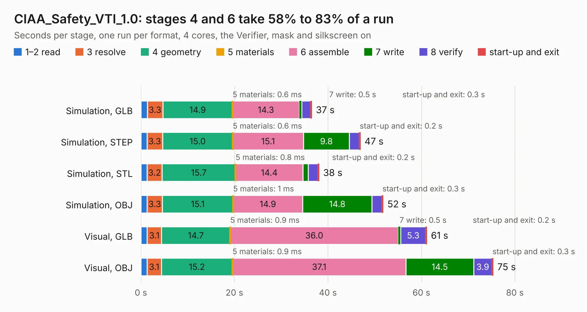

# 751. CIAA_Safety_VTI_1.0

Board 751 of the 3,106 of [Corpus Testing](../Corpus-Testing.md), on [Corpus Page 7](../CorpusTestingPages/Corpus-Testing-07.md#751-ciaa_safety_vti_10).

| Mode and format | 1–2 read | 3 resolve | 4 geometry | 5 materials | 6 assemble | 7 write | 8 verify | start-up and exit | Total |
|---|---:|---:|---:|---:|---:|---:|---:|---:|---:|
| Simulation, GLB | 1.4 | 3.3 | 14.9 | 0.6&nbsp;ms | 14.3 | 0.5 | 1.9 | 0.3 | 36.5 |
| Simulation, STEP | 1.3 | 3.3 | 15.0 | 0.6&nbsp;ms | 15.1 | 9.8 | 2.1 | 0.2 | 46.9 |
| Simulation, STL | 1.3 | 3.2 | 15.7 | 0.8&nbsp;ms | 14.4 | 1.1 | 2.0 | 0.2 | 38.1 |
| Simulation, OBJ | 1.3 | 3.3 | 15.1 | 1&nbsp;ms | 14.9 | 14.8 | 2.1 | 0.3 | 51.8 |
| Visual, GLB | 1.3 | 3.1 | 14.7 | 0.9&nbsp;ms | 36.0 | 0.5 | 5.3 | 0.2 | 61.1 |
| Visual, OBJ | 1.3 | 3.1 | 15.2 | 0.9&nbsp;ms | 37.1 | 14.5 | 3.9 | 0.3 | 75.3 |

<table align="center"><tr><td valign="top">

| Board | Repo: [ciaa/Hardware](https://github.com/ciaa/Hardware) Board: `CIAA_Safety_VTI_1.0.kicad_pcb` |
|---|---|
| Folder | PCB / Safety |
| Complexity | 309&nbsp;/&nbsp;1000 (size&nbsp;264, features&nbsp;45) |
| KESE&nbsp;features | through vias, drill offsets, filled zones |
| Tested | 9th November 2026 |
| Copper&nbsp;layers | 2 |
| File&nbsp;format | KiCad 4 (4) |
| Parts,&nbsp;tracks,&nbsp;vias | 275, 6,269, 370 |
| Triangles,&nbsp;simulation | 3,642,146 in 252 parts |
| Verifier | PASS in all six runs |

</td><td valign="top">

<table>
<tr><th>File type</th><th>File size</th><th>Peak memory used</th></tr>
<tr><th colspan="3" align="left">Simulation</th></tr>
<tr><td>GLB</td><td align="right">127&nbsp;MB</td><td align="right">1.2&nbsp;GB</td></tr>
<tr><td>STEP</td><td align="right">732&nbsp;MB</td><td align="right">1.7&nbsp;GB</td></tr>
<tr><td>STL</td><td align="right">182&nbsp;MB</td><td align="right">1.2&nbsp;GB</td></tr>
<tr><td>OBJ</td><td align="right">391&nbsp;MB</td><td align="right">2.4&nbsp;GB</td></tr>
<tr><th colspan="3" align="left">Visual</th></tr>
<tr><td>GLB</td><td align="right">117&nbsp;MB</td><td align="right">1.8&nbsp;GB</td></tr>
<tr><td>OBJ</td><td align="right">366&nbsp;MB</td><td align="right">2.4&nbsp;GB</td></tr>
</table>

</td></tr></table>

| Previous | Next |
|:---|---:|
| [750. ciaa-rx](b0750b_Hardware_ciaa-rx.md) | [752. ciaa-z3r0](b0752b_Hardware_ciaa-z3r0.md) |
