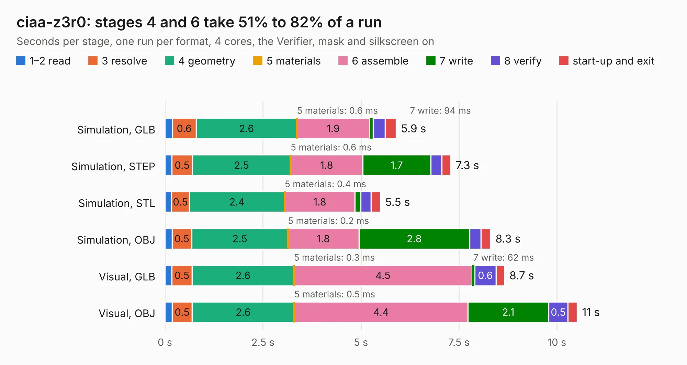

# 753. ciaa-z3r0

Board 753 of the 3,112 of [Corpus Testing](../Corpus-Testing.md), on [Corpus Page 7](../CorpusTestingPages/Corpus-Testing-07.md#753-ciaa-z3r0).

| Mode and format | 1–2 read | 3 resolve | 4 geometry | 5 materials | 6 assemble | 7 write | 8 verify | start-up and exit | Total |
|---|---:|---:|---:|---:|---:|---:|---:|---:|---:|
| Simulation, GLB | 0.2 | 0.6 | 2.6 | 0.6&nbsp;ms | 1.9 | 94&nbsp;ms | 0.3 | 0.3 | 5.9 |
| Simulation, STEP | 0.2 | 0.5 | 2.5 | 0.6&nbsp;ms | 1.8 | 1.7 | 0.3 | 0.2 | 7.3 |
| Simulation, STL | 0.2 | 0.5 | 2.4 | 0.4&nbsp;ms | 1.8 | 0.1 | 0.3 | 0.2 | 5.5 |
| Simulation, OBJ | 0.2 | 0.5 | 2.5 | 0.2&nbsp;ms | 1.8 | 2.8 | 0.3 | 0.2 | 8.3 |
| Visual, GLB | 0.2 | 0.5 | 2.6 | 0.3&nbsp;ms | 4.5 | 62&nbsp;ms | 0.6 | 0.2 | 8.7 |
| Visual, OBJ | 0.2 | 0.5 | 2.6 | 0.5&nbsp;ms | 4.4 | 2.1 | 0.5 | 0.2 | 10.5 |

<table align="center"><tr><td valign="top">

| Board | Repo: [ciaa/Hardware](https://github.com/ciaa/Hardware) Board: `ciaa-z3r0.kicad_pcb` |
|---|---|
| Folder | PCB / Z3R0 |
| Complexity | 238&nbsp;/&nbsp;1000 (size&nbsp;203, features&nbsp;35) |
| KESE&nbsp;features | through vias, filled zones |
| Tested | 9th November 2026 |
| Copper&nbsp;layers | 2 |
| File&nbsp;format | KiCad 5 (20170123) |
| Parts,&nbsp;tracks,&nbsp;vias | 33, 652, 30 |
| Triangles,&nbsp;simulation | 500,440 in 65 parts |
| Verifier | PASS in all six runs |

</td><td valign="top">

<table>
<tr><th>File type</th><th>File size</th><th>Peak memory used</th></tr>
<tr><th colspan="3" align="left">Simulation</th></tr>
<tr><td>GLB</td><td align="right">18&nbsp;MB</td><td align="right">291&nbsp;MB</td></tr>
<tr><td>STEP</td><td align="right">88&nbsp;MB</td><td align="right">322&nbsp;MB</td></tr>
<tr><td>STL</td><td align="right">25&nbsp;MB</td><td align="right">292&nbsp;MB</td></tr>
<tr><td>OBJ</td><td align="right">51&nbsp;MB</td><td align="right">383&nbsp;MB</td></tr>
<tr><th colspan="3" align="left">Visual</th></tr>
<tr><td>GLB</td><td align="right">13&nbsp;MB</td><td align="right">361&nbsp;MB</td></tr>
<tr><td>OBJ</td><td align="right">37&nbsp;MB</td><td align="right">357&nbsp;MB</td></tr>
</table>

</td></tr></table>

| Previous | Next |
|:---|---:|
| [752. CIAA_Safety_VTI_1.0](b0752b_Hardware_CIAA-Safety-VTI-1-0.md) | [754. vme-wren](b0754b_kicad-demo-vme-wren_vme-wren.md) |
