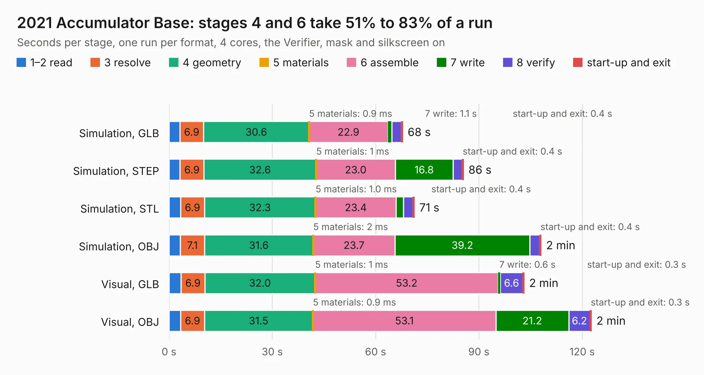

# 754. 2021 Accumulator Base

Board 754 of the 3,106 of [Corpus Testing](../Corpus-Testing.md), on [Corpus Page 7](../CorpusTestingPages/Corpus-Testing-07.md#754-2021-accumulator-base).

| Mode and format | 1–2 read | 3 resolve | 4 geometry | 5 materials | 6 assemble | 7 write | 8 verify | start-up and exit | Total |
|---|---:|---:|---:|---:|---:|---:|---:|---:|---:|
| Simulation, GLB | 3.2 | 6.9 | 30.6 | 0.9&nbsp;ms | 22.9 | 1.1 | 2.8 | 0.4 | 67.9 |
| Simulation, STEP | 3.2 | 6.9 | 32.6 | 1&nbsp;ms | 23.0 | 16.8 | 2.6 | 0.4 | 85.5 |
| Simulation, STL | 3.4 | 6.9 | 32.3 | 1.0&nbsp;ms | 23.4 | 2.2 | 2.7 | 0.4 | 71.2 |
| Simulation, OBJ | 3.3 | 7.1 | 31.6 | 2&nbsp;ms | 23.7 | 39.2 | 2.9 | 0.4 | 108.1 |
| Visual, GLB | 3.5 | 6.9 | 32.0 | 1&nbsp;ms | 53.2 | 0.6 | 6.6 | 0.3 | 103.1 |
| Visual, OBJ | 3.4 | 6.9 | 31.5 | 0.9&nbsp;ms | 53.1 | 21.2 | 6.2 | 0.3 | 122.7 |

<table align="center"><tr><td valign="top">

| Board | Repo: [columbia-fsae/2021_accumulator_electronics](https://github.com/columbia-fsae/2021_accumulator_electronics) Board: `2021 Accumulator Base.kicad_pcb` |
|---|---|
| Folder | Accumulator Base |
| Complexity | 269&nbsp;/&nbsp;1000 (size&nbsp;214, features&nbsp;55) |
| KESE&nbsp;features | through vias, rounded, trapezoid or chamfered pads, filled zones, curved board outline |
| Tested | 9th November 2026 |
| Copper&nbsp;layers | 4 |
| File&nbsp;format | KiCad 5 (20171130) |
| Parts,&nbsp;tracks,&nbsp;vias | 136, 1,402, 330 |
| Triangles,&nbsp;simulation | 5,674,802 in 209 parts |
| Verifier | PASS in all six runs |

</td><td valign="top">

<table>
<tr><th>File type</th><th>File size</th><th>Peak memory used</th></tr>
<tr><th colspan="3" align="left">Simulation</th></tr>
<tr><td>GLB</td><td align="right">193&nbsp;MB</td><td align="right">1.8&nbsp;GB</td></tr>
<tr><td>STEP</td><td align="right">832&nbsp;MB</td><td align="right">2.0&nbsp;GB</td></tr>
<tr><td>STL</td><td align="right">284&nbsp;MB</td><td align="right">1.7&nbsp;GB</td></tr>
<tr><td>OBJ</td><td align="right">611&nbsp;MB</td><td align="right">3.7&nbsp;GB</td></tr>
<tr><th colspan="3" align="left">Visual</th></tr>
<tr><td>GLB</td><td align="right">112&nbsp;MB</td><td align="right">1.9&nbsp;GB</td></tr>
<tr><td>OBJ</td><td align="right">352&nbsp;MB</td><td align="right">2.5&nbsp;GB</td></tr>
</table>

</td></tr></table>

| Previous | Next |
|:---|---:|
| [753. fmcw3](b0753b_fmcw3-kicad_fmcw3.md) | [755. AIL_TSAL](b0755b_2021-accumulator-electronics_AIL-TSAL.md) |
