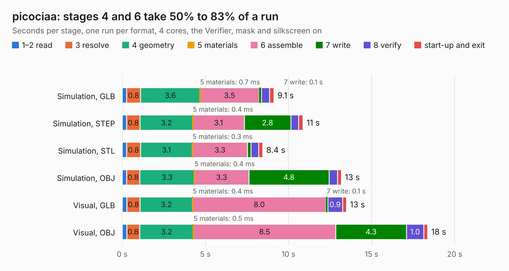

# 756. picociaa

Board 756 of the 3,130 of [Corpus Testing](../Corpus-Testing.md), on [Corpus Page 7](../CorpusTestingPages/Corpus-Testing-07.md#756-picociaa).

| Mode and format | 1–2 read | 3 resolve | 4 geometry | 5 materials | 6 assemble | 7 write | 8 verify | start-up and exit | Total |
|---|---:|---:|---:|---:|---:|---:|---:|---:|---:|
| Simulation, GLB | 0.3 | 0.8 | 3.6 | 0.7&nbsp;ms | 3.5 | 0.1 | 0.5 | 0.3 | 9.1 |
| Simulation, STEP | 0.3 | 0.8 | 3.2 | 0.4&nbsp;ms | 3.1 | 2.8 | 0.5 | 0.3 | 10.9 |
| Simulation, STL | 0.3 | 0.8 | 3.1 | 0.3&nbsp;ms | 3.3 | 0.2 | 0.5 | 0.2 | 8.4 |
| Simulation, OBJ | 0.3 | 0.8 | 3.3 | 0.4&nbsp;ms | 3.3 | 4.8 | 0.5 | 0.2 | 13.2 |
| Visual, GLB | 0.3 | 0.8 | 3.2 | 0.4&nbsp;ms | 8.0 | 0.1 | 0.9 | 0.2 | 13.5 |
| Visual, OBJ | 0.3 | 0.8 | 3.2 | 0.5&nbsp;ms | 8.5 | 4.3 | 1.0 | 0.2 | 18.4 |

<table align="center"><tr><td valign="top">

| Board | Repo: [ciaa/Hardware](https://github.com/ciaa/Hardware) Board: `picociaa.kicad_pcb` |
|---|---|
| Folder | PCB / pico |
| Complexity | 269&nbsp;/&nbsp;1000 (size&nbsp;224, features&nbsp;45) |
| KESE&nbsp;features | through vias, filled zones, curved board outline |
| Tested | 9th November 2026 |
| Copper&nbsp;layers | 2 |
| File&nbsp;format | KiCad 4 (4) |
| Parts,&nbsp;tracks,&nbsp;vias | 64, 868, 90 |
| Triangles,&nbsp;simulation | 823,776 in 101 parts |
| Verifier | PASS in all six runs |

</td><td valign="top">

<table>
<tr><th>File type</th><th>File size</th><th>Peak memory used</th></tr>
<tr><th colspan="3" align="left">Simulation</th></tr>
<tr><td>GLB</td><td align="right">29&nbsp;MB</td><td align="right">431&nbsp;MB</td></tr>
<tr><td>STEP</td><td align="right">148&nbsp;MB</td><td align="right">483&nbsp;MB</td></tr>
<tr><td>STL</td><td align="right">41&nbsp;MB</td><td align="right">430&nbsp;MB</td></tr>
<tr><td>OBJ</td><td align="right">84&nbsp;MB</td><td align="right">537&nbsp;MB</td></tr>
<tr><th colspan="3" align="left">Visual</th></tr>
<tr><td>GLB</td><td align="right">24&nbsp;MB</td><td align="right">607&nbsp;MB</td></tr>
<tr><td>OBJ</td><td align="right">72&nbsp;MB</td><td align="right">591&nbsp;MB</td></tr>
</table>

</td></tr></table>

| Previous | Next |
|:---|---:|
| [755. ciaa-pic](b0755b_Hardware_ciaa-pic.md) | [757. .kicad_pcb](b0757b_Hardware_kicad-pcb.md) |
