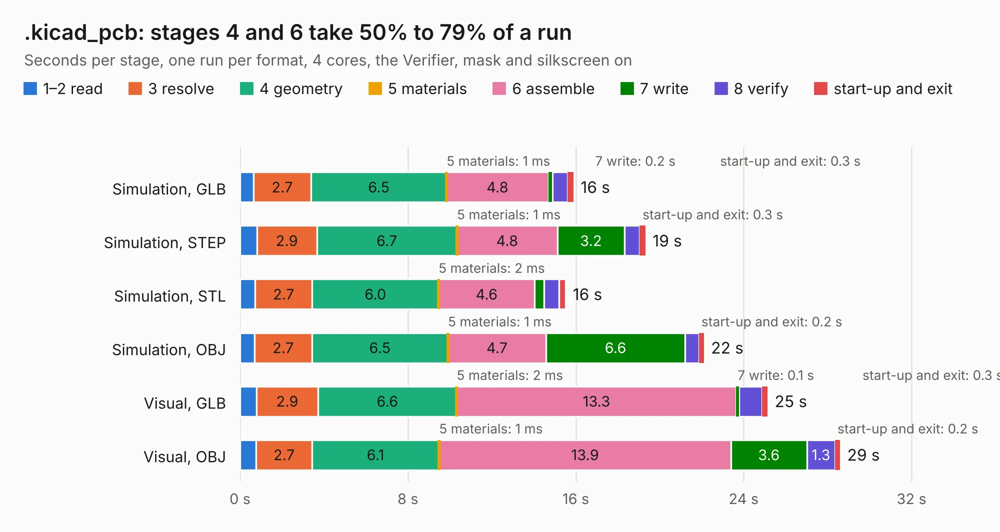

# 758. .kicad_pcb

Board 758 of the 3,132 of [Corpus Testing](../Corpus-Testing.md), on [Corpus Page 8](../CorpusTestingPages/Corpus-Testing-08.md#758-kicad_pcb).

| Mode and format | 1–2 read | 3 resolve | 4 geometry | 5 materials | 6 assemble | 7 write | 8 verify | start-up and exit | Total |
|---|---:|---:|---:|---:|---:|---:|---:|---:|---:|
| Simulation, GLB | 0.6 | 2.7 | 6.5 | 1&nbsp;ms | 4.8 | 0.2 | 0.7 | 0.3 | 15.9 |
| Simulation, STEP | 0.8 | 2.9 | 6.7 | 1&nbsp;ms | 4.8 | 3.2 | 0.7 | 0.3 | 19.3 |
| Simulation, STL | 0.7 | 2.7 | 6.0 | 2&nbsp;ms | 4.6 | 0.5 | 0.7 | 0.3 | 15.5 |
| Simulation, OBJ | 0.7 | 2.7 | 6.5 | 1&nbsp;ms | 4.7 | 6.6 | 0.7 | 0.2 | 22.1 |
| Visual, GLB | 0.8 | 2.9 | 6.6 | 2&nbsp;ms | 13.3 | 0.1 | 1.1 | 0.3 | 25.1 |
| Visual, OBJ | 0.8 | 2.7 | 6.1 | 1&nbsp;ms | 13.9 | 3.6 | 1.3 | 0.2 | 28.6 |

<table align="center"><tr><td valign="top">

| Board | Repo: [ciaa/Hardware](https://github.com/ciaa/Hardware) Board: `.kicad_pcb.kicad_pcb` |
|---|---|
| Folder | PCB / RX / hw |
| Complexity | 145&nbsp;/&nbsp;1000 (size&nbsp;145, features&nbsp;0) |
| Tested | 9th November 2026 |
| Copper&nbsp;layers | 4 |
| File&nbsp;format | KiCad 3 (3) |
| Parts,&nbsp;tracks,&nbsp;vias | 418, 0, 0 |
| Triangles,&nbsp;simulation | 1,351,032 in 323 parts |
| Note | mostly unrouted |
| Verifier | Simulation, GLB: Verifier FAIL Simulation, STEP: Verifier FAIL Simulation, STL: Verifier FAIL Simulation, OBJ: Verifier FAIL |
| Bad&nbsp;design | Bad design according to KESE: copper of two nets on top of each other in the file, a short KiCad's DRC reports; terminal blocks J10 and J11 placed overlapping at (67.15, 16.50) mm: J10 pad 1 (net `N-00000409`) and J11 pad 3 (no net), plated holes 0.06 mm apart. KESE models what the file says, so the Verifier rightly finds the two nets' solids overlapping |

</td><td valign="top">

<table>
<tr><th>File type</th><th>File size</th><th>Peak memory used</th></tr>
<tr><th colspan="3" align="left">Simulation</th></tr>
<tr><td>GLB</td><td align="right">44&nbsp;MB</td><td align="right">478&nbsp;MB</td></tr>
<tr><td>STEP</td><td align="right">153&nbsp;MB</td><td align="right">582&nbsp;MB</td></tr>
<tr><td>STL</td><td align="right">68&nbsp;MB</td><td align="right">501&nbsp;MB</td></tr>
<tr><td>OBJ</td><td align="right">140&nbsp;MB</td><td align="right">936&nbsp;MB</td></tr>
<tr><th colspan="3" align="left">Visual</th></tr>
<tr><td>GLB</td><td align="right">28&nbsp;MB</td><td align="right">764&nbsp;MB</td></tr>
<tr><td>OBJ</td><td align="right">83&nbsp;MB</td><td align="right">728&nbsp;MB</td></tr>
</table>

</td></tr></table>

| Previous | Next |
|:---|---:|
| [757. picociaa](b0757b_Hardware_picociaa.md) | [759. ciaa-rx](b0759b_Hardware_ciaa-rx.md) |
