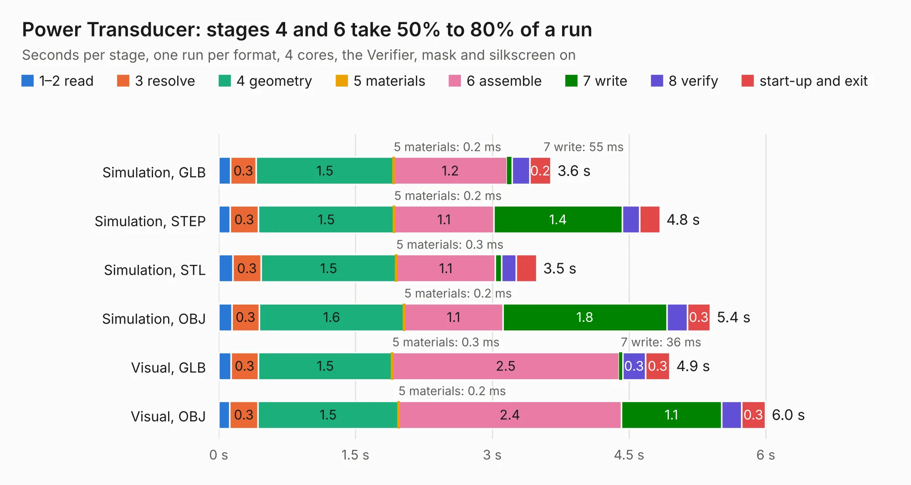

# 759. Power Transducer

Board 759 of the 3,108 of [Corpus Testing](../Corpus-Testing.md), on [Corpus Page 8](../CorpusTestingPages/Corpus-Testing-08.md#759-power-transducer).

| Mode and format | 1–2 read | 3 resolve | 4 geometry | 5 materials | 6 assemble | 7 write | 8 verify | start-up and exit | Total |
|---|---:|---:|---:|---:|---:|---:|---:|---:|---:|
| Simulation, GLB | 0.1 | 0.3 | 1.5 | 0.2&nbsp;ms | 1.2 | 55&nbsp;ms | 0.2 | 0.2 | 3.6 |
| Simulation, STEP | 0.1 | 0.3 | 1.5 | 0.2&nbsp;ms | 1.1 | 1.4 | 0.2 | 0.2 | 4.8 |
| Simulation, STL | 0.2 | 0.3 | 1.5 | 0.3&nbsp;ms | 1.1 | 66&nbsp;ms | 0.2 | 0.2 | 3.5 |
| Simulation, OBJ | 0.1 | 0.3 | 1.6 | 0.2&nbsp;ms | 1.1 | 1.8 | 0.2 | 0.3 | 5.4 |
| Visual, GLB | 0.1 | 0.3 | 1.5 | 0.3&nbsp;ms | 2.5 | 36&nbsp;ms | 0.3 | 0.3 | 4.9 |
| Visual, OBJ | 0.1 | 0.3 | 1.5 | 0.2&nbsp;ms | 2.4 | 1.1 | 0.2 | 0.3 | 6.0 |

<table align="center"><tr><td valign="top">

| Board | Repo: [columbia-fsae/2021_accumulator_electronics](https://github.com/columbia-fsae/2021_accumulator_electronics) Board: `Power Transducer.kicad_pcb` |
|---|---|
| Folder | Power Transducer-Shield / 07-02-2020 |
| Complexity | 182&nbsp;/&nbsp;1000 (size&nbsp;127, features&nbsp;55) |
| KESE&nbsp;features | through vias, rounded, trapezoid or chamfered pads, filled zones, curved board outline |
| Tested | 9th November 2026 |
| Copper&nbsp;layers | 2 |
| File&nbsp;format | KiCad 5 (20171130) |
| Parts,&nbsp;tracks,&nbsp;vias | 19, 84, 11 |
| Triangles,&nbsp;simulation | 287,172 in 28 parts |
| Verifier | PASS in all six runs |

</td><td valign="top">

<table>
<tr><th>File type</th><th>File size</th><th>Peak memory used</th></tr>
<tr><th colspan="3" align="left">Simulation</th></tr>
<tr><td>GLB</td><td align="right">10.0&nbsp;MB</td><td align="right">247&nbsp;MB</td></tr>
<tr><td>STEP</td><td align="right">49&nbsp;MB</td><td align="right">251&nbsp;MB</td></tr>
<tr><td>STL</td><td align="right">14&nbsp;MB</td><td align="right">245&nbsp;MB</td></tr>
<tr><td>OBJ</td><td align="right">29&nbsp;MB</td><td align="right">239&nbsp;MB</td></tr>
<tr><th colspan="3" align="left">Visual</th></tr>
<tr><td>GLB</td><td align="right">6.5&nbsp;MB</td><td align="right">222&nbsp;MB</td></tr>
<tr><td>OBJ</td><td align="right">19&nbsp;MB</td><td align="right">223&nbsp;MB</td></tr>
</table>

</td></tr></table>

| Previous | Next |
|:---|---:|
| [758. Inverter ISO Analog](b0758b_2021-accumulator-electronics_Inverter-ISO-Analog.md) | [760. panel_proto_data_slicer_board](b0760b_adsbee_panel-proto-data-slicer-board.md) |
