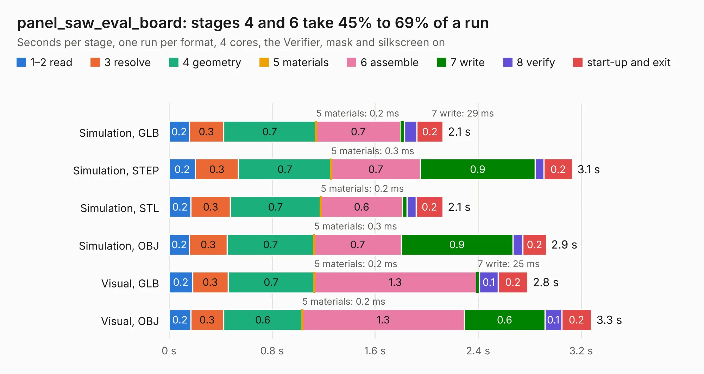

# 761. panel_saw_eval_board

Board 761 of the 3,103 of [Corpus Testing](../Corpus-Testing.md), on [Corpus Page 8](../CorpusTestingPages/Corpus-Testing-08.md#761-panel_saw_eval_board).

| Mode and format | 1–2 read | 3 resolve | 4 geometry | 5 materials | 6 assemble | 7 write | 8 verify | start-up and exit | Total |
|---|---:|---:|---:|---:|---:|---:|---:|---:|---:|
| Simulation, GLB | 0.2 | 0.3 | 0.7 | 0.2&nbsp;ms | 0.7 | 29&nbsp;ms | 97&nbsp;ms | 0.2 | 2.1 |
| Simulation, STEP | 0.2 | 0.3 | 0.7 | 0.3&nbsp;ms | 0.7 | 0.9 | 69&nbsp;ms | 0.2 | 3.1 |
| Simulation, STL | 0.2 | 0.3 | 0.7 | 0.2&nbsp;ms | 0.6 | 35&nbsp;ms | 70&nbsp;ms | 0.2 | 2.1 |
| Simulation, OBJ | 0.2 | 0.3 | 0.7 | 0.3&nbsp;ms | 0.7 | 0.9 | 78&nbsp;ms | 0.2 | 2.9 |
| Visual, GLB | 0.2 | 0.3 | 0.7 | 0.2&nbsp;ms | 1.3 | 25&nbsp;ms | 0.1 | 0.2 | 2.8 |
| Visual, OBJ | 0.2 | 0.3 | 0.6 | 0.2&nbsp;ms | 1.3 | 0.6 | 0.1 | 0.2 | 3.3 |

<table align="center"><tr><td valign="top">

| Board | Repo: [CoolNamesAllTaken/adsbee](https://github.com/CoolNamesAllTaken/adsbee) Board: `panel_saw_eval_board.kicad_pcb` |
|---|---|
| Folder | kicad / prototyping / panel_saw_eval_board |
| Complexity | 201&nbsp;/&nbsp;1000 (size&nbsp;151, features&nbsp;50) |
| KESE&nbsp;features | through vias, filled zones, knockout text |
| Tested | 9th November 2026 |
| Copper&nbsp;layers | 2 |
| File&nbsp;format | KiCad 8 (20240108) |
| Parts,&nbsp;tracks,&nbsp;vias | 36, 48, 96 |
| Triangles,&nbsp;simulation | 147,520 in 44 parts |
| Note | panel |
| Verifier | PASS in all six runs |

</td><td valign="top">

<table>
<tr><th>File type</th><th>File size</th><th>Peak memory used</th></tr>
<tr><th colspan="3" align="left">Simulation</th></tr>
<tr><td>GLB</td><td align="right">5.0&nbsp;MB</td><td align="right">199&nbsp;MB</td></tr>
<tr><td>STEP</td><td align="right">17&nbsp;MB</td><td align="right">212&nbsp;MB</td></tr>
<tr><td>STL</td><td align="right">7.4&nbsp;MB</td><td align="right">199&nbsp;MB</td></tr>
<tr><td>OBJ</td><td align="right">15&nbsp;MB</td><td align="right">199&nbsp;MB</td></tr>
<tr><th colspan="3" align="left">Visual</th></tr>
<tr><td>GLB</td><td align="right">4.0&nbsp;MB</td><td align="right">176&nbsp;MB</td></tr>
<tr><td>OBJ</td><td align="right">12&nbsp;MB</td><td align="right">179&nbsp;MB</td></tr>
</table>

</td></tr></table>

| Previous | Next |
|:---|---:|
| [760. panel_proto_tracking_comparator_board](b0760b_adsbee_panel-proto-tracking-comparator-board.md) | [762. proto_ads_bee_detector_board](b0762b_adsbee_proto-ads-bee-detector-board.md) |
