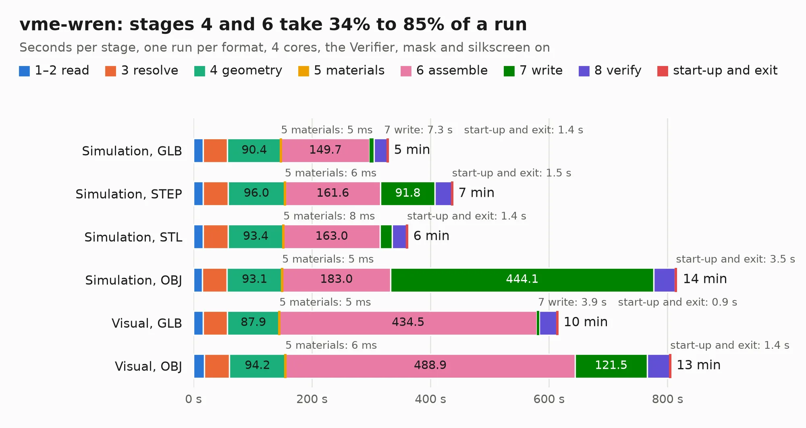

# 762. vme-wren

Board 762 of the 3,138 of [Corpus Testing](../Corpus-Testing.md), on [Corpus Page 8](../CorpusTestingPages/Corpus-Testing-08.md#762-vme-wren).

| Mode and format | 1–2 read | 3 resolve | 4 geometry | 5 materials | 6 assemble | 7 write | 8 verify | start-up and exit | Total |
|---|---:|---:|---:|---:|---:|---:|---:|---:|---:|
| Simulation, GLB | 16.4 | 41.0 | 90.4 | 5&nbsp;ms | 149.7 | 7.3 | 22.3 | 1.4 | 328.5 |
| Simulation, STEP | 16.1 | 42.1 | 96.0 | 6&nbsp;ms | 161.6 | 91.8 | 28.1 | 1.5 | 437.2 |
| Simulation, STL | 16.5 | 41.8 | 93.4 | 8&nbsp;ms | 163.0 | 20.9 | 24.3 | 1.4 | 361.2 |
| Simulation, OBJ |  |  |  |  |  |  |  |  | exceeded 11 GB on a 15 GB machine (stopped there, not a KESE failure); it will be run again on a machine with more memory |
| Visual, GLB | 16.5 | 40.6 | 87.9 | 5&nbsp;ms | 434.5 | 3.9 | 30.5 | 0.9 | 614.7 |
| Visual, OBJ | 18.4 | 42.4 | 94.2 | 6&nbsp;ms | 488.9 | 121.5 | 38.4 | 1.4 | 805.3 |

<table align="center"><tr><td valign="top">

| Board | Repo: [circuitly/kicad-demo-vme-wren](https://github.com/circuitly/kicad-demo-vme-wren) Board: `vme-wren.kicad_pcb` |
|---|---|
| Complexity | 523&nbsp;/&nbsp;1000 (size&nbsp;378, features&nbsp;145) |
| KESE&nbsp;features | through vias, slotted holes, custom pads, rounded, trapezoid or chamfered pads, arc tracks, filled zones, copper drawings, copper text, curved board outline, stack-up, dielectric εr and tanδ |
| Tested | 9th November 2026 to 10th November 2026 |
| Copper&nbsp;layers | 12 |
| File&nbsp;format | KiCad 9 (20241229) |
| Parts,&nbsp;tracks,&nbsp;vias | 1,479, 26,650, 4,374 |
| Triangles,&nbsp;simulation | 38,156,760 in 1822 parts |
| Verifier | Simulation, OBJ: exceeded 11 GB on a 15 GB machine (stopped there, not a KESE failure); it will be run again on a machine with more memory |
| Run&nbsp;again | Visual, OBJ: failed in the corpus run, run again with the memory cap raised from 11 GB to 14.5 GB, and passed |

</td><td valign="top">

<table>
<tr><th>File type</th><th>File size</th><th>Peak memory used</th></tr>
<tr><th colspan="3" align="left">Simulation</th></tr>
<tr><td>GLB</td><td align="right">1.2&nbsp;GB</td><td align="right">7.0&nbsp;GB</td></tr>
<tr><td>STEP</td><td align="right">3.3&nbsp;GB</td><td align="right">11&nbsp;GB</td></tr>
<tr><td>STL</td><td align="right">1.9&nbsp;GB</td><td align="right">7.6&nbsp;GB</td></tr>
<tr><td>OBJ</td><td align="right">–</td><td align="right">11&nbsp;GB</td></tr>
<tr><th colspan="3" align="left">Visual</th></tr>
<tr><td>GLB</td><td align="right">599&nbsp;MB</td><td align="right">11&nbsp;GB</td></tr>
<tr><td>OBJ</td><td align="right">2.1&nbsp;GB</td><td align="right">13&nbsp;GB</td></tr>
</table>

</td></tr></table>

| Previous | Next |
|:---|---:|
| [761. ciaa-z3r0](b0761b_Hardware_ciaa-z3r0.md) | [763. fmcw3](b0763b_fmcw3-kicad_fmcw3.md) |
